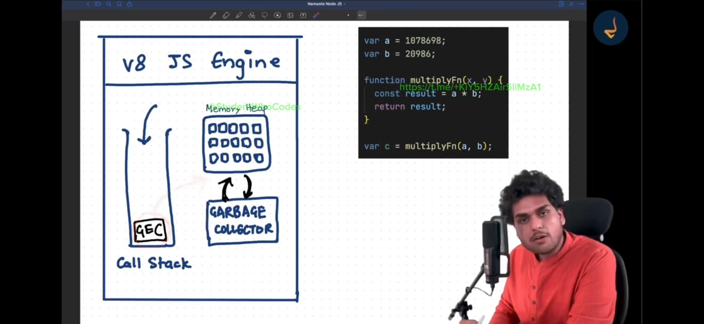
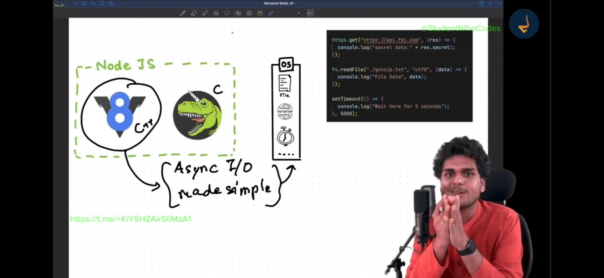
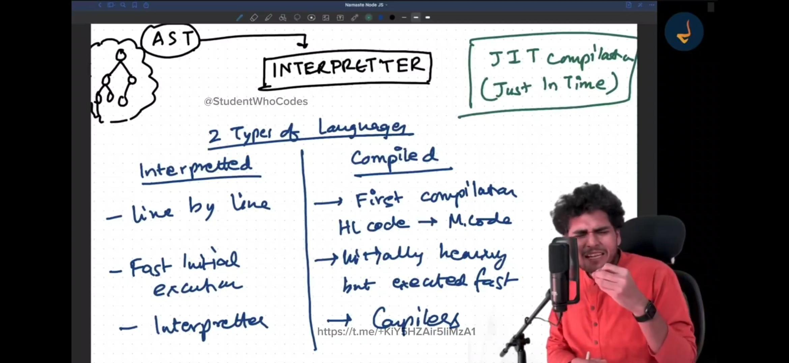
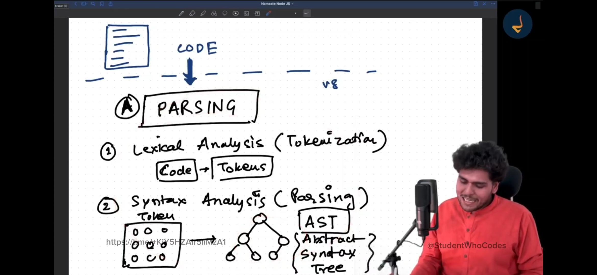
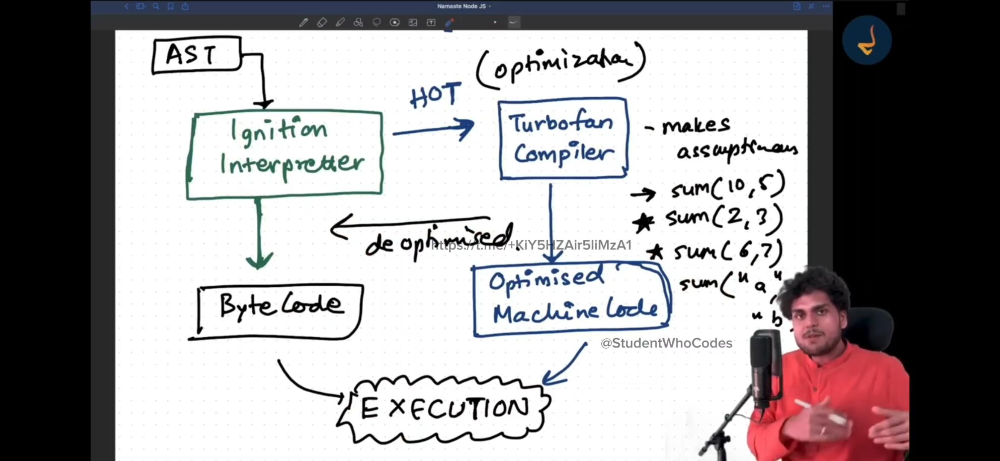
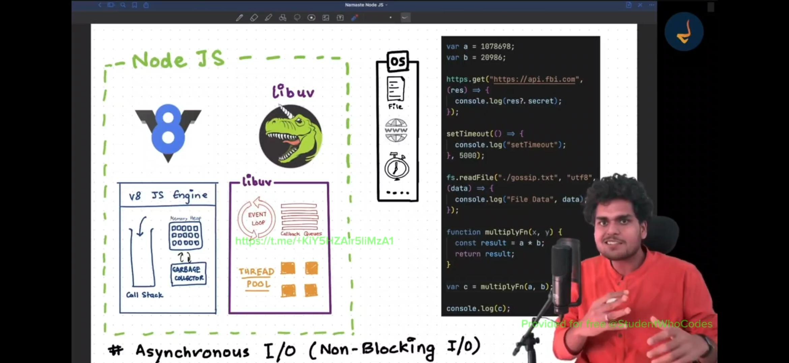
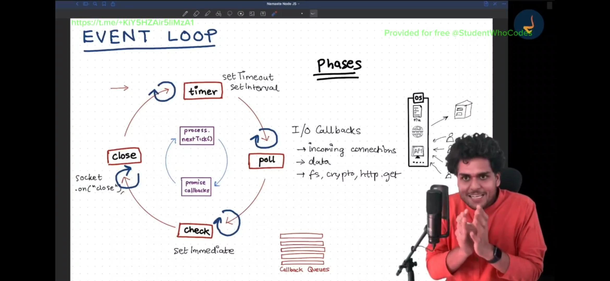
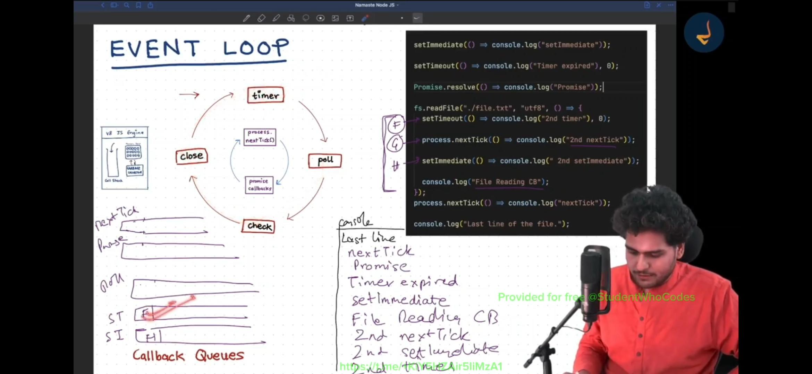

# Node.js Runtime: Core Concepts with Whiteboard Diagrams

> The whiteboard diagrams are kept exactly as drawn, so they can be redrawn from memory.
> Extended version with Mermaid diagrams, epoll internals and `worker_threads`/`cluster`: [03b-NodeJS-Runtime-V8-JIT-Libuv-Epoll-Single-vs-Multi-Threaded.md](03b-NodeJS-Runtime-V8-JIT-Libuv-Epoll-Single-vs-Multi-Threaded.md)
> Deep dive with labs: [03-NodeJS-Internals-Event-Loop-Libuv-Threadpool.md](03-NodeJS-Internals-Event-Loop-Libuv-Threadpool.md)

---

## Part 1: Node.js, JavaScript, libuv and JIT

### 1.1 What Node.js is

**Node.js is an event-driven runtime with asynchronous (non-blocking) I/O.**

### 1.2 JavaScript is synchronous and single-threaded

JavaScript is a **synchronous, single-threaded** language. It runs code one statement at a time on the **call stack**, and keeps its data in the **memory heap**.

Timers, file access and HTTP calls are **not part of JavaScript itself**. They are provided by the environment JavaScript runs in:

| Environment | Provides timers / file / HTTP via |
| :--- | :--- |
| Browser (frontend) | Browser (Web) APIs |
| **Node.js** | **libuv**, a C library that Node.js uses to talk to the operating system |

### 1.3 Inside the V8 JS engine

The call stack, memory heap and garbage collector all live inside V8.



- **Call stack:** where code executes. The **GEC (Global Execution Context)** sits at the bottom. When a function is called (for example `multiplyFn(a, b)`), it is pushed on top of the GEC, runs, returns its result and is popped off.
- **Memory heap:** where variables and objects are stored.
- **Garbage collector:** works with the memory heap and frees memory that is no longer in use.

### 1.4 libuv offloads async work to the OS


Node.js contains the V8 engine and libuv. V8 runs the JavaScript. Whenever an asynchronous operation is needed, V8 **offloads it to libuv**, and libuv hands it to the **OS**, which deals with files, databases, the network, timers and more.



V8 is written in C++ and libuv in C. Together they make asynchronous I/O simple. For example, `https.get(...)`, `fs.readFile(...)` and `setTimeout(...)` all go to the OS (network, file, timer) through libuv.

### 1.5 How V8 runs code: interpreted, compiled, or both (JIT)

JavaScript is **neither purely interpreted nor purely compiled**. It uses a mixture of both, called **JIT (Just-In-Time) compilation**.



| | **Interpreted** | **Compiled** |
| :--- | :--- | :--- |
| How it runs | Executes **line by line** | The whole high-level code is first **compiled into machine code**, then run |
| Speed | **Fast initial execution** | Initially heavy (compilation takes time), but **executes fast** |
| Tool | Interpreter | Compiler |

### 1.6 The V8 pipeline

**Step A: Parsing**



1. **Lexical analysis (tokenization):** the code is broken into **tokens**.
2. **Syntax analysis (parsing):** the tokens are converted into an **AST (Abstract Syntax Tree)**.

**Step B: Interpreter, then compiler for hot code**



1. The AST goes to the **Ignition interpreter**, which generates **bytecode** and starts executing it.
2. Code that is called again and again is **hot code**. It is passed to the **Turbofan compiler**, which **optimises** it into machine code. Later calls then run that machine code, which is much faster.
3. Turbofan **makes assumptions** while optimising. For example, if `sum(10, 5)`, `sum(2, 3)` and `sum(6, 7)` are always called with numbers, it assumes numbers.
4. If the assumption breaks, for example `sum("a", "b")` with strings, the optimised code is **de-optimised** and execution goes back to the interpreter (bytecode). If the strings version becomes hot, it is optimised again for strings.

---

## Part 2: V8 + libuv, the Event Loop and the Callback Queue



Node.js has two main parts:

1. **The V8 engine.** It runs JavaScript, which is synchronous and single-threaded, on the call stack.
2. **libuv.** It handles everything beyond plain JavaScript: timers, API (network) calls, file operations and so on.

libuv has several components. The ones to remember are the **event loop**, the **callback queues** and the **thread pool**.

**How it works:**

1. Asynchronous operations are handed to libuv (and through it to the OS or the thread pool).
2. When an operation finishes, its callback is placed in a **callback queue**.
3. The **event loop** keeps checking the **call stack**. When the call stack is **empty**, it takes the callbacks from the queues one by one and runs them on the **main thread**.

The whole setup is called **asynchronous I/O (non-blocking I/O)**, because the main thread is never blocked while the work is happening.

---

## Part 3: The Event Loop Phases

### 3.1 The structure



The event loop has **two circles**:

- **Outer circle:** the phases.
- **Inner circle:** `process.nextTick()` and **promise callbacks**.

**The main phases:**

| Phase | What runs there |
| :--- | :--- |
| **Timers** | `setTimeout`, `setInterval` callbacks |
| **Poll** | I/O callbacks: incoming connections, data, `fs`, `crypto`, `http.get` |
| **Check** | `setImmediate` callbacks |
| **Close** | Close callbacks, for example `socket.on("close")` |

**Two more phases** sit **after the timers phase** and **before poll**. They deal with deferred I/O callbacks (for example retries and error handling):

- **Pending callbacks**
- **Idle / prepare**

**Tick:** one full cycle of the event loop is called a **tick**.

**Order of the inner circle:** `process.nextTick()` callbacks run first, then promise callbacks. They are drained **between phases**, before the loop moves to the next phase.

### 3.2 One cycle, step by step


When the event loop starts:

1. It first drains the inner circle: `process.nextTick()`, then promise callbacks.
2. It moves to the **timers** phase. If a timer has expired, its callback is put on the call stack and executed.
3. It drains the inner circle again (nextTick, then promises).
4. It moves to the **poll** phase, then drains the inner circle again.
5. It moves to the **check** phase (`setImmediate`), then drains the inner circle again.
6. It moves to the **close** phase and goes back to the timers phase. The loop continues like this.

### 3.3 When there is nothing to do: the loop rests at poll


When there are no pending callbacks, the event loop **stops at the poll phase and waits**. This is where the OS notifies it that something has come in (new connections, data and so on).

If a `setImmediate` callback is queued, the loop does not wait. The phase after poll is **check**, not timers.

**Waiting for timers:** if there are three timers (5 s, 10 s and 15 s), the loop waits in the poll phase until the **nearest** timer (5 s) is due, and only then starts the next cycle. It does not keep cycling during those 5 seconds.

### 3.4 Worked example



```javascript
setImmediate(() => console.log("setImmediate"));

setTimeout(() => console.log("Timer expired"), 0);

Promise.resolve().then(() => console.log("Promise"));

fs.readFile("./file.txt", "utf8", () => {
  setTimeout(() => console.log("2nd timer"), 0);
  process.nextTick(() => console.log("2nd nextTick"));
  setImmediate(() => console.log("2nd setImmediate"));
  console.log("File Reading CB");
});

process.nextTick(() => console.log("nextTick"));

console.log("Last line of the file.");
```

> The video snippet writes `Promise.resolve(() => ...)`, which never runs the function. `Promise.resolve().then(...)` is what prints `"Promise"`.

**Output:**

```
Last line of the file.
nextTick
Promise
Timer expired
setImmediate
File Reading CB
2nd nextTick
2nd setImmediate
2nd timer
```

**Why this order:**

1. `Last line of the file.`: all top-level synchronous code runs first.
2. `nextTick`: the inner circle runs `process.nextTick` callbacks first.
3. `Promise`: then promise callbacks.
4. `Timer expired`: the timers phase.
5. `setImmediate`: the check phase.
6. `File Reading CB`: when the file read finishes, its callback runs in the poll phase.
7. `2nd nextTick`: drained right after that callback.
8. `2nd setImmediate`: the check phase comes right after poll.
9. `2nd timer`: the timers phase of the next tick.

---

## Part 4: libuv and the OS, the Thread Pool, and Single vs Multi-threaded

### 4.1 libuv talks to the OS through epoll / kqueue


libuv is written in C and communicates with the OS in both directions. Each OS provides a **scalable I/O event notification mechanism**:

- **Linux:** `epoll`
- **macOS:** `kqueue`


- **fds** are file/socket descriptors, the handles the OS uses to identify open sockets and files.
- **Open question:** which data structure does epoll use internally? *(answered in 03b)*
- **To study next:** EventEmitter, and Streams & Buffers.

### 4.2 The thread pool

Node.js has three main parts:

1. **The V8 engine** and the main call stack.
2. **libuv**, where the asynchronous operations are handled.
3. **The thread pool inside libuv**, which has **4 threads by default**.

libuv hands **file-system** and **cryptography** work to the thread pool. If one file operation and one crypto operation are handed over, **two of the four threads are busy, and the main call stack is not blocked**. When they finish, those two threads become free again and are available for the next jobs.

### 4.3 Is Node.js single-threaded or multi-threaded?

It depends on the context:

- **Synchronous code:** single-threaded. The V8 engine runs everything on one call stack.
- **Asynchronous operations:** libuv has a **thread pool (4 threads by default)** working in the background, so in this context Node.js is **multi-threaded**.
