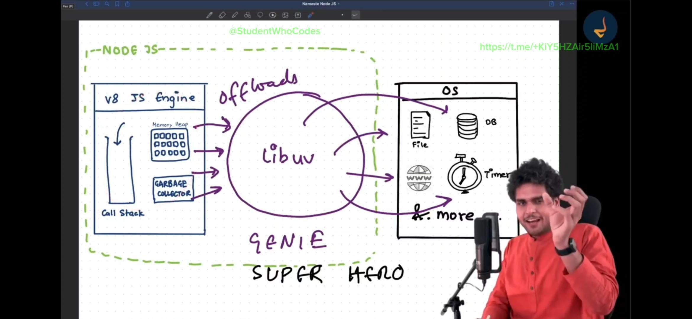
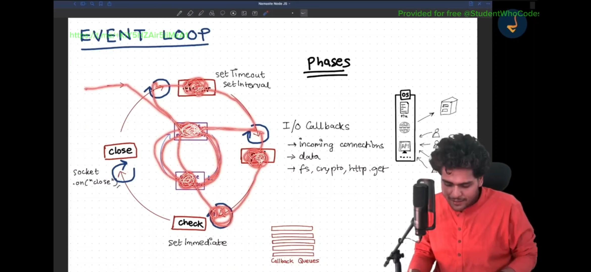
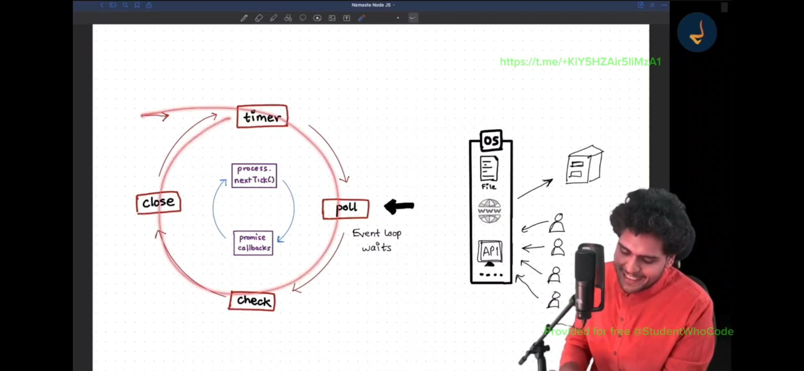
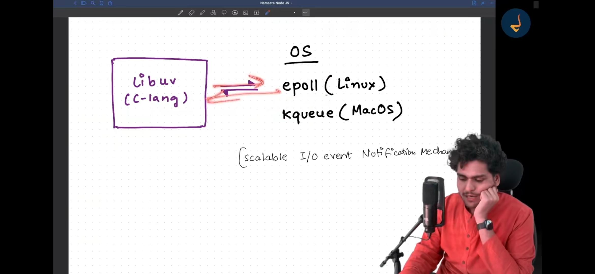
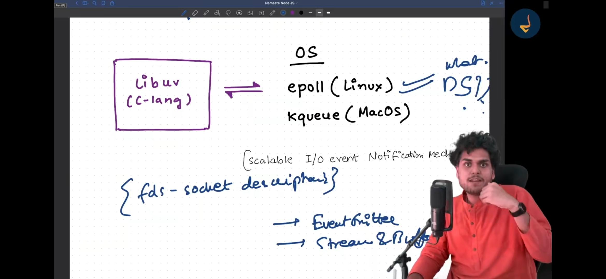

# Node.js Runtime: Core Concepts with Whiteboard Diagrams

> The whiteboard diagrams are kept exactly as drawn, so they can be redrawn from memory.
> Mermaid versions of the diagrams and extra details (full 6-phase loop, poll-phase decision flow, epoll internals, thread-pool routing): [03b-NodeJS-Runtime-V8-JIT-Libuv-Epoll-Single-vs-Multi-Threaded.md](03b-NodeJS-Runtime-V8-JIT-Libuv-Epoll-Single-vs-Multi-Threaded.md)
> Practical use cases, labs and graceful shutdown: [03-NodeJS-Internals-Event-Loop-Libuv-Threadpool.md](03-NodeJS-Internals-Event-Loop-Libuv-Threadpool.md)

---

## Part 1: Node.js, JavaScript, libuv and JIT

### 1.1 What Node.js is

**Node.js is an event-driven runtime with asynchronous (non-blocking) I/O.**

### 1.2 JavaScript is synchronous and single-threaded

JavaScript is a **synchronous, single-threaded** language. It runs code one statement at a time on the **call stack**, and keeps its data in the **memory heap**.

Timers, file access and HTTP calls are **not part of JavaScript itself**. They are provided by the environment JavaScript runs in:

| Environment | Provides timers / file / HTTP via |
| :--- | :--- |
| Browser (frontend) | Browser (Web) APIs |
| **Node.js** | **libuv**, a C library that Node.js uses to talk to the operating system |

### 1.3 Inside the V8 JS engine

The call stack, memory heap and garbage collector all live inside V8.


- **Call stack:** where code executes. The **GEC (Global Execution Context)** sits at the bottom. When a function is called (for example `multiplyFn(a, b)`), it is pushed on top of the GEC, runs, returns its result and is popped off.
- **Memory heap:** where variables and objects are stored.
- **Garbage collector:** works with the memory heap and frees memory that is no longer in use.

### 1.4 libuv offloads async work to the OS



Node.js contains the V8 engine and libuv. V8 runs the JavaScript. Whenever an asynchronous operation is needed, V8 **offloads it to libuv**, and libuv hands it to the **OS**, which deals with files, databases, the network, timers and more.


V8 is written in C++ and libuv in C. Together they make asynchronous I/O simple. For example, `https.get(...)`, `fs.readFile(...)` and `setTimeout(...)` all go to the OS (network, file, timer) through libuv.

### 1.5 How V8 runs code: interpreted, compiled, or both (JIT)

JavaScript is **neither purely interpreted nor purely compiled**. It uses a mixture of both, called **JIT (Just-In-Time) compilation**.


| | **Interpreted** | **Compiled** |
| :--- | :--- | :--- |
| How it runs | Executes **line by line** | The whole high-level code is first **compiled into machine code**, then run |
| Speed | **Fast initial execution** | Initially heavy (compilation takes time), but **executes fast** |
| Tool | Interpreter | Compiler |

### 1.6 The V8 pipeline

**Step A: Parsing**


1. **Lexical analysis (tokenization):** the code is broken into **tokens**.
2. **Syntax analysis (parsing):** the tokens are converted into an **AST (Abstract Syntax Tree)**.

**Step B: Interpreter, then compiler for hot code**


1. The AST goes to the **Ignition interpreter**, which generates **bytecode** and starts executing it.
2. Code that is called again and again is **hot code**. It is passed to the **Turbofan compiler**, which **optimises** it into machine code. Later calls then run that machine code, which is much faster.
3. Turbofan **makes assumptions** while optimising. For example, if `sum(10, 5)`, `sum(2, 3)` and `sum(6, 7)` are always called with numbers, it assumes numbers.
4. If the assumption breaks, for example `sum("a", "b")` with strings, the optimised code is **de-optimised** and execution goes back to the interpreter (bytecode). If the strings version becomes hot, it is optimised again for strings.

---

## Part 2: V8 + libuv, the Event Loop and the Callback Queue


Node.js has two main parts:

1. **The V8 engine.** It runs JavaScript, which is synchronous and single-threaded, on the call stack.
2. **libuv.** It handles everything beyond plain JavaScript: timers, API (network) calls, file operations and so on.

libuv has several components. The ones to remember are the **event loop**, the **callback queues** and the **thread pool**.

**How it works:**

1. Asynchronous operations are handed to libuv (and through it to the OS or the thread pool).
2. When an operation finishes, its callback is placed in a **callback queue**.
3. The **event loop** keeps checking the **call stack**. When the call stack is **empty**, it takes the callbacks from the queues one by one and runs them on the **main thread**.

The whole setup is called **asynchronous I/O (non-blocking I/O)**, because the main thread is never blocked while the work is happening.

---

## Part 3: The Event Loop Phases

### 3.1 The structure


The event loop has **two circles**:

- **Outer circle:** the phases.
- **Inner circle:** `process.nextTick()` and **promise callbacks**.

**The main phases:**

| Phase | What runs there |
| :--- | :--- |
| **Timers** | `setTimeout`, `setInterval` callbacks |
| **Poll** | I/O callbacks: incoming connections, data, `fs`, `crypto`, `http.get` |
| **Check** | `setImmediate` callbacks |
| **Close** | Close callbacks, for example `socket.on("close")` |

**Two more phases** sit **after the timers phase** and **before poll**. They deal with deferred I/O callbacks (for example retries and error handling):

- **Pending callbacks**
- **Idle / prepare**

**Tick:** one full cycle of the event loop is called a **tick**.

**Order of the inner circle:** `process.nextTick()` callbacks run first, then promise callbacks. They are drained **between phases**, before the loop moves to the next phase.

### 3.2 One cycle, step by step



When the event loop starts:

1. It first drains the inner circle: `process.nextTick()`, then promise callbacks.
2. It moves to the **timers** phase. If a timer has expired, its callback is put on the call stack and executed.
3. It drains the inner circle again (nextTick, then promises).
4. It moves to the **poll** phase, then drains the inner circle again.
5. It moves to the **check** phase (`setImmediate`), then drains the inner circle again.
6. It moves to the **close** phase and goes back to the timers phase. The loop continues like this.

### 3.3 When there is nothing to do: the loop rests at poll



When there are no pending callbacks, the event loop **stops at the poll phase and waits**. This is where the OS notifies it that something has come in (new connections, data and so on).

If a `setImmediate` callback is queued, the loop does not wait. The phase after poll is **check**, not timers.

**Waiting for timers:** if there are three timers (5 s, 10 s and 15 s), the loop waits in the poll phase until the **nearest** timer (5 s) is due, and only then starts the next cycle. It does not keep cycling during those 5 seconds.

### 3.4 Worked example


```javascript
setImmediate(() => console.log("setImmediate"));

setTimeout(() => console.log("Timer expired"), 0);

Promise.resolve().then(() => console.log("Promise"));

fs.readFile("./file.txt", "utf8", () => {
  setTimeout(() => console.log("2nd timer"), 0);
  process.nextTick(() => console.log("2nd nextTick"));
  setImmediate(() => console.log("2nd setImmediate"));
  console.log("File Reading CB");
});

process.nextTick(() => console.log("nextTick"));

console.log("Last line of the file.");
```

> The video snippet writes `Promise.resolve(() => ...)`, which never runs the function. `Promise.resolve().then(...)` is what prints `"Promise"`.

**Output:**

```
Last line of the file.
nextTick
Promise
Timer expired
setImmediate
File Reading CB
2nd nextTick
2nd setImmediate
2nd timer
```

**Why this order:**

1. `Last line of the file.`: all top-level synchronous code runs first.
2. `nextTick`: the inner circle runs `process.nextTick` callbacks first.
3. `Promise`: then promise callbacks.
4. `Timer expired`: the timers phase.
5. `setImmediate`: the check phase.
6. `File Reading CB`: when the file read finishes, its callback runs in the poll phase.
7. `2nd nextTick`: drained right after that callback.
8. `2nd setImmediate`: the check phase comes right after poll.
9. `2nd timer`: the timers phase of the next tick.

---

## Part 4: libuv and the OS, the Thread Pool, and Single vs Multi-threaded

### 4.1 libuv talks to the OS through epoll / kqueue



libuv is written in C and communicates with the OS in both directions. Each OS provides a **scalable I/O event notification mechanism**:

- **Linux:** `epoll`
- **macOS:** `kqueue`



- **fds** are file/socket descriptors, the handles the OS uses to identify open sockets and files.
- **Open question:** which data structure does epoll use internally? *(answered in 03b)*
- **To study next:** EventEmitter, and Streams & Buffers.

### 4.2 The thread pool

Node.js has three main parts:

1. **The V8 engine** and the main call stack.
2. **libuv**, where the asynchronous operations are handled.
3. **The thread pool inside libuv**, which has **4 threads by default**.

libuv hands **file-system** and **cryptography** work to the thread pool. If one file operation and one crypto operation are handed over, **two of the four threads are busy, and the main call stack is not blocked**. When they finish, those two threads become free again and are available for the next jobs.

**Changing the pool size: `UV_THREADPOOL_SIZE`**

- The default is **4 threads**. It can be changed with the **`UV_THREADPOOL_SIZE`** environment variable, up to a maximum of **1024**.
- It must be set **before the process starts** (before the pool is first used), because the pool is created once and its size cannot change afterwards.

```bash
# Linux / macOS
UV_THREADPOOL_SIZE=16 node app.js

# Windows PowerShell
$env:UV_THREADPOOL_SIZE = 16; node app.js
```

- If more than 4 file/crypto jobs arrive at once, the extra jobs **wait in a queue** until a thread is free. Raising the size removes that waiting.

### 4.3 Is Node.js single-threaded or multi-threaded?

It depends on the context:

- **Synchronous code:** single-threaded. The V8 engine runs everything on one call stack.
- **Asynchronous operations:** libuv has a **thread pool (4 threads by default)** working in the background, so in this context Node.js is **multi-threaded**.

### 4.4 If the pool can be increased, why do worker threads, child processes and cluster exist?

Because the thread pool and the other tools solve **different problems**.

**The thread pool only runs libuv's built-in blocking tasks:** `fs`, `crypto` (pbkdf2, scrypt, bcrypt), `zlib` and `dns.lookup`. **Your own JavaScript never runs on it.** A heavy `for` loop, a big `JSON.parse`, image processing in JS or a long calculation still runs on the **main thread** and blocks the event loop, no matter how large `UV_THREADPOOL_SIZE` is.

| Tool | What it gives you | Use it for |
| :--- | :--- | :--- |
| **`UV_THREADPOOL_SIZE`** | More background threads for libuv's built-in tasks (fs, crypto, zlib, dns) | Many simultaneous file reads, password hashes or compressions waiting in the queue |
| **`worker_threads`** | Extra **JavaScript threads**, each with its own V8 engine and event loop (data is passed by messages, or shared through `SharedArrayBuffer`) | **CPU-heavy JavaScript** that would otherwise block the main thread |
| **`child_process`** | A completely **separate OS process** with its own memory, and it can run **any program** (Python, ffmpeg, shell commands, another Node script) | Running external tools, or isolating risky work so a crash doesn't take down the main app |
| **`cluster`** | Several Node.js **processes** (usually one per CPU core) **sharing the same server port** | Using **all CPU cores** for an HTTP server, and keeping the app up if one process dies |

**Why not just set the pool to 1024?**

- **CPU cores are the real limit.** A machine with 8 cores can run only 8 threads truly in parallel. Hundreds of threads fighting for 8 cores waste time on context switching and use more memory, and don't make the work faster.
- **It only helps the four built-in task types.** It does nothing for your own JavaScript.
- **Network I/O doesn't use the pool at all.** Sockets and HTTP go through epoll/kqueue, so raising the size doesn't help there.
- **A bigger pool doesn't give isolation.** If one thread's work crashes the process, everything goes down, whereas with child processes or cluster only that process dies.

### 4.5 If V8 is single-threaded, where do worker threads come from?

"V8 is single-threaded" really means **one V8 instance (called an isolate) runs JavaScript on one thread at a time**. V8 is a library, and a process can create **more than one isolate**.

When you create a `new Worker(...)`, Node.js:

1. Asks the **OS to create a new thread** (through libuv's thread API, **not** from the 4-thread pool).
2. Creates a **brand-new V8 isolate** on that thread, with its **own call stack, memory heap and garbage collector**.
3. Creates a **brand-new event loop** for that thread.

```
One Node.js process
├── Main thread     → V8 isolate #1 (own call stack + heap) + event loop #1
├── Worker thread 1 → V8 isolate #2 (own call stack + heap) + event loop #2
├── Worker thread 2 → V8 isolate #3 (own call stack + heap) + event loop #3
└── libuv thread pool (4 threads) → shared by all of the above for fs / crypto / zlib / dns
```

So **each JavaScript thread is still single-threaded**. There are just several of them, side by side.

- **Memory is not shared by default.** Each worker has its own heap, so objects can't be touched from another thread. Threads communicate by **message passing** (`postMessage`, data is copied), or share raw memory explicitly with `SharedArrayBuffer` + `Atomics`.
- **Same process, different from `child_process`.** Workers live inside the same process (lighter, can share memory). A child process is a separate OS process with its own memory.
- **Workers are not free.** Each one costs start-up time and memory (its own V8 + event loop), so don't create one per request. Create a small **pool of workers** (about the number of CPU cores) and reuse them.

**Rule of thumb**

- Slow because of **many fs / crypto / zlib jobs** → raise `UV_THREADPOOL_SIZE` (roughly up to the number of CPU cores).
- Slow because of **heavy JavaScript computation** → `worker_threads`.
- Need to **run another program or isolate work** → `child_process`.
- Need to **use all cores for a web server** → `cluster` (or PM2 cluster mode).

---

## Part 5: Interview Questions: Threads, Concurrency and Workers

### 5.1 Where each question is covered

| Interview question | Covered in |
| :--- | :--- |
| Is Node.js single-threaded? | [4.3](#43-is-nodejs-single-threaded-or-multi-threaded) and Q1 below |
| How does Node handle multiple tasks at once? | Part 2, [3.3](#33-when-there-is-nothing-to-do-the-loop-rests-at-poll) and Q2 below (concurrency vs parallelism) |
| How do you use multiple threads? | [4.4](#44-if-the-pool-can-be-increased-why-do-worker-threads-child-processes-and-cluster-exist) and Q3 below |
| What does a worker do? | [4.5](#45-if-v8-is-single-threaded-where-do-worker-threads-come-from) and Q4 below (with code) |
| If single-threaded, how is there another thread? | [4.5](#45-if-v8-is-single-threaded-where-do-worker-threads-come-from) and Q5 below |
| How do threads work together? | Q6 below (message passing, `SharedArrayBuffer`, `Atomics`) |

### Q1. Is Node.js single-threaded?

**Your JavaScript runs on one main thread** (the event loop thread). **Node.js itself is not purely single-threaded**: libuv runs a **thread pool** (4 threads by default) for fs, crypto, zlib and DNS, and V8 uses other **internal threads** (for example garbage collection and JIT compilation helpers).

### Q2. How does Node handle multiple tasks at the same time?

Through the **event loop and non-blocking I/O**:

1. Async operations (network, file, database) are **handed off to the OS or libuv**.
2. The main thread keeps running other code instead of waiting.
3. When an operation finishes, its callback is queued, and the event loop runs it when the call stack is empty. With **promises** and **`async/await`**, the code after `await` is the part that resumes: the function is suspended at `await`, and when the result is ready its continuation runs as a promise callback.

**This gives concurrency, not parallelism:**

| | **Concurrency** | **Parallelism** |
| :--- | :--- | :--- |
| Meaning | Making progress on **many tasks by switching between them** | Running **multiple tasks at the same instant** on different CPU cores |
| In Node.js | The event loop with non-blocking I/O (one JS thread) | libuv pool threads, `worker_threads`, `cluster` / `child_process` |
| Analogy | One chef who starts the rice, then chops vegetables while the rice cooks | Several chefs, each cooking a dish at the same time |

### Q3. How do you use multiple threads or cores?

- **`worker_threads`:** for **CPU-heavy JavaScript** (extra JS threads inside the same process).
- **`cluster`:** to **scale across cores**, one Node.js process per core sharing the same port. (Cluster is built on `child_process.fork`.)
- **`child_process`:** to run **separate processes**, including other programs.

### Q4. What does a worker do? (with code)

A worker **runs JavaScript in a separate thread with its own V8 instance and event loop**. Heavy computation (image processing, hashing, parsing) runs there, so it **doesn't block the main thread**.

```javascript
// main.js
const { Worker } = require("node:worker_threads");

const worker = new Worker("./hash-worker.js", {
  workerData: { input: "hello" },          // data given to the worker at start
});

worker.on("message", (result) => console.log("Result:", result)); // from the worker
worker.on("error", (err) => console.error("Worker error:", err));
worker.on("exit", (code) => console.log("Worker exited with code", code));

console.log("Main thread is free to do other work");
```

```javascript
// hash-worker.js
const { parentPort, workerData } = require("node:worker_threads");
const crypto = require("node:crypto");

let hash = workerData.input;
for (let i = 0; i < 1_000_000; i++) {       // CPU-heavy work, off the main thread
  hash = crypto.createHash("sha256").update(hash).digest("hex");
}

parentPort.postMessage(hash);                // send the result back to main
```

### Q5. If Node.js is single-threaded, how is there another thread?

The "single thread" refers only to the **main JavaScript execution thread**. Workers are **separate threads that Node.js spawns explicitly**, each with its own **isolated JavaScript context** (own V8 isolate, call stack and heap), as explained in [4.5](#45-if-v8-is-single-threaded-where-do-worker-threads-come-from). Separately, **libuv's thread pool** runs in the background for fs, crypto, DNS and similar work.

### Q6. How do threads work together?

**They don't share variables by default.** Each thread has its own memory, so they communicate by **message passing**:

```javascript
// in the main thread
worker.postMessage({ task: "resize", id: 42 });          // send
worker.on("message", (msg) => console.log(msg));          // receive

// in the worker thread
parentPort.on("message", (msg) => { /* do the work */ parentPort.postMessage({ done: true }); });
```

- Messages are **copied** (structured clone). Large binary data (an `ArrayBuffer`) can be **transferred** instead of copied, which is faster and moves ownership to the other thread.
- For **shared memory**, use a **`SharedArrayBuffer`**: both threads see the same bytes. Because two threads can then read and write the same memory at the same time, use **`Atomics`** to avoid **race conditions**.

```javascript
const shared = new SharedArrayBuffer(4);
const counter = new Int32Array(shared);   // pass `shared` to the worker via workerData

// counter[0]++ in two threads at once is NOT safe (read-modify-write can interleave: lost updates)
Atomics.add(counter, 0, 1);               // ✅ atomic: no race condition
```

> **One-liner answer:** *"Node.js runs JavaScript on a single main thread and gets concurrency from the event loop and non-blocking I/O. For parallelism, libuv's thread pool handles fs/crypto/DNS, `worker_threads` runs CPU-heavy JavaScript in separate threads with their own V8 and event loop, and `cluster`/`child_process` scale across cores. Threads communicate by message passing, or share memory through `SharedArrayBuffer` and `Atomics`."*
