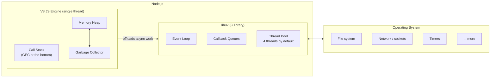
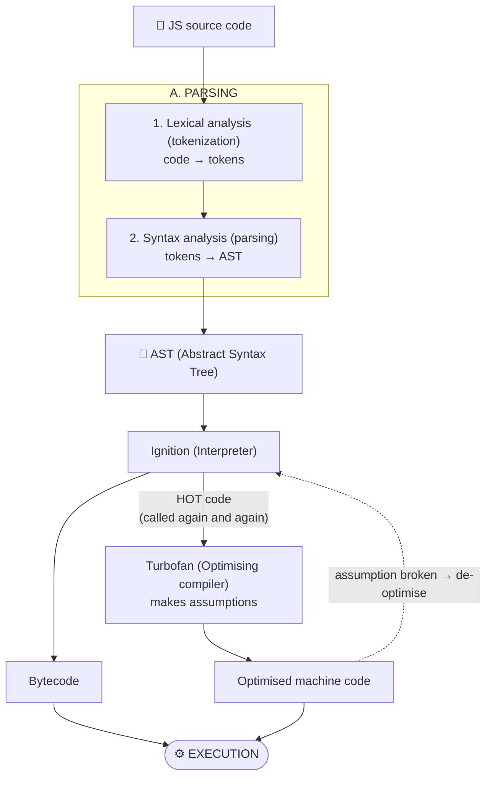
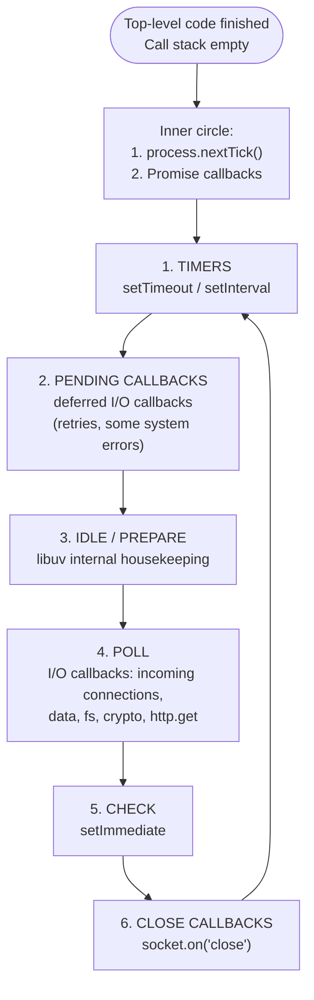
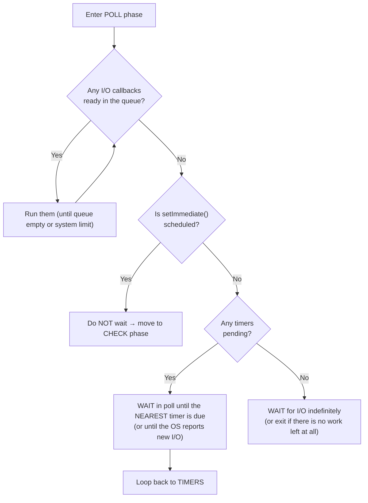
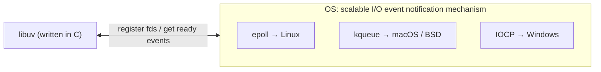
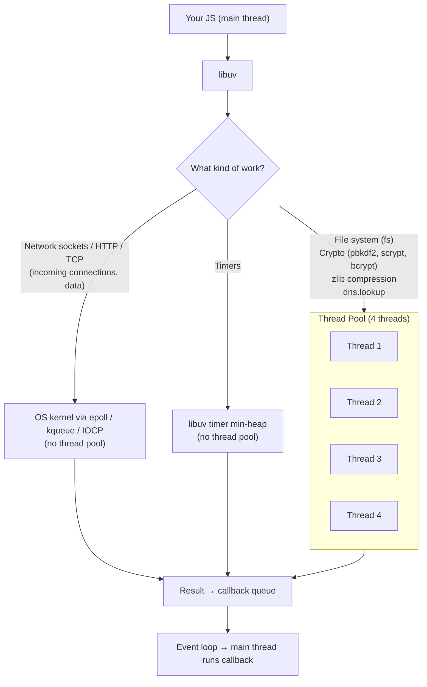
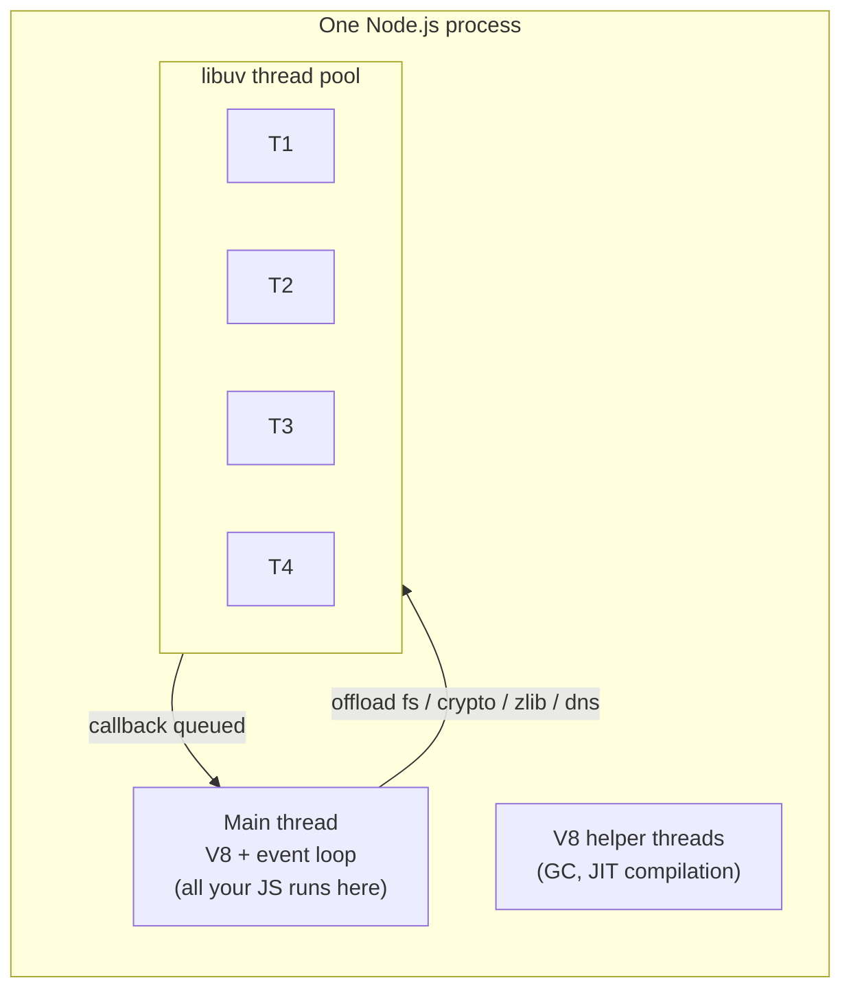
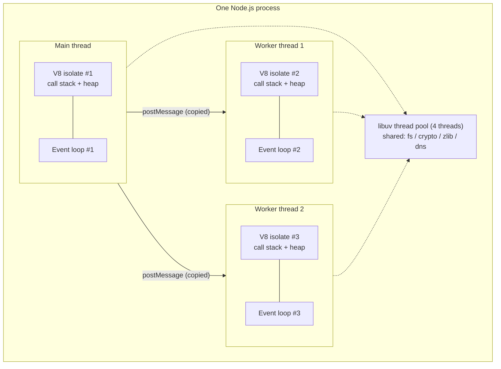

# Node.js Runtime: Mermaid Diagrams & Deep-Dive Extras

> **How the three Node.js runtime notes fit together**
> - [03a-NodeJS-Runtime-Core-Concepts-With-Whiteboards.md](03a-NodeJS-Runtime-Core-Concepts-With-Whiteboards.md): **the main study note.** Concepts, whiteboard diagrams, thread pool size, workers and interview Q&A.
> - **This file (03b):** Mermaid versions of the diagrams, plus the extra details that are not in 03a (full 6-phase loop, poll-phase decision flow, epoll internals, thread-pool routing, process-level threads).
> - [03-NodeJS-Internals-Event-Loop-Libuv-Threadpool.md](03-NodeJS-Internals-Event-Loop-Libuv-Threadpool.md): practical use cases, hands-on labs and graceful shutdown.

---

## 1. Big Picture: V8 + libuv + OS

Explained in [03a, Part 1](03a-NodeJS-Runtime-Core-Concepts-With-Whiteboards.md#part-1-nodejs-javascript-libuv-and-jit) and [Part 2](03a-NodeJS-Runtime-Core-Concepts-With-Whiteboards.md#part-2-v8--libuv-the-event-loop-and-the-callback-queue).

> ⚠️ libuv doesn't execute the callbacks in the queue. It only *delivers* them. The JS callback itself always runs on V8's single thread.

---

## 2. V8 Pipeline: Parsing → AST → Ignition → Turbofan

Explained in [03a, 1.5–1.6](03a-NodeJS-Runtime-Core-Concepts-With-Whiteboards.md#15-how-v8-runs-code-interpreted-compiled-or-both-jit).

- 💡 **Practical takeaway:** keep function argument types consistent so V8 can optimise and keep the optimised code.
- Turbofan takes the **hot bytecode plus the type feedback** that Ignition collected.
- Modern V8 has a middle tier called **Sparkplug** (a quick baseline compiler) between Ignition and Turbofan.

---

## 3. The Event Loop

Explained in [03a, Part 3](03a-NodeJS-Runtime-Core-Concepts-With-Whiteboards.md#part-3-the-event-loop-phases), including the worked example.

### 3.1 All six phases, in order

Between **every** phase (and in modern Node, after **every callback**) the inner circle is drained: `process.nextTick()` first, then Promise callbacks.

### 3.2 What the loop does inside the poll phase

When nothing is left to do, the loop does **not** spin the CPU. It parks in poll and lets the OS (epoll/kqueue) wake it up.

### 3.3 Ordering caveat for the worked example

The order of **`Timer expired` vs `setImmediate` at top level** is **not guaranteed**. It depends on whether 1 ms has elapsed when the loop starts, so it can flip between runs. **Inside an I/O callback**, `setImmediate` always runs before `setTimeout(…, 0)`, because CHECK comes right after POLL while TIMERS is the next iteration. The exact timing of `File Reading CB` also depends on how fast the disk read finishes.

---

## 4. libuv ↔ OS: epoll, kqueue, IOCP

Explained in [03a, 4.1](03a-NodeJS-Runtime-Core-Concepts-With-Whiteboards.md#41-libuv-talks-to-the-os-through-epoll--kqueue).

- libuv hides the three mechanisms behind one API.
- **fds (file/socket descriptors):** to the OS, every open socket or file is just an integer handle. libuv says *"tell me when **these** descriptors become readable/writable"*, so **one thread can watch thousands of connections** without a thread per connection.
- **What data structure is behind epoll?** Inside the Linux kernel an epoll instance keeps:
  - an **interest list**: a **red-black tree** of every fd being watched (fast add/remove/lookup), and
  - a **ready list**: a **linked list** of fds that have events right now. `epoll_wait()` just hands you this list, so it doesn't scan every connection each time.
- **Related topics:** EventEmitter → [13-NodeJS-EventEmitter-Architecture-Event-Driven-Design.md](13-NodeJS-EventEmitter-Architecture-Event-Driven-Design.md) · Streams & Buffers → [14-NodeJS-Buffer-Architecture-Binary-Data-Encoding.md](14-NodeJS-Buffer-Architecture-Binary-Data-Encoding.md)

---

## 5. Who Gets the Thread Pool and Who Doesn't

Pool size and behaviour are in [03a, 4.2](03a-NodeJS-Runtime-Core-Concepts-With-Whiteboards.md#42-the-thread-pool).

> ⚠️ Only **fs, crypto, zlib and `dns.lookup`** use the pool. **Network I/O does not**; it uses epoll/kqueue/IOCP. Timers don't use it either. That is why one Node process can serve thousands of connections with only 4 pool threads.

---

## 6. Single-Threaded or Multi-Threaded? The Process-Level View

Short answer in [03a, 4.3](03a-NodeJS-Runtime-Core-Concepts-With-Whiteboards.md#43-is-nodejs-single-threaded-or-multi-threaded) and [Part 5, Q1](03a-NodeJS-Runtime-Core-Concepts-With-Whiteboards.md#q1-is-nodejs-single-threaded).

| Context | Answer | Why |
| :--- | :--- | :--- |
| **Running your JavaScript** (sync code on the call stack) | **Single-threaded** | One V8 call stack. Only one line of JS runs at a time. |
| **Doing async work** (fs, crypto, zlib, dns) | **Multi-threaded** | libuv's thread pool has 4 threads working in the background. |
| **The Node process as a whole** | **Multi-threaded** | Main thread + libuv pool + V8's own helper threads (GC, compilation). |

---

## 7. Worker Threads: One V8 Isolate + Event Loop per Thread

Explained in [03a, 4.5](03a-NodeJS-Runtime-Core-Concepts-With-Whiteboards.md#45-if-v8-is-single-threaded-where-do-worker-threads-come-from). Code and communication details are in [03a, Part 5](03a-NodeJS-Runtime-Core-Concepts-With-Whiteboards.md#part-5-interview-questions-threads-concurrency-and-workers).

---

## 8. Quick Revision Cheat-Sheet

| Topic | Remember |
| :--- | :--- |
| Node.js | Event-driven, asynchronous I/O runtime |
| Formula | **Node = V8 + libuv + C++ bindings** |
| JavaScript | Synchronous, single-threaded. No built-in timers/files/HTTP. |
| Browser equivalent of libuv | Web APIs |
| V8 pipeline | Source → tokens → **AST** → **Ignition** (bytecode) → hot → **Turbofan** (machine code) ⟲ de-optimise |
| JS execution model | **JIT** = interpreter + compiler |
| Libuv contains | Event loop, callback queues, thread pool (4), OS interface |
| OS mechanisms | epoll (Linux), kqueue (macOS), IOCP (Windows) |
| 1 event loop cycle | = 1 **tick** |
| Phase order | Timers → Pending callbacks → Idle/Prepare → **Poll** → **Check** → Close |
| Inner queues | `process.nextTick()` **then** promise callbacks, between phases |
| Idle behaviour | Loop parks in **poll**; if `setImmediate` is queued → **check** next; else waits for the **nearest** timer |
| Thread pool | 4 threads by default (`UV_THREADPOOL_SIZE`, max 1024); fs, crypto, zlib, dns.lookup only |
| Network I/O | Not on the thread pool; OS notifies via epoll/kqueue |
| Single vs multi | JS = single thread · Node process = multi-threaded |
| More JS parallelism | `worker_threads` (CPU-heavy JS) · `cluster` (all cores) · `child_process` (other programs) |
