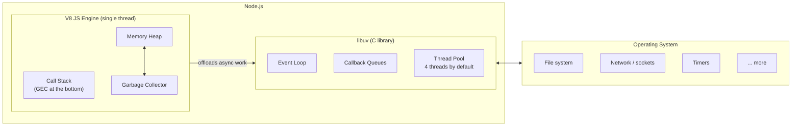
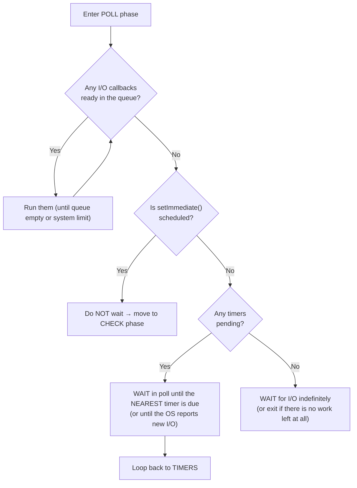
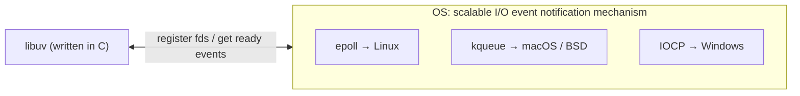
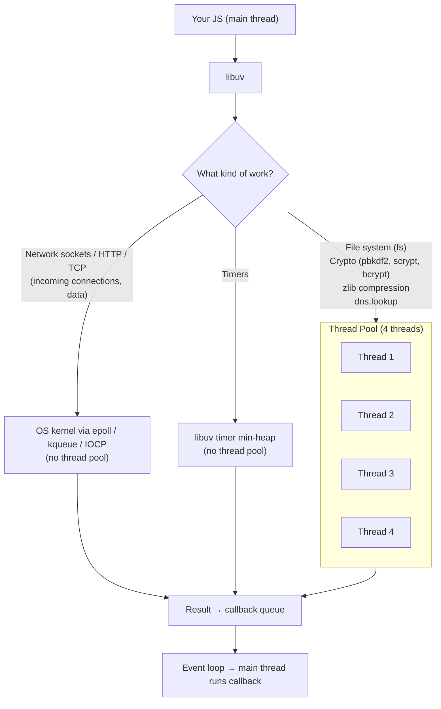
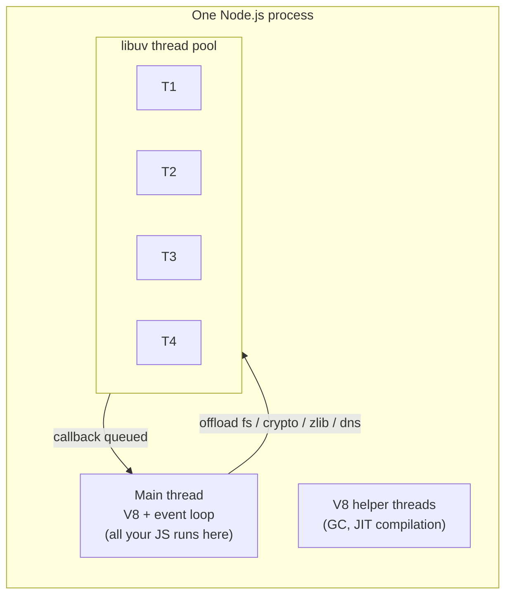

# Node.js Runtime Fundamentals: V8, JIT, Libuv, Epoll & "Is Node Single-Threaded?"

> **Companion note.** This is the *"how does it all fit together"* layer. For the deep dive on timers/`setImmediate`/`nextTick` behaviour, thread-pool labs and graceful shutdown, see [03-NodeJS-Internals-Event-Loop-Libuv-Threadpool.md](03-NodeJS-Internals-Event-Loop-Libuv-Threadpool.md).

---

## Executive Summary

- **Node.js is an event-driven runtime with asynchronous (non-blocking) I/O.**
- **Node.js = V8 (runs your JS) + libuv (does the async work) + C++ bindings gluing them.**
- **JavaScript itself is synchronous and single-threaded.** It has no concept of timers, files or HTTP. Those come from the *host*: the **browser** gives you Web APIs, **Node.js** gives you **libuv**.
- **V8 is a JIT engine** (interpreter + optimising compiler), so JS is neither purely interpreted nor purely compiled.
- **Libuv** owns the **event loop**, the **callback queues** and a **thread pool (4 threads by default)**, and talks to the OS through **epoll (Linux) / kqueue (macOS) / IOCP (Windows)**.
- **Single or multi-threaded?** Your JS runs on **one** thread. The Node *process* is multi-threaded because of libuv's thread pool.

---

## 1. JavaScript vs the Host Environment

JavaScript (ECMAScript) only gives you syntax, data types and functions. These things are **not** in the language:

| Feature | Not JavaScript. Provided by... | In the browser | In Node.js |
| :--- | :--- | :--- | :--- |
| Timers (`setTimeout`) | Host | Web APIs | **libuv** |
| HTTP calls (`fetch`, `https.get`) | Host | Web APIs | **libuv** (+ OS sockets) |
| File access (`fs.readFile`) | Host | Not allowed | **libuv** (thread pool) |

```javascript
https.get("https://api.fbi.com", (res) => console.log(res.secret)); // network  → libuv
fs.readFile("./gossip.txt", "utf8", (data) => console.log(data));   // file     → libuv
setTimeout(() => console.log("5 sec passed"), 5000);                // timer    → libuv
```

> **Analogy:** JavaScript is a brilliant chef who can only do one thing at a time. libuv is the kitchen staff and the delivery partners. The chef says "get me this file / this API response / ring me in 5 seconds", then keeps cooking while someone else does the waiting.

---

## 2. Big Picture: V8 + Libuv + OS

*(Your "Node.js, libuv genie / superhero" diagram, with the thread pool and event loop added.)*



### 2.1 What lives inside V8 (your first diagram)

| Part | Role |
| :--- | :--- |
| **Call Stack** | Runs one function at a time (LIFO). The bottom frame is the **GEC (Global Execution Context)**, created when the file starts. |
| **Memory Heap** | Where objects, arrays and closures are stored. |
| **Garbage Collector** | Frees heap memory that nothing references any more. |

```javascript
var a = 1078698;
var b = 20986;
function multiplyFn(x, y) { const result = a * b; return result; }
var c = multiplyFn(a, b);
// GEC pushed → multiplyFn() pushed on top → returns → popped → GEC finishes
```

### 2.2 What libuv does

Libuv is a **C library** with several components. The ones you need to know:

1. **Event Loop**: keeps cycling through phases and picks up finished work.
2. **Callback Queues**: finished async operations wait here for their turn.
3. **Thread Pool**: runs blocking work (fs, crypto, ...) in background threads.
4. **OS interface**: epoll / kqueue / IOCP (see section 5).

**How the event loop and callback queue cooperate:**

1. V8 runs your top-level code on the call stack.
2. Async calls (timer, file, HTTP) are handed to libuv, which hands them to the OS or the thread pool.
3. When one finishes, its callback is placed in a **callback queue**.
4. The event loop checks whether the **call stack is empty**. If so, it takes callbacks from the queues one by one and runs them **on the main thread**.

> ⚠️ *Precision note:* libuv doesn't execute the callbacks "in the queue". It only *delivers* them. The actual JS callback always runs on V8's single thread.

---

## 3. How V8 Runs Your Code: Parsing → AST → Ignition → Turbofan

### 3.1 Interpreted vs Compiled vs JIT

| | **Interpreted** | **Compiled** | **JIT (what JS does)** |
| :--- | :--- | :--- | :--- |
| How | Line by line | Whole program translated to machine code first | Interpret first, compile the **hot** parts while running |
| Start-up | ⚡ Fast | 🐢 Slow (initial heavy compile) | ⚡ Fast |
| Run speed | Slower | 🚀 Very fast | 🚀 Fast where it matters |
| Tool | Interpreter | Compiler | Interpreter **and** compiler |

JavaScript is **neither purely interpreted nor purely compiled**. It uses **JIT (Just-In-Time) compilation**, a mix of both.

### 3.2 The full pipeline


**Step by step:**

1. **Lexical analysis (tokenization):** the raw text is split into tokens (`var`, `a`, `=`, `10`, ...).
2. **Syntax analysis (parsing):** tokens are arranged into an **AST**, a tree showing the structure of the program.
3. **Ignition (interpreter):** walks the AST, produces **bytecode** and starts executing right away (fast start-up).
4. **Hot code → Turbofan:** if a function is called again and again ("hot"), V8 sends it to the **Turbofan** optimising compiler, which produces **optimised machine code**. Later calls run that super-fast version.
5. **De-optimisation:** Turbofan optimises by **making assumptions**. If an assumption breaks, V8 throws away the optimised code and falls back to Ignition.

```javascript
function sum(a, b) { return a + b; }
sum(10, 5);   // interpreted
sum(2, 3);    // hot → Turbofan assumes "a and b are always numbers" → fast machine code
sum(6, 7);    // runs the optimised version ⚡
sum("a", "b") // 💥 assumption broken (strings!) → DE-OPTIMISE → back to Ignition
              //    ...and if it becomes hot with strings, it is re-optimised for strings
```

> 💡 **Practical takeaway:** keep function argument types consistent so V8 can optimise and keep the optimised code.

> ⚠️ *Precision notes (your notes said "AST goes to both the interpreter and the compiler"):* strictly, the AST goes to **Ignition**, which generates the bytecode. Turbofan later takes the **hot bytecode plus the type feedback** Ignition collected. Modern V8 also has a middle tier called **Sparkplug** (a quick baseline compiler) between Ignition and Turbofan. And **V8 is an engine, not a language**: "JavaScript" is the language that is single-threaded and synchronous.

---

## 4. The Event Loop: Phases, Ticks and the Inner Queues

### 4.1 Vocabulary

- **One full cycle of the event loop = one "tick".**
- **Outer circle:** the *phases* (libuv).
- **Inner circle:** `process.nextTick()` queue and **promise callbacks** (microtasks), managed by Node/V8 and drained **in between** phases.

### 4.2 All phases, in order


> Between **every** phase (and in modern Node, after **every callback**) the inner circle is drained: **`process.nextTick()` first, then Promise callbacks**, then the loop continues.

| # | Phase | What runs there |
| :--- | :--- | :--- |
| 1 | **Timers** | Expired `setTimeout` / `setInterval` callbacks |
| 2 | **Pending callbacks** | Some I/O callbacks deferred to the next iteration (e.g. retries, certain error handling) |
| 3 | **Idle / Prepare** | Internal libuv use only (you never schedule work here) |
| 4 | **Poll** | New I/O events: incoming connections, data, `fs`, `crypto`, `http.get` callbacks. **Where the loop can wait.** |
| 5 | **Check** | `setImmediate()` callbacks |
| 6 | **Close** | Cleanup like `socket.on('close')` |

### 4.3 The poll phase is where the loop rests ("the catch")

When nothing is left to do, the loop does **not** spin the CPU. It **parks in the poll phase** and asks the OS (epoll/kqueue) to wake it up. What happens next depends on what is scheduled:



- **If `setImmediate` is queued → next is CHECK, not TIMERS.**
- **Timer wait example:** timers at 5 s, 10 s and 15 s → the loop waits in poll for the **nearest one (5 s)**, then starts the next cycle. It does **not** keep ticking for those 5 seconds.

> ⚠️ *Wording fix:* your note says "the *latest* timer that can expire". It's the **earliest / nearest** one, which is the one due first.

### 4.4 Worked example (your last event-loop diagram)

```javascript
setImmediate(() => console.log("setImmediate"));
setTimeout(() => console.log("Timer expired"), 0);
Promise.resolve().then(() => console.log("Promise"));

fs.readFile("./file.txt", "utf8", () => {
  setTimeout(() => console.log("2nd timer"), 0);
  process.nextTick(() => console.log("2nd nextTick"));
  setImmediate(() => console.log("2nd setImmediate"));
  console.log("File Reading CB");
});

process.nextTick(() => console.log("nextTick"));
console.log("Last line of the file.");
```

> ⚠️ *Code fix:* the video snippet writes `Promise.resolve(() => ...)`. That never runs the function (it just resolves *with* a function). To get `"Promise"` in the output you need `Promise.resolve().then(...)` as above.

**Output (typical):**

```
Last line of the file.     ← 1. top-level sync code finishes first
nextTick                   ← 2. inner circle: nextTick queue first
Promise                    ← 3. then promise callbacks
Timer expired              ← 4. TIMERS phase
setImmediate               ← 5. CHECK phase (file still being read by the thread pool)
File Reading CB            ← 6. POLL phase: file ready → callback runs
2nd nextTick               ← 7. inner circle drains right after that callback
2nd setImmediate           ← 8. CHECK phase (before timers, because we are past poll)
2nd timer                  ← 9. next tick's TIMERS phase
```

**Why steps 7 → 9 are in this order:** inside an I/O callback (poll), `setImmediate` is **always** run before a `setTimeout(…, 0)`, because CHECK comes right after POLL while TIMERS is the next iteration.

> ⚠️ *Caveat:* the order of **`Timer expired` vs `setImmediate` at top level** (steps 4 and 5) is not guaranteed by Node. It depends on whether 1 ms has elapsed when the loop starts, so it can flip between runs. Inside an I/O callback the order (step 8 before 9) **is** guaranteed. The exact timing of `File Reading CB` also depends on how fast the disk read finishes.

---

## 5. Libuv ↔ OS: epoll, kqueue, IOCP



- Each OS has a **scalable I/O event notification mechanism**. libuv hides the differences behind one API.
  - **Linux → `epoll`**
  - **macOS → `kqueue`**
  - **Windows → `IOCP`** *(added to your notes, as Node runs on Windows too)*
- **fds = file/socket descriptors.** To the OS, every open socket or file is just an integer handle. libuv says *"tell me when **these** descriptors become readable/writable"*, so **one thread can watch thousands of connections** without a thread per connection.
- **"What data structure is behind epoll?"** (your "what DS?" question). Inside the Linux kernel an epoll instance keeps:
  - an **interest list**: a **red-black tree** of every fd being watched (fast add/remove/lookup), and
  - a **ready list**: a **linked list** of fds that have events right now. `epoll_wait()` just hands you this list, so it doesn't scan every connection each time.
- **Follow-up topics you flagged:** **EventEmitter** (covered in [13-NodeJS-EventEmitter-Architecture-Event-Driven-Design.md](13-NodeJS-EventEmitter-Architecture-Event-Driven-Design.md)) and **Streams & Buffers** (covered in [14-NodeJS-Buffer-Architecture-Binary-Data-Encoding.md](14-NodeJS-Buffer-Architecture-Binary-Data-Encoding.md)).

---

## 6. The Thread Pool: Who Gets It and Who Doesn't

Libuv keeps a pool of **4 threads by default** (`UV_THREADPOOL_SIZE`, see the main note for tuning).



**How the pool behaves:**
- If a file read and a crypto job are handed to the pool, **2 of the 4 threads are busy, and the main thread is not blocked.** When they finish, those 2 threads free up for the next jobs.
- If you submit **more than 4 jobs** at once, the extra ones **queue up** until a thread is free.

> ⚠️ *Precision note:* only **fs, crypto, zlib and `dns.lookup`** use the pool. **Network I/O (sockets, `http`, `https.get` data) does not**; it uses epoll/kqueue/IOCP as in section 5. Timers don't use it either. That is why one Node process can serve thousands of connections with only 4 pool threads.

---

## 7. Is Node.js Single-Threaded or Multi-Threaded?

**It depends on the context:**

| Context | Answer | Why |
| :--- | :--- | :--- |
| **Running your JavaScript** (sync code on the call stack) | **Single-threaded** | One V8 call stack. Only one line of JS runs at a time. |
| **Doing async work** (fs, crypto, zlib, dns) | **Multi-threaded** | libuv's thread pool has 4 threads working in the background. |
| **The Node process as a whole** | **Multi-threaded** | Main thread + libuv pool + V8's own helper threads (GC, compilation). |



> **One-liner for interviews:** *"Node.js runs JavaScript on a single thread, but it is not single-threaded overall: libuv runs a pool of 4 worker threads in the background for file, crypto, compression and DNS work, and the OS handles network I/O."*

### 7.1 Beyond the default (my addition, not from your notes)

If you need **more JavaScript parallelism** you opt in explicitly:

| Tool | What it gives you | Use for |
| :--- | :--- | :--- |
| **`worker_threads`** | Extra JS threads, each with its own V8 + event loop (can share memory) | CPU-heavy JS (image processing, parsing big JSON) |
| **`cluster` / PM2 cluster mode** | Multiple Node **processes**, one per CPU core, sharing a port | Using all cores for an HTTP server |

---

## 8. Quick Revision Cheat-Sheet

| Topic | Remember |
| :--- | :--- |
| Node.js | Event-driven, asynchronous I/O runtime |
| Formula | **Node = V8 + libuv + C++ bindings** |
| JavaScript | Synchronous, single-threaded. No built-in timers/files/HTTP. |
| Browser equivalent of libuv | Web APIs |
| V8 pipeline | Source → tokens → **AST** → **Ignition** (bytecode) → hot → **Turbofan** (machine code) ⟲ de-optimise |
| JS execution model | **JIT** = interpreter + compiler |
| Libuv contains | Event loop, callback queues, thread pool (4), OS interface |
| OS mechanisms | epoll (Linux), kqueue (macOS), IOCP (Windows) |
| 1 event loop cycle | = 1 **tick** |
| Phase order | Timers → Pending callbacks → Idle/Prepare → **Poll** → **Check** → Close |
| Inner queues | `process.nextTick()` **then** promise callbacks, between phases |
| Idle behaviour | Loop parks in **poll**; if `setImmediate` is queued → **check** next; else waits for the **nearest** timer |
| Thread pool | 4 threads by default; fs, crypto, zlib, dns.lookup only |
| Network I/O | Not on the thread pool; OS notifies via epoll/kqueue |
| Single vs multi | JS = single thread · Node process = multi-threaded |
