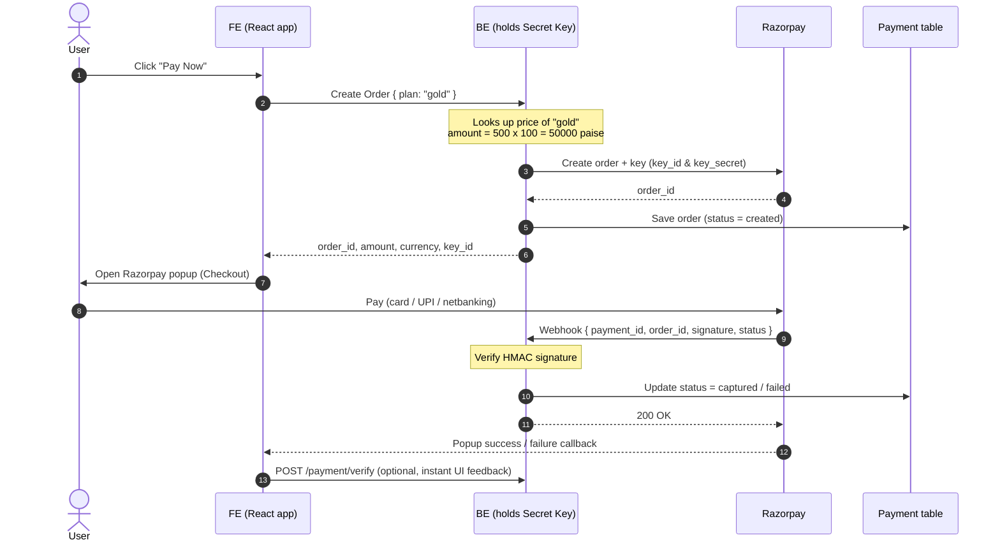

# Razorpay Payment Integration: Create Order, Verify Payment, Webhooks

---

## Executive Summary

Every Razorpay (or Stripe/PayPal-style) payment integration has exactly **two steps**:

1. **Create Order** — the backend asks Razorpay to create an order and gets an `order_id` back.
2. **Payment Verification** — after the user pays, the backend *proves* the payment is genuine by checking a cryptographic signature (and/or receiving a webhook).

Three golden rules, memorize these:

| # | Rule | Why |
| :--- | :--- | :--- |
| 1 | **Never trust the amount from the frontend.** Frontend sends only a *plan type* (`gold`, `silver`, `member`); backend looks up the price. | The browser can be edited in DevTools. A user could change `500` to `1` and pay one rupee for a gold plan. |
| 2 | **Amounts are in the smallest currency unit** (paise for INR, cents for USD). `₹500` → send `500 * 100 = 50000`. | Razorpay only deals in integers, never decimals. |
| 3 | **The secret key lives only on the backend.** | Anyone with the secret can create orders, issue refunds and forge signatures. |

---

## 1. The Big Picture (Your Diagram, Explained)



### Step-by-step walkthrough (numbers match the diagram)

1. **User clicks Pay Now** in the FE.
2. **FE → BE: Create Order.** Frontend calls your own backend, sending only the plan type (`gold`), never an amount.
3. **BE → Razorpay: create order + key.** Backend holds the `key_id` + `key_secret`. It decides the amount itself (in paise) and calls Razorpay's Orders API, authenticated with the key pair.
4. **Razorpay → BE: `order_id`.** Razorpay returns an order (`order_XXXXXXXX`).
5. **BE → DB.** Backend saves the order in the **Payment** table with status `created`.
6. **BE → FE: order details.** Backend returns `order_id`, `amount`, `currency` and the **public** `key_id` (never the secret).
7. **FE opens the Razorpay popup.** Using `checkout.js` and the `order_id`, Razorpay's hosted UI opens. Your app never touches card details (PCI compliance is Razorpay's problem).
8. **User pays** inside the popup (card / UPI / netbanking). Success or failure happens at Razorpay.
9. **Razorpay → BE: webhook.** Razorpay calls your backend URL with the `payment_id`, `order_id` and `signature`, saying the payment succeeded or failed.
10. **BE verifies & updates DB.** Backend verifies the HMAC signature, then sets the Payment row to `captured` or `failed` (and e.g. activates the membership).
11. **BE → Razorpay: `200 OK`.** Acknowledge quickly, or Razorpay retries the webhook.
12. **Popup closes in the FE** with a success or failure callback.
13. **FE → BE: `/payment/verify` (optional).** Gives instant UI feedback using `razorpay_signature`. The webhook (step 9) remains the source of truth.

> **Analogy:** Think of a restaurant bill. The waiter (backend) writes the bill (order) using the menu price, not what the customer *claims* the price is. The card machine (Razorpay) takes the payment, and then the machine's printed receipt (signature) is what the waiter checks, not the customer's word that "I already paid".

---

## 2. Step 1 — Create Order

### 2.1 Never pass the amount from the frontend

```
❌ BAD  — frontend decides the price
POST /payment/create-order
{ "amount": 1, "currency": "INR" }        ← user edited this in DevTools. Pays ₹1 for Gold.

✅ GOOD — frontend only sends a plan type, backend owns the price
POST /payment/create-order
{ "plan": "gold" }
```

Keep the prices in a server-side constant (or DB table):

```typescript
// constants/plans.ts  — SERVER SIDE ONLY, source of truth for prices
export const PLANS = {
  silver: { priceInRupees: 300, label: 'Silver Membership' },
  gold:   { priceInRupees: 500, label: 'Gold Membership'   },
} as const;

export type PlanType = keyof typeof PLANS;
```

### 2.2 Amounts are in the smallest unit (paise / cents)

Razorpay only accepts **integers in the currency's smallest sub-unit**.

| Currency | Main unit | Smallest unit | You want to charge | Send to Razorpay |
| :--- | :--- | :--- | :--- | :--- |
| INR | Rupee (₹) | **Paise** (1/100) | ₹500 | `500 * 100 = 50000` |
| USD | Dollar ($) | **Cents** (1/100) | $10 | `10 * 100 = 1000` |
| EUR | Euro (€) | Cents (1/100) | €7.50 | `750` |

```typescript
const amountInPaise = PLANS[plan].priceInRupees * 100; // ₹500 → 50000
```

> ⚠️ **Common bug:** Sending `500` means **₹5.00**, not ₹500. The order will "work" but you will undercharge by 100x. Always multiply by 100.
>
> ⚠️ **Tiny correction to the "÷100 for every currency" mental model:** most currencies use 100 sub-units, but not all. Zero-decimal currencies like JPY have *no* sub-unit (¥500 → `500`), and some like KWD use 1000 (3 decimals). For INR and USD, always `* 100`. Check Razorpay's currency docs if you add other currencies.
>
> ⚠️ Avoid float math for money (`19.99 * 100 = 1998.9999999999998`). Store prices as integers in paise, or wrap with `Math.round(...)`.

### 2.3 Backend: create the order

```bash
npm i razorpay
```

```typescript
// config/razorpay.ts
import Razorpay from 'razorpay';

export const razorpay = new Razorpay({
  key_id: process.env.RAZORPAY_KEY_ID!,         // public — safe to send to FE
  key_secret: process.env.RAZORPAY_KEY_SECRET!, // PRIVATE — never leaves the server
});
```

```typescript
// routes/payment.ts
import { Router } from 'express';
import { razorpay } from '../config/razorpay';
import { PLANS, PlanType } from '../constants/plans';

const router = Router();

router.post('/create-order', authMiddleware, async (req, res) => {
  const { plan } = req.body as { plan: PlanType };

  // 1. Validate plan type (never trust input)
  if (!(plan in PLANS)) {
    return res.status(400).json({ error: 'Invalid plan' });
  }

  // 2. Backend decides the amount, in PAISE
  const amount = PLANS[plan].priceInRupees * 100;

  // 3. Create the order at Razorpay
  const order = await razorpay.orders.create({
    amount,                       // integer, in paise
    currency: 'INR',
    receipt: `rcpt_${req.user.id}_${Date.now()}`, // your own reference (max 40 chars)
    notes: { userId: String(req.user.id), plan },  // comes back in webhooks, handy for lookup
  });

  // 4. Save to DB with status "created"
  await db.insert(payments).values({
    userId: req.user.id,
    orderId: order.id,            // "order_Nxxxxxxxx"
    amount,
    currency: 'INR',
    plan,
    status: 'created',
  });

  // 5. Send back what the FE needs. key_id is public; key_secret is NOT included.
  res.json({
    orderId: order.id,
    amount: order.amount,
    currency: order.currency,
    keyId: process.env.RAZORPAY_KEY_ID,
  });
});
```

**Response from Razorpay (`order`):**

```json
{
  "id": "order_Nxxxxxxxxxxxx",
  "entity": "order",
  "amount": 50000,
  "currency": "INR",
  "receipt": "rcpt_42_1730000000000",
  "status": "created",
  "notes": { "userId": "42", "plan": "gold" }
}
```

---

## 3. Frontend — Open the Razorpay Popup

Add Razorpay's script once (e.g. in `index.html`):

```html
<script src="https://checkout.razorpay.com/v1/checkout.js"></script>
```

```typescript
async function handlePayNow(plan: 'silver' | 'gold') {
  // 1. Ask OUR backend to create an order (send plan type only, no amount!)
  const res = await fetch('/payment/create-order', {
    method: 'POST',
    headers: { 'Content-Type': 'application/json' },
    credentials: 'include',
    body: JSON.stringify({ plan }),
  });
  const { orderId, amount, currency, keyId } = await res.json();

  // 2. Configure the Razorpay popup
  const options = {
    key: keyId,            // public key id
    amount,                // paise, shown to user as ₹500.00
    currency,
    order_id: orderId,     // links the popup to the order we created
    name: 'My App',
    description: `${plan} membership`,
    prefill: { name: user.name, email: user.email },
    theme: { color: '#3399cc' },

    // Called on SUCCESS in the popup
    handler: async (response: {
      razorpay_payment_id: string;
      razorpay_order_id: string;
      razorpay_signature: string;
    }) => {
      // Optional but recommended: send to backend for immediate verification
      await fetch('/payment/verify', {
        method: 'POST',
        headers: { 'Content-Type': 'application/json' },
        credentials: 'include',
        body: JSON.stringify(response),
      });
      // then refresh user / show success UI
    },
  };

  // 3. Open the popup
  const rzp = new (window as any).Razorpay(options);
  rzp.on('payment.failed', (err: any) => console.error(err.error.description));
  rzp.open();
}
```

> The popup is **Razorpay's UI**. Card numbers/UPI PINs never pass through your servers.

---

## 4. Step 2 — Payment Verification

> **Why verify at all?** The frontend saying "payment succeeded!" means nothing, since a user can call your `/verify` endpoint with made-up data or just edit the UI. The only source of truth is something **only Razorpay could have produced**: a signature created with a secret the user never sees.

### 4.1 How the signature works (HMAC-SHA256)

```
signature = HMAC_SHA256( order_id + "|" + payment_id ,  KEY_SECRET )
```

Razorpay computes this and sends it along. Your backend recomputes it with *its* copy of the secret and compares:

```
        Razorpay                                        Your Backend
 ┌────────────────────────┐                    ┌─────────────────────────────┐
 │ has KEY_SECRET         │                    │ has KEY_SECRET              │
 │ sig = HMAC(order|pay)  │──── sends sig ────►│ expected = HMAC(order|pay)  │
 └────────────────────────┘                    │ expected === sig ?          │
                                               │   ✅ genuine → mark paid    │
                                               │   ❌ forged  → reject       │
                                               └─────────────────────────────┘
```

A forger can't produce a matching signature without the secret. That is *why* the secret must stay on the backend.

### 4.2 Two verification channels (know the difference)

| | **A) Verify API** (`/payment/verify`) | **B) Webhook** (`/payment/webhook`) |
| :--- | :--- | :--- |
| **Triggered by** | Frontend `handler` callback after success | Razorpay server → your server |
| **Needs user's browser open?** | ✅ Yes (if tab closes, you never hear back) | ❌ No, works even if the user closes the tab |
| **Secret used** | `KEY_SECRET` | A separate **Webhook Secret** (set in Razorpay Dashboard) |
| **Signature header / field** | `razorpay_signature` in body | `X-Razorpay-Signature` header |
| **What is signed** | `order_id\|payment_id` | The **raw request body** |
| **Covers failures?** | Only success path | ✅ `payment.failed`, `payment.captured`, `order.paid`, refunds... |
| **Recommendation** | Fast UI feedback | **Source of truth.** Always implement it. |

In your diagram the webhook is the arrow from Razorpay's cloud back to the backend. It is the reliable one, because users close tabs, lose network, or their phone dies mid-payment.

### 4.3 Verify API (from the frontend callback)

```typescript
import crypto from 'crypto';

router.post('/verify', authMiddleware, async (req, res) => {
  const { razorpay_order_id, razorpay_payment_id, razorpay_signature } = req.body;

  // Recompute the signature using YOUR secret
  const expected = crypto
    .createHmac('sha256', process.env.RAZORPAY_KEY_SECRET!)
    .update(`${razorpay_order_id}|${razorpay_payment_id}`)
    .digest('hex');

  // Constant-time compare (prevents timing attacks)
  const valid =
    expected.length === razorpay_signature.length &&
    crypto.timingSafeEqual(Buffer.from(expected), Buffer.from(razorpay_signature));

  if (!valid) return res.status(400).json({ error: 'Invalid signature' });

  await markPaymentSuccess(razorpay_order_id, razorpay_payment_id); // idempotent!
  res.json({ success: true });
});
```

> The SDK also ships a helper: `validatePaymentVerification({ order_id, payment_id }, signature, secret)` from `razorpay/dist/utils/razorpay-utils`.

### 4.4 Webhook (Razorpay → your backend)

Setup in **Razorpay Dashboard → Settings → Webhooks**:
- URL: `https://api.yourapp.com/payment/webhook` (must be public HTTPS; use ngrok locally)
- Secret: choose any string, store as `RAZORPAY_WEBHOOK_SECRET`
- Events: `payment.captured`, `payment.failed`, `order.paid`

```typescript
// ⚠️ Must use express.raw(): signature is computed over the EXACT raw bytes.
// If express.json() parses it first, re-serializing changes bytes → signature mismatch.
router.post('/webhook', express.raw({ type: 'application/json' }), async (req, res) => {
  const signature = req.headers['x-razorpay-signature'] as string;

  const expected = crypto
    .createHmac('sha256', process.env.RAZORPAY_WEBHOOK_SECRET!) // NOT the key secret
    .update(req.body)           // raw Buffer
    .digest('hex');

  const valid =
    expected.length === signature.length &&
    crypto.timingSafeEqual(Buffer.from(expected), Buffer.from(signature));

  if (!valid) return res.status(400).send('Invalid signature');

  const event = JSON.parse(req.body.toString());

  switch (event.event) {
    case 'payment.captured': {
      const p = event.payload.payment.entity; // { id, order_id, amount, status, notes ... }
      await markPaymentSuccess(p.order_id, p.id);          // set status = "captured", activate plan
      break;
    }
    case 'payment.failed': {
      const p = event.payload.payment.entity;
      await markPaymentFailed(p.order_id, p.id);           // set status = "failed"
      break;
    }
  }

  res.status(200).json({ received: true }); // reply fast (<5s) or Razorpay retries
});
```

> ⚠️ Mount this route **before** any global `app.use(express.json())`, or use route-level parsers as above. Otherwise the body is already parsed and the raw bytes are gone.

### 4.5 Production rules for payments

1. **Idempotency.** Razorpay may deliver the same webhook multiple times, and both `/verify` and the webhook may fire for the same payment. Check "already `captured`?" before activating a plan twice.
2. **Check the amount too.** On the webhook, compare `payment.amount` with the amount stored in *your* Payment table for that `order_id`.
3. **Return 200 quickly.** Do heavy work (emails, invoices) in a queue.
4. **Never log or commit secrets.** Keep `RAZORPAY_KEY_SECRET` and `RAZORPAY_WEBHOOK_SECRET` in `.env`; only `key_id` goes to the frontend.
5. **Test mode first.** Use `rzp_test_...` keys; switch to `rzp_live_...` only in production.

---

## 5. Payment Status Lifecycle (DB "Payment" Table)

The table sketched in the bottom-left of your diagram:

```
 ┌──────────┐  popup opened   ┌───────────┐   webhook: captured   ┌──────────┐
 │ created  │────────────────►│ attempted │──────────────────────►│ captured │ ✅ activate plan
 └──────────┘                 └─────┬─────┘                       └──────────┘
                                    │ webhook: payment.failed
                                    ▼
                              ┌──────────┐
                              │  failed  │ ❌ user may retry (same order OK)
                              └──────────┘
```

| Column | Example | Purpose |
| :--- | :--- | :--- |
| `id` | 1 | PK |
| `userId` | 42 | who is paying |
| `orderId` | `order_Nxxxx` | link to Razorpay order (unique) |
| `paymentId` | `pay_Nxxxx` | filled in after payment |
| `amount` | 50000 | **paise**, integer |
| `currency` | `INR` | |
| `plan` | `gold` | what they bought |
| `status` | `created / captured / failed` | state machine above |
| `notes` | `{...}` | extra metadata |

---

## 6. Quick Recap Cheat-Sheet

```
 1. FE  ──{ plan: "gold" }──────────────►  BE        (NO amount from FE!)
 2. BE  looks up price, amount = 500 * 100 = 50000    (paise!)
 3. BE  ──orders.create({amount,currency})──► Razorpay
 4. BE  ◄──────────── order_id ───────────  Razorpay
 5. BE  ──{ orderId, keyId, amount }──────►  FE        (key_id public, secret NEVER)
 6. FE  opens Razorpay popup, user pays
 7. Razorpay ──webhook { payment_id, signature }──► BE
 8. BE  HMAC-verify signature → update Payment table → activate plan
```

| Remember | Detail |
| :--- | :--- |
| Two steps | Create Order → Verify Payment |
| Amount source | Backend only. FE sends plan type. |
| Unit | Paise / cents. `₹500 → 500 * 100` |
| Secret key | Backend only |
| Source of truth | Signature verification + webhook, never the FE |
| Webhook body | Parse with `express.raw()` so signature bytes match |
| Idempotent | Same event can arrive twice |
