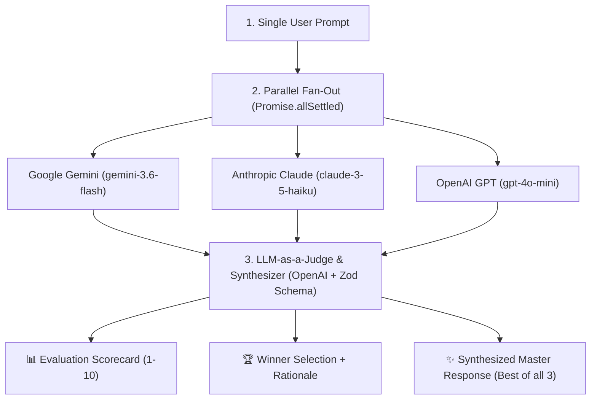

# 04 — SDK Deep Dive: From Raw HTTP to Multi-Model Ensembles & Agent SDKs

> **Cohort Series**: Generative AI Notes  
> **Topic**: What is an SDK? The 3 Tiers of Calling LLMs (REST vs. SDK vs. Agent SDK), Multi-Model Fan-Out & LLM-as-a-Judge, LangChain vs. Native Agent SDKs, and OpenAI API Interoperability (Calling Claude/Ollama via OpenAI SDK).  
> **Core Visual**: The Evolution from Raw Network Sockets to Autonomous Agent Frameworks.  

---

## 🧭 1. The Big Picture: The 3-Tier Evolution of Calling AI

When communicating with Large Language Models, developers do not interact with magic; they communicate over the network. Over the last two years, the way we connect to models evolved across three distinct tiers:

```
┌─────────────────────────────────────────────────────────────────────────────────────────┐
│                                THE 3-TIER EVOLUTION ARCHITECTURE                        │
└─────────────────────────────────────────────────────────────────────────────────────────┘

      TIER 1: REST API                TIER 2: PROVIDER SDK               TIER 3: AGENT SDK / FRAMEWORK
     (Raw Wire Protocol)            (Client Abstraction Layer)            (Autonomous Harness Layer)

    ┌───────────────────┐             ┌─────────────────────┐             ┌─────────────────────────┐
    │     REST API      │             │         SDK         │             │        Agent SDK        │
    │   (axios/fetch)   │             │   (openai, google,  │             │ (LangChain, OpenAI Agents│
    │                   │             │      anthropic)     │             │       MCP / Swarm)      │
    └─────────▲─────────┘             └──────────▲──────────┘             └────────────▲────────────┘
              │                                  │                                     │
    ┌─────────┴─────────┐             ┌──────────┴──────────┐             ┌────────────┴────────────┐
    │ • Open HTTP Conn  │             │ • Model Selection   │             │ • Multi-turn Prompting  │
    │ • Request Headers │             │ • Structured Input  │             │ • Tool Execution Loops  │
    │ • Status Code 200 │ ──────────► │ • Typed Output (Zod)│ ──────────► │ • Guardrails & Safety   │
    │ • JSON.parse()    │             │ • Auto-Retry (429)  │             │ • Automated Retries     │
    │ • Error Coercion  │             │ • Stream Decoders   │             │ • Circuit Breakers      │
    └───────────────────┘             └─────────────────────┘             └─────────────────────────┘
```

### The Blackboard Diagram Explained:
1. **REST API**: You open a raw TCP/HTTP connection, pass manual `Authorization: Bearer ...` headers, serialize a JSON body, inspect the HTTP status code, parse the response buffer with `JSON.parse()`, and handle network dropouts manually.
2. **SDK (Software Development Kit)**: Wraps the REST API. You give it a `model` and an `input`, and it returns a strongly typed `output`. It handles connection pooling, authentication, type definitions, and exponential backoff retries.
3. **Agent SDK (or LangChain)**: Wraps the SDK. A raw model call only does single-turn text generation. An Agent SDK adds the **autonomous loop**: it parses tool calls, invokes local code/APIs, enforces input/output guardrails, manages memory/state, and loops until the final answer is ready.

---

## 🛠️ 2. What is an SDK & How Does It Compare to REST APIs?

### 1. What is an SDK?
An **SDK (Software Development Kit)** is a package of libraries, code interfaces, type signatures, and helper utilities distributed by a service provider (e.g. OpenAI, Anthropic, Google) to make communicating with their remote APIs idiomatic and secure in your programming language.

### 2. Side-by-Side Comparison: Raw HTTP Call vs. Provider SDK

#### Option A: The Hard Way (Raw REST via `fetch` / `axios`)
```javascript
// Raw REST API approach (Manual & Fragile)
const res = await fetch("https://api.openai.com/v1/chat/completions", {
  method: "POST",
  headers: {
    "Content-Type": "application/json",
    "Authorization": `Bearer ${process.env.OPENAI_API_KEY}`,
  },
  body: JSON.stringify({
    model: "gpt-4o-mini",
    messages: [{ role: "user", content: "Hello" }],
  }),
});

if (!res.ok) {
  const errBody = await res.json();
  throw new Error(`OpenAI error [${res.status}]: ${errBody.error.message}`);
}

const data = await res.json();
const reply = data.choices[0].message.content;
```

#### Option B: The SDK Way (`npm i openai`)
```javascript
import OpenAI from "openai";

const client = new OpenAI({ apiKey: process.env.OPENAI_API_KEY });
const res = await client.chat.completions.create({
  model: "gpt-4o-mini",
  messages: [{ role: "user", content: "Hello" }],
});

console.log(res.choices[0].message.content);
```

| Feature | Raw REST API (`fetch`/`axios`) | Official SDK (`openai`, `@google/genai`, `@anthropic-ai/sdk`) |
| :--- | :--- | :--- |
| **Authentication** | Manual header composition (`Bearer token`) | Automatic environment variable detection (`process.env.OPENAI_API_KEY`) |
| **Type Safety & Autocomplete** | None (everything is `any` or untyped JSON) | 100% TypeScript types for models, parameters, and responses |
| **Transient Errors (429 / 503)** | Crashes immediately unless you write backoff code | Built-in exponential backoff and jitter retries |
| **Streaming (Server-Sent Events)** | Manual `ReadableStream` decoding and event parsing | Native async iterators (`for await (const chunk of stream)`) |
| **Structured JSON Schema** | Manual prompt coercion + manual `JSON.parse` | Native Zod helpers (`zodResponseFormat`, `zodTextFormat`) |

---

## ⚡ 3. The 4 Modes of Calling Modern LLM SDKs

Modern SDKs provide four primary patterns depending on your product requirements:

### Mode 1: One-Shot Unstructured Text
Standard request-response for short queries:
```javascript
const response = await openai.chat.completions.create({
  model: "gpt-4o-mini",
  messages: [{ role: "user", content: "Explain quantum computing in 1 sentence." }],
});
console.log(response.choices[0].message.content);
```

### Mode 2: Real-Time Token Streaming (`stream: true`)
Essential for production web applications (ChatGPT-like typing effect):
```javascript
const stream = await openai.chat.completions.create({
  model: "gpt-4o",
  messages: [{ role: "user", content: "Write a short story about Mars." }],
  stream: true,
});

for await (const chunk of stream) {
  const token = chunk.choices[0]?.delta?.content || "";
  process.stdout.write(token);
}
```

### Mode 3: Structured Outputs with Zod Parsing
Constrains token decoding so the model cannot emit malformed JSON:
```javascript
import { z } from "zod";
import { zodResponseFormat } from "openai/helpers/zod";

const UserProfileSchema = z.object({
  name: z.string(),
  age: z.number(),
  skills: z.array(z.string()),
});

const completion = await openai.chat.completions.parse({
  model: "gpt-4o-mini",
  messages: [{ role: "user", content: "Saif is a 24-year-old engineer who knows React and Node." }],
  response_format: zodResponseFormat(UserProfileSchema, "user_profile"),
});

// Guaranteed to be typed and validated!
const user = completion.choices[0].message.parsed;
console.log(user.skills); // ['React', 'Node']
```

### Mode 4: OpenAI Responses API (`client.responses.create` / `.parse`)
The newest generation API designed to replace chat completions with a cleaner `input`/`output` interface:
```javascript
const response = await openai.responses.create({
  model: "gpt-4o-mini",
  input: "Summarize the history of Unix in 50 words.",
});
console.log(response.output_text);
```

---

## 🌐 4. Hands-On: Calling the Big 3 Frontier SDKs

In our hands-on labs, we configured and invoked the three primary model providers:

```
┌────────────────────────────────────────────────────────────────────────────────────────┐
│                              THE "BIG THREE" PROVIDER MATRIX                           │
├──────────────────────────┬─────────────────────────────┬───────────────────────────────┤
│ Provider                 │ Official Node SDK           │ Current Flagship Models       │
├──────────────────────────┼─────────────────────────────┼───────────────────────────────┤
│ **Google**               │ `@google/genai`             │ `gemini-3.6-flash`, `gemini-2.5-pro`│
│ **Anthropic**            │ `@anthropic-ai/sdk`         │ `claude-3-5-sonnet-latest`, `haiku`│
│ **OpenAI**               │ `openai`                    │ `gpt-4o`, `gpt-4o-mini`       │
└──────────────────────────┴─────────────────────────────┴───────────────────────────────┘
```

### 1. Google Gemini SDK (`@google/genai`)
Google's newest SDK uses the `GoogleGenAI` class and a unified `contents` interface:
```javascript
import { GoogleGenAI } from "@google/genai";

const ai = new GoogleGenAI({ apiKey: process.env.GEMINI_API_KEY });

const response = await ai.models.generateContent({
  model: "gemini-3.6-flash",
  contents: "Why is distributed consensus hard?",
});

console.log(response.text);
```

### 2. Anthropic Claude SDK (`@anthropic-ai/sdk`)
Anthropic uses a strictly typed Messages API requiring explicit `max_tokens`:
```javascript
import Anthropic from "@anthropic-ai/sdk";

const anthropic = new Anthropic({ apiKey: process.env.ANTHROPIC_API_KEY });

const response = await anthropic.messages.create({
  model: "claude-3-5-haiku-latest",
  max_tokens: 1024,
  messages: [{ role: "user", content: "Explain CRDTs in 2 paragraphs." }],
});

const textBlock = response.content.find((block) => block.type === "text");
console.log(textBlock.text);
```

### 3. OpenAI SDK (`openai`)
The industry standard interface utilizing chat roles (`system`, `user`, `assistant`):
```javascript
import OpenAI from "openai";

const openai = new OpenAI({ apiKey: process.env.OPENAI_API_KEY });

const response = await openai.chat.completions.create({
  model: "gpt-4o-mini",
  messages: [{ role: "user", content: "What are the trade-offs of Kafka vs SQS?" }],
});

console.log(response.choices[0].message.content);
```

---

## 🏆 5. Multi-Model Orchestration: Fan-Out & LLM-as-a-Judge

In our lab [`06-multi-model-ensemble-judge.js`](file:///c:/Users/mohammed-saif/Desktop/cohort/13-genai/setup/01-prompting/06-multi-model-ensemble-judge.js), we combined all three models into an **Ensemble Pipeline**.

### The Architectural Problem:
No single AI model is superior at everything:
* **Gemini** excels at extensive context windows, structured tables, and deep search synthesis.
* **Claude** excels at nuanced system architecture, concise code, and edge-case reasoning.
* **OpenAI (GPT-4o)** excels at strict instruction-following, Zod schema validation, and meta-evaluation.

### Our 3-Step Multi-Model Pipeline:



### Key Engineering Practices Implemented:
1. **Parallel Execution via `Promise.allSettled`**:
   Rather than calling Model A $\to$ waiting $\to$ calling Model B $\to$ waiting, we launch all 3 concurrently:
   ```javascript
   const [geminiRes, claudeRes, openaiRes] = await Promise.allSettled([
     queryGoogleGemini(prompt),
     queryAnthropicClaude(prompt),
     queryOpenAI(prompt),
   ]);
   ```
   **Latency**: The total fan-out time equals $\max(\text{latency}_G, \text{latency}_C, \text{latency}_O)$, not the sum!

2. **LLM-as-a-Judge**:
   We feed the original prompt and all 3 anonymized answers to a meta-evaluator model with a clear rubric:
   - Score each model from 1 to 10 on accuracy, completeness, and clarity.
   - Pick the winning answer with technical justification.

3. **Mixture-of-Agents (MoA) / Response Fusion**:
   Rather than merely picking one winner, the judge synthesizes a **Master Answer** that incorporates the unique nuances of each candidate while eliminating repetitive fluff.

4. **Zod Structured Output Schema**:
   The judge is bound by strict decoding:
   ```javascript
   const EnsembleJudgmentSchema = z.object({
     modelEvaluations: z.array(z.object({
       model: z.string(),
       score: z.number().min(1).max(10),
       strengths: z.string(),
       weaknesses: z.string(),
     })),
     winner: z.object({ model: z.string(), reason: z.string() }),
     synthesizedResponse: z.string(),
   });
   ```

---

## 🧱 6. The Rise of Frameworks: Why Did LangChain Emerge?

### The Problem With Raw SDKs in 2023:
When you use raw SDKs, the model only generates strings. It does not:
* Connect to a SQL database.
* Execute tools in a `while` loop.
* Manage conversation memory across 50 turns.
* Mask PII or catch prompt injections.
* Switch from OpenAI to Anthropic without rewriting the entire codebase.

Because every team was reinventing these boilerplate loops, **LangChain** and **LlamaIndex** emerged to standardize prompt templates, chains, and tool calling.

### How LangChain Solved It (LCEL Example):
```javascript
import { ChatOpenAI } from "@langchain/openai";
import { ChatPromptTemplate } from "@langchain/core/prompts";
import { StringOutputParser } from "@langchain/core/output_parsers";

// Model-agnostic abstraction: swap ChatOpenAI with ChatAnthropic with zero code change!
const model = new ChatOpenAI({ model: "gpt-4o-mini", temperature: 0 });

const prompt = ChatPromptTemplate.fromMessages([
  ["system", "You are a senior DevOps architect. Answer succinctly."],
  ["user", "{question}"],
]);

// LangChain Expression Language (LCEL) Pipe: Prompt -> Model -> Parser
const chain = prompt.pipe(model).pipe(new StringOutputParser());

const result = await chain.invoke({
  question: "What is the difference between Blue-Green and Canary deployments?",
});

console.log(result);
```

### The Trade-Off with LangChain:
* **The Good**: Unified API across 50+ providers, built-in vector store integrations, standardized memory.
* **The Bad**: Heavy abstraction leakage, complex debugging when chains fail, massive package dependency trees, and steep learning curves for custom agent loops.

---

## 🤖 7. The New Era: Native Agent SDKs & Protocols

Recognizing that third-party frameworks like LangChain were often bloated and brittle, the frontier AI labs developed **Native Agentic SDKs and Protocols**:

```
┌─────────────────────────────────────────────────────────────────────────────┐
│                       NATIVE AGENT PROTOCOL ECOSYSTEM                       │
└─────────────────────────────────────────────────────────────────────────────┘

    1. ANTHROPIC MCP (Model Context Protocol)
       • Open standard for exposing local/remote tools, files, and DBs to Claude.
       • Claude acts as the agent client; your local system runs MCP tool servers.

    2. OPENAI AGENTS SDK / RESPONSES API
       • Built-in agent loops with automatic tool calling dispatch.
       • Swarm (lightweight multi-agent handoffs) and the Responses API.

    3. NATIVE FUNCTION CALLING
       • Models are trained natively on tool grammar, removing the need for
         complex regex prompt parsers.
```

### Why Native Agent SDKs Are Winning:
1. **Built into the Model's Weights**: Frontier models (GPT-4o, Claude 3.5 Sonnet) are pre-trained specifically to emit tool schemas natively rather than relying on prompt hacks.
2. **Deterministic Schemas**: Using Zod directly with the official SDK (`parse()` + `zodResponseFormat`) is 100% reliable compared to regex-based prompt parsers.
3. **Lighter & Faster**: No bloated intermediate layers—just your business logic, the official client, and a TypeScript loop.

---

## 🔄 8. Interoperability: Using the OpenAI SDK with Claude, Ollama, & Others!

One of the most important concepts in modern AI engineering is that **OpenAI's API schema has become the HTTP standard of the Generative AI industry** (much like S3 is the standard for object storage).

Almost every major model provider, local runner, and proxy exposes an **OpenAI-Compatible `/v1/chat/completions` Endpoint**:
* **Local Models**: Ollama, vLLM, LM Studio, LocalAI.
* **Alternative Clouds**: Groq, Together AI, Mistral, Perplexity, DeepSeek.
* **AI Gateways**: LiteLLM, Portkey, OpenRouter, Cloudflare AI Gateway.

### 1. Using the OpenAI SDK to Call Local Models (Ollama / DeepSeek)
You can run open-weight models locally with Ollama and control them via the official `openai` Node SDK simply by setting `baseURL`:

```javascript
import OpenAI from "openai";

// Point the OpenAI client to your local Ollama server!
const localClient = new OpenAI({
  baseURL: "http://localhost:11434/v1",
  apiKey: "ollama", // Required by SDK, ignored by local runner
});

const response = await localClient.chat.completions.create({
  model: "deepseek-r1:8b", // or "llama3.2"
  messages: [{ role: "user", content: "Explain memory safety in Rust." }],
});

console.log(response.choices[0].message.content);
```

### 2. Using the OpenAI SDK to Call Claude via an AI Gateway (OpenRouter / LiteLLM)
You can call Anthropic's Claude using your OpenAI SDK client by pointing it to an OpenAI-compatible gateway:

```javascript
import OpenAI from "openai";

// Using OpenRouter / LiteLLM as an OpenAI-compatible gateway
const gatewayClient = new OpenAI({
  baseURL: "https://openrouter.ai/api/v1",
  apiKey: process.env.OPENROUTER_API_KEY,
});

// Calling Anthropic Claude through the OpenAI SDK!
const response = await gatewayClient.chat.completions.create({
  model: "anthropic/claude-3.5-sonnet",
  messages: [{ role: "user", content: "Review this database migration script." }],
});

console.log(response.choices[0].message.content);
```

### 3. How Reverse Gateway Mapping Works
```
┌─────────────────────────────────────────────────────────────────────────────┐
│                     OPENAI SDK INTEROPERABILITY ARCHITECTURE                │
└─────────────────────────────────────────────────────────────────────────────┘

    Your Application Code
    (Imports official 'openai' SDK)
                   │
                   ▼  POST baseURL/chat/completions
    ┌───────────────────────────────┐
    │     API Gateway / Proxy       │
    │  (LiteLLM, OpenRouter, vLLM)  │
    └──────────────┬────────────────┘
                   │ Translates request format & credentials
         ┌─────────┼─────────┐
         ▼         ▼         ▼
    ┌─────────┐┌─────────┐┌───────────┐
    │ Claude  ││ Gemini  ││ Local     │
    │ (Sonnet)││ (Flash) ││ (DeepSeek)│
    └─────────┘└─────────┘└───────────┘
```

**Why This Matters for Software Architecture**:
* **No Vendor Lock-In**: Write your application once using the OpenAI client interface.
* **Zero Code Changes for Cost Optimization**: Switch from `gpt-4o` to `deepseek-r1` or `claude-3-5-sonnet` in production by toggling two environment variables (`OPENAI_BASE_URL` and `MODEL_NAME`).
* **Offline Development**: Point your code to `http://localhost:11434/v1` during flights or local testing without modifying your application logic.

---

## 📋 The 1-Minute Summary Cheat Sheet

| Concept | What It Is | How We Used It in Code |
| :--- | :--- | :--- |
| **REST API** | Raw HTTP calls (`fetch`/`axios`) requiring manual headers, serialization, and status parsing. | Manual network tier underneath all client libraries. |
| **Provider SDK** | High-level client (`openai`, `@google/genai`, `@anthropic-ai/sdk`) with types, retries, and streaming. | Hands-on labs `01-gemini`, `02-openai`, `03-claude`. |
| **Streaming** | Reading tokens in real-time via Server-Sent Events (SSE). | `02a-open-ai-streaming.js` using `for await (const chunk of stream)`. |
| **Zod Constrained Decoding** | Forcing mathematical JSON schema compliance at the token generator level. | `02-open-ai-sdk.js` with `zodTextFormat` and `06` with `zodResponseFormat`. |
| **Multi-Model Fan-Out** | Querying multiple frontier models in parallel via `Promise.allSettled`. | `06-multi-model-ensemble-judge.js` querying Gemini, Claude, and GPT simultaneously. |
| **LLM-as-a-Judge** | Using an independent evaluator model to critique, score, and select the best candidate. | Evaluator agent in `06-multi-model-ensemble-judge.js`. |
| **Response Fusion (MoA)** | Synthesizing unique points from multiple models into one master answer. | Master synthesizer in `06-multi-model-ensemble-judge.js`. |
| **LangChain** | Third-party framework standardizing chains, prompt templates, and vector stores across models. | Abstraction layer for multi-step workflows. |
| **Native Agent SDKs** | First-party protocols (Anthropic MCP, OpenAI Assistants / Agents) built directly for tool execution. | Modern alternative to bulky third-party orchestration frameworks. |
| **OpenAI Compatibility** | Standard protocol allowing `openai` SDK to call Ollama, Claude, or DeepSeek via `baseURL`. | Portable enterprise pattern avoiding provider lock-in. |
