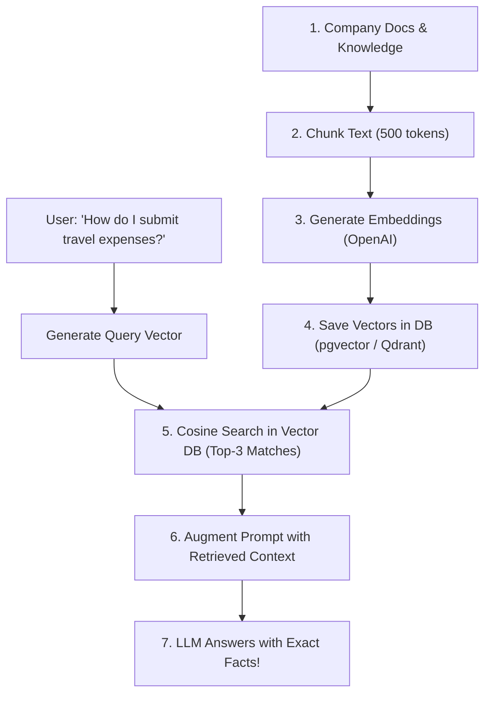

# 06 — Vector Databases, Embeddings, Semantic Search & Long-Term Memory

> **Cohort Series**: Generative AI Notes  
> **Topic**: What are Embeddings & High-Dimensional Vectors? Semantic Search vs. Keyword Search, Similarity Metrics (Cosine, Dot Product, Euclidean), Vector Indexing (HNSW vs. IVFFlat), Vector DB Landscape (pgvector, Pinecone, Qdrant), and Building Long-Term Agent Memory with Node.js.  
> **Core Rule**: Taught for the complete layman—plain English, everyday analogies (Supermarket Aisles, GPS, Express Highways), visual ASCII architecture diagrams, and Node.js code snippets!  

---

## 🧭 1. The Big Picture: What is an Embedding? (Layman Analogy)

Imagine you walk into a giant supermarket looking for **fresh strawberries**:
* If you ask: *"Where are the strawberries?"*, the manager doesn't say: *"Go to aisle 'S' because strawberry starts with 'S'."*
* Instead, they point you to the **Produce / Fresh Fruits Section**.
* And what sits right next to the strawberries? **Blueberries, apples, bananas, and grapes.**
* What sits across the hall? **Milk and yogurt** (because people eat fruit with yogurt).
* What is 5 aisles away? **Bleach and laundry detergent** (completely unrelated to fruit).

```
┌─────────────────────────────────────────────────────────────────────────────────────────┐
│                               THE SUPERMARKET OF MEANINGS                               │
└─────────────────────────────────────────────────────────────────────────────────────────┘

        AISLE 1: PRODUCE (Fruits)                  AISLE 12: CLEANING SUPPLIES
     ┌─────────────────────────────┐             ┌─────────────────────────────┐
     │  • Strawberry  [0.92, 0.88] │             │  • Floor Cleaner [0.05, 0.01]│
     │  • Blueberry   [0.91, 0.85] │             │  • Detergent     [0.04, 0.02]│
     │  • Apple       [0.85, 0.79] │             │  • Bleach        [0.02, 0.00]│
     └─────────────────────────────┘             └─────────────────────────────┘
                    ▲                                           ▲
                    │                                           │
                    └────────── [ 200 METERS APART ] ───────────┘
```

### The Problem With Computers:
Computers are dumb calculators. They love numbers like `42` or `3.14`, but they have **zero idea what the word "strawberry" means**:
* To a computer, `"strawberry"` is just 10 letters: `['s', 't', 'r', 'a', 'w', 'b', 'e', 'r', 'r', 'y']`.
* If you ask a standard SQL database: `SELECT * FROM products WHERE name LIKE '%sweet fruit%'`, it returns **zero rows** because the literal word `"sweet"` is not in `"strawberry"`.

### The Solution: The "GPS Coordinates of Meaning"
An **Embedding** is a mathematical translator. It takes any text, image, or audio and converts it into a list of decimal numbers (a **vector**) that acts like **GPS coordinates in a universe of meaning**:

$$\text{"Strawberry"} \longrightarrow [0.892, -0.412, 0.751, 0.023, \dots, 0.941]$$

* Two concepts that **mean the same thing** get GPS coordinates that sit **right next to each other**.
* Two concepts that have **unrelated meanings** get GPS coordinates that sit **miles apart**.

---

## 📐 2. Dimensions & Point Embeddings: Why So Many Numbers?

When you look at GPS coordinates in the real world, you only need **2 dimensions**: `(Latitude, Longitude)`.  
If you are flying an airplane, you add a 3rd dimension: `(Latitude, Longitude, Altitude)`.

Now, how many dimensions do you need to describe **human thought, emotions, medical terms, and legal contracts**?  
**Thousands of dimensions!**

```
┌─────────────────────────────────────────────────────────────────────────────────────────┐
│                           WHAT DO EMBEDDING DIMENSIONS REPRESENT?                       │
└─────────────────────────────────────────────────────────────────────────────────────────┘

               Dimension 1:     Dimension 2:     Dimension 3:     Dimension 1536:
                 (Fruitiness)      (Tech/Gadget)     (Pet/Animal)     (Royalty)
               ─────────────    ─────────────    ────────────     ───────────────
   "Apple"   ►    +0.95            +0.85            -0.60             -0.10
   "Banana"  ►    +0.98            -0.80            -0.70             -0.20
   "iPhone"  ►    -0.80            +0.99            -0.50             +0.15
   "King"    ►    -0.90            -0.40            -0.30             +0.99
```

> 💡 **Notice**: `"Apple"` has a high score in both **Fruitiness** (the food) and **Tech** (the company)! The embedding model captures the double meaning across 1,536 distinct numerical axes!

### Common Model Dimensions:
| Embedding Model | Provider | Dimensions | Typical Use Case |
| :--- | :--- | :--- | :--- |
| `text-embedding-3-small` | OpenAI | **1,536** | High speed, cost-effective search ($0.02 / 1M tokens) |
| `text-embedding-3-large` | OpenAI | **3,072** | High accuracy, complex legal & medical retrieval |
| `text-embedding-004` | Google | **768** | Fast multilingual search on Vertex AI |
| `all-MiniLM-L6-v2` | Open Source (HuggingFace) | **384** | Runs locally on CPU/device without API costs |

---

## 🔍 3. Semantic Search vs. Traditional Keyword Search

Why is everyone replacing their old search bars with vector embeddings?

```
┌─────────────────────────────────────────────────────────────────────────────────────────┐
│                         KEYWORD SEARCH VS. SEMANTIC SEARCH                              │
└─────────────────────────────────────────────────────────────────────────────────────────┘

   USER SEARCH QUERY: "My laptop battery drains in 30 minutes, how to replace it?"

   TRADITIONAL SEARCH (SQL LIKE / Elastic BM25)     SEMANTIC VECTOR SEARCH (Embeddings)
   ────────────────────────────────────────────     ───────────────────────────────────
   • Looks for exact words: "battery", "replace".   • Understands the underlying INTENT.
   • Finds a document:                              • Finds documents like:
     "How to replace battery on your watch."          "Fixing poor power retention on MacBook"
   • MISSES the best document because it says:       "Replacing aging lithium-ion cells"
     "Power cell lifespan and installation guide"     "Diagnosing fast battery discharge"
   • ❌ Matches irrelevant words, misses meaning!    • ✅ Matches the exact solution!
```

| Dimension | Keyword Search (BM25 / SQL Full-Text) | Semantic Vector Search (Embeddings) |
| :--- | :--- | :--- |
| **How it finds results** | Exact character and word frequency matching. | Meaning similarity in high-dimensional vector space. |
| **Synonyms & Slang** | Fails unless you manually write a synonym dictionary. | Automatic (`"automobile"` $\leftrightarrow$ `"car"`, `"bug"` $\leftrightarrow$ `"error"`). |
| **Typos & Grammar** | Fragile without fuzzy search. | Resilient (understands general sentence context). |
| **Multilingual** | Needs separate language dictionaries. | Can match an English query to a Spanish document! |
| **Exact ID / Code lookup** | ⭐ Superior for exact SKUs (`"PART-9942"`). | ⚠️ Can struggle with exact serial numbers (needs hybrid search). |

---

## 📏 4. Similarity Metrics: How Do We Measure Distance?

Once text is turned into coordinates, how does the computer know which two vectors are the closest?  
There are **three primary mathematical formulas**:

```
┌─────────────────────────────────────────────────────────────────────────────────────────┐
│                              THE 3 SIMILARITY METRICS                                   │
└─────────────────────────────────────────────────────────────────────────────────────────┘

      1. COSINE SIMILARITY               2. EUCLIDEAN (L2) DISTANCE          3. DOT PRODUCT (INNER PRODUCT)
      (Measures the ANGLE)                (Measures the RULER DISTANCE)      (Angle + Magnitude combined)

            Vector A                             Point A                           Vector A
            ↗                                    •                                 ↗
           /  θ (angle)                           \                               /
          /                                        \ distance                    /
         ───────► Vector B                          • Point B                   ───────► Vector B
```

### 1. Cosine Similarity (The Industry Standard for Text)
* **What it measures**: The **angle ($\theta$)** between two arrows pointing from the origin.
* **Range**: `-1.0` (opposite) to `+1.0` (identical direction).
* **Why it's King for Text**: If Document 1 is a 10-word summary and Document 2 is a 1,000-word essay about the same topic, their arrows point in the **exact same direction**, even though Document 2 is longer! Cosine similarity ignores length and measures **pure topical alignment**.

### 2. Euclidean Distance (L2 Distance)
* **What it measures**: A physical ruler measuring the straight-line distance between two points.
* **Formula**: $\sqrt{(x_2 - x_1)^2 + (y_2 - y_1)^2 + \dots}$
* **When to use**: Image recognition, physical sensor coordinates, or when the absolute magnitude of the vectors matters.

### 3. Dot Product
* **What it measures**: Multiplies the matching dimensions of both vectors and sums them up: $A \cdot B = \sum A_i B_i$.
* **The Magic Trick**: If your embedding model outputs **normalized vectors** (length = 1.0, which OpenAI and Cohere do by default), then:
$$\text{Dot Product} = \text{Cosine Similarity}$$
Dot product is computationally faster because the database doesn't need to divide by vector lengths!

---

## ⚡ 5. Vector Indexing: Why Brute Force Fails & ANN Saves the Day

Imagine your company stores **10 million documents** in a database:
* When a user searches, how do you find the top 5 closest matches?

### The Naive Way: Exact KNN (K-Nearest Neighbors)
* Calculate the cosine distance between the user's query and **all 10,000,000 vectors** one by one.
* **Result**: Your database server catches fire 🔥. A single search takes 8 seconds!
* This is called **Brute Force ($O(N)$)**.

To search in **5 milliseconds**, we use **Approximate Nearest Neighbors (ANN)** indexing. The two most famous algorithms are **HNSW** and **IVFFlat**:

```
┌─────────────────────────────────────────────────────────────────────────────────────────┐
│                              HNSW VS. IVFFLAT INDEXING                                  │
└─────────────────────────────────────────────────────────────────────────────────────────┘

   HNSW (Hierarchical Navigable Small World)        IVFFLAT (Inverted File Flat)
   ─────────────────────────────────────────        ───────────────────────────
   • The "Express Highway & Street Map"             • The "Postal Zip Code" System
   
   Layer 2 (Highways):   [A]───────────────►[B]     • Groups vectors into clusters (Voronoi cells).
                          │                  │      • Only searches inside the closest cluster
   Layer 1 (Main Roads): [A]───►[C]───►[D]──►[B]      instead of the entire database.
                          │      │      │    │
   Layer 0 (Local Alley):[A]─[E]─[C]─[F]─[D]─[B]

   ⚡ Speed: Blazing fast (~2ms)                     ⚡ Speed: Fast (~10ms)
   🎯 Accuracy (Recall): Extremely high (>98%)      🎯 Accuracy (Recall): Medium (~90%)
   💾 RAM Usage: High (stores graph in memory)      💾 RAM Usage: Low (stores centroids)
```

### 1. HNSW (Hierarchical Navigable Small World)
* **The Analogy**: Imagine traveling from New York to a specific house in Los Angeles. You don't walk through every local street in the country. You take a cross-country flight (Layer 2), take a highway to the neighborhood (Layer 1), and then check the street addresses (Layer 0).
* **When to pick HNSW**: **Production standard.** Use when you need sub-5ms query latency and high accuracy, and have enough RAM.

### 2. IVFFlat (Inverted File Flat)
* **The Analogy**: Like sorting mail by Postal Zip Code. Instead of searching the whole country, you identify the 2 closest zip codes and only search inside those boxes.
* **When to pick IVFFlat**: When memory/RAM is limited, or when datasets are constantly bulk-updated and rebuilding an HNSW graph is too expensive.

---

## 🗄️ 6. The Vector Database Landscape: Which One Should You Pick?

Do you need to buy an expensive new database, or can you use the PostgreSQL database you already own?

```
┌─────────────────────────────────────────────────────────────────────────────────────────┐
│                              THE VECTOR DATABASE ECOSYSTEM                              │
└─────────────────────────────────────────────────────────────────────────────────────────┘

   SPECIALIZED DEDICATED VECTOR DBs                 RELATIONAL / HYBRID EXTENSIONS
   ────────────────────────────────                 ──────────────────────────────
   Built from the ground up for vectors.           Add vector support to your existing DB.

   🌲 Pinecone                                      🐘 pgvector (PostgreSQL)
   • 100% managed Serverless cloud.                 • Open-source extension for Postgres.
   • Zero devops, pay-per-query.                    • Joins vectors with normal SQL tables!
   • Ideal for fast prototyping without servers.    • 90% of production startups start here!

   ⚡ Qdrant                                         🔴 Redis / MongoDB Atlas
   • Ultra-fast, written in Rust.                   • In-memory caching with vector search.
   • Native payload filtering & hybrid search.      • Great if already using Mongo or Redis.
   • Open-source or managed cloud.
```

### The Architectural Decision Matrix:
| Criteria | PostgreSQL + `pgvector` | Dedicated Vector DB (Pinecone / Qdrant) |
| :--- | :--- | :--- |
| **Number of Vectors** | Under 5 Million vectors. | 10M to 1 Billion+ vectors. |
| **Data Relational Joins** | ⭐ **Best**: `SELECT * FROM docs JOIN users ON ...` | ❌ Complex: Vectors live in DB A, metadata lives in DB B. |
| **Operational Overhead** | Zero new servers (uses your existing Postgres). | Another cloud service, API key, and billing account. |
| **ACID Transactions** | ⭐ Full transactional consistency. | Eventual consistency. |
| **Recommendation** | **Start with pgvector!** (Upgrade to Qdrant/Pinecone only when scaling past 10M vectors). | Pick when scaling to massive enterprise datasets. |

---

### 🗂️ 6.1 The Rosetta Stone: Vector DB vs. Traditional SQL & NoSQL Mental Model

If you come from a traditional backend background (PostgreSQL, MySQL, MongoDB), how do you map the terminology of Vector Databases to concepts you already know?

A very common mental model beginners use is:
* **"Index = Database"**
* **"Namespace = Table"**
* **"Vector = Row"**

> **Is this correct?**  
> **Yes, fundamentally this is spot on!** However, there are a few **critical nuances and corrections** across different database engines (Pinecone vs. Qdrant vs. pgvector) that every engineer should know so you never get confused in architecture discussions or production setups.

```
┌─────────────────────────────────────────────────────────────────────────────────────────┐
│                       VECTOR DB HIERARCHY (PINECONE / SPECIALIZED VDB)                  │
└─────────────────────────────────────────────────────────────────────────────────────────┘

 📁 INDEX (Database Instance / Cluster)
    Configured with Dimension (e.g., 1536) & Distance Metric (Cosine)
    │
    ├── 📑 NAMESPACE: "customer_support" (Table / Tenant Partition)
    │   ├── 🏷️ RECORD / VECTOR 1 (Row: ID + Float Coordinates + JSON Metadata)
    │   └── 🏷️ RECORD / VECTOR 2 (Row: ID + Float Coordinates + JSON Metadata)
    │
    └── 📑 NAMESPACE: "internal_wiki" (Table / Tenant Partition)
        ├── 🏷️ RECORD / VECTOR 3 (Row: ID + Float Coordinates + JSON Metadata)
        └── 🏷️ RECORD / VECTOR 4 (Row: ID + Float Coordinates + JSON Metadata)
```

#### 1. "Index means Database" (Partially True — The Terminology Trap ⚠️)
* **In Pinecone**: **100% True.** In Pinecone, an **Index** is the top-level provisioned unit (the actual database instance/cluster). When you create an index, you define the embedding dimension (e.g., `1536`), similarity metric (`cosine`, `euclidean`, or `dotproduct`), and cloud hardware.
* **The Correction / Nuance across the ecosystem**:
  * In traditional SQL and in **pgvector**, an **Index** does *not* mean the database! An index in SQL is an auxiliary search data structure (like B-Tree, HNSW, or IVFFlat) built on top of a table column to speed up queries.
  * In **Qdrant, Chroma, and Milvus**, the top-level container is called a **Collection** (exactly like a MongoDB collection).
  * **Rule of Thumb**: When Pinecone says *"Index"*, think *"Database Instance"*. When PostgreSQL/pgvector says *"Index"*, think *"HNSW Search Accelerator"*.

#### 2. "Namespace means Table" (True — Logical Partitioning 📑)
* **In Pinecone**: **100% True.** A **Namespace** is a logical partition inside an Index.
  * Searches within a namespace are completely isolated: if you query `namespace: "tenant_abc"`, the search engine will never scan vectors from `namespace: "tenant_xyz"`.
  * This is ideal for **multi-tenant SaaS apps** (one namespace per customer) or **domain isolation** (e.g., `namespace: "legal_docs"` vs `namespace: "sales_transcripts"`).
* **The Correction / Nuance**:
  * Unlike SQL tables which can have completely different column schemas, all namespaces within a Pinecone index must share the **exact same vector dimensions** (e.g., all 1536-dim) and distance metric.
  * In **Qdrant**, this is handled via **Payload Filtering** (storing a `tenant_id` field in metadata) or separate **Collections**.
  * In **pgvector**, you can simply use a regular SQL **Table**, schema, or partition column.

#### 3. "Vector means Row" (True — But a Vector is a 3-Part Object 🏷️)
* **In all Vector DBs**: **100% True.** A single vector entry corresponds directly to a **Row** in SQL or a **Document** in MongoDB.
* **The Correction / Nuance**:
  * A vector entry is not just a raw array of floating-point numbers `[0.12, -0.45, ...]`. In modern vector databases, every "Vector" (called a **Record** in Pinecone or a **Point** in Qdrant) is a **3-part object**:
    1. **ID** $\rightarrow$ Like a SQL **Primary Key** (e.g., `"doc_chunk_104"`).
    2. **Values / Embedding** $\rightarrow$ The numerical coordinate array (`[0.82, -0.19, ...]`).
    3. **Metadata / Payload** $\rightarrow$ A JSON object containing traditional columns/fields (e.g., `{ "author": "Saif", "created_at": "2026-10-20", "text": "Raw chunk text..." }`).
  * **Why Metadata Matters**: It allows **Hybrid / Metadata Filtering**! You can tell the vector DB: *"Find the 5 most semantically similar paragraphs (vector search), BUT ONLY WHERE `author == 'Saif'` and `year >= 2024` (metadata SQL filter)."*

#### 🗺️ The Universal Comparison Matrix (The Rosetta Stone)

| Concept | Traditional SQL (Postgres/MySQL) | NoSQL (MongoDB) | Pinecone | Qdrant / Milvus | pgvector (PostgreSQL) |
| :--- | :--- | :--- | :--- | :--- | :--- |
| **Top Container** | Database (`CREATE DATABASE`) | Database | **Index** | Service / Cluster | Database |
| **Table / Partition** | Table (`CREATE TABLE`) | Collection | **Namespace** | Collection (or Payload Tenant) | Table |
| **Single Entry** | Row | Document | **Record / Vector** | **Point / Entity** | Row |
| **Primary Key** | `id` (Primary Key) | `_id` | **Vector ID** (`id`) | Point ID (`id`) | `id` (Primary Key) |
| **Embedding Values** | N/A (unless BLOB/Array) | Array field | `values` | `vector` | `embedding vector(1536)` |
| **Attributes / Data** | Columns (`title`, `author`) | Document Fields | **Metadata** (JSON) | **Payload** (JSON) | Table Columns |
| **Search Accelerator** | B-Tree / GIN Index | B-Tree Index | HNSW / Flat (Internal) | HNSW / IVF Index | `CREATE INDEX ... USING hnsw` |
| **Filtering Clause** | `WHERE category = 'tech'` | `{ category: 'tech' }` | `filter: { category: 'tech' }` | `filter: { must: [...] }` | `WHERE category = 'tech'` |

---

## 🧠 7. Agent Long-Term Memory & RAG Architecture

Why do AI agents need vector databases in the first place?

Because frontier models (like GPT-4o or Claude 3.5 Sonnet) suffer from **short-term memory loss**:
* Their **Context Window** (e.g. 128k tokens) is like human **RAM / Working Memory**.
* When you close the terminal or start a new session, **everything is forgotten**.
* Feeding 500 PDF manuals into every single prompt costs $10.00 per question and takes 30 seconds!

### The Solution: RAG (Retrieval-Augmented Generation)



---

## 💻 8. Hands-On Code: Vector Search with Node.js & OpenAI

Let's build a working Node.js implementation that generates embeddings, computes cosine similarity, and searches semantically.

### 1. Generating Embeddings with OpenAI SDK (`text-embedding-3-small`)

```javascript
import OpenAI from "openai";

const openai = new OpenAI({ apiKey: process.env.OPENAI_API_KEY });

async function getEmbedding(text) {
  const response = await openai.embeddings.create({
    model: "text-embedding-3-small",
    input: text,
  });

  // Returns an array of 1536 floating-point numbers
  return response.data[0].embedding;
}

const vector = await getEmbedding("I love eating fresh apples");
console.log("Vector dimensions:", vector.length); // 1536
console.log("First 3 coordinates:", vector.slice(0, 3)); // [0.0142, -0.0521, 0.0891]
```

---

### 2. Computing Cosine Similarity in Pure JavaScript

```javascript
function cosineSimilarity(vecA, vecB) {
  let dotProduct = 0;
  let normA = 0;
  let normB = 0;

  for (let i = 0; i < vecA.length; i++) {
    dotProduct += vecA[i] * vecB[i];
    normA += vecA[i] * vecA[i];
    normB += vecB[i] * vecB[i];
  }

  return dotProduct / (Math.sqrt(normA) * Math.sqrt(normB));
}

// Quick Test:
const appleVector = await getEmbedding("Juicy red apple");
const fruitVector = await getEmbedding("Fresh sweet strawberry");
const carVector = await getEmbedding("Electric sports car with turbo engine");

console.log("Apple vs Strawberry:", cosineSimilarity(appleVector, fruitVector)); // ~0.82 (High similarity!)
console.log("Apple vs Sports Car:", cosineSimilarity(appleVector, carVector));   // ~0.15 (Low similarity!)
```

---

### 3. PostgreSQL + `pgvector` Setup & Node.js Query Pattern

In PostgreSQL, enable the extension and create an HNSW index:

```sql
-- 1. Enable the vector extension
CREATE EXTENSION IF NOT EXISTS vector;

-- 2. Create table with a 1536-dimensional vector column
CREATE TABLE documents (
    id SERIAL PRIMARY KEY,
    content TEXT NOT NULL,
    embedding vector(1536)
);

-- 3. Create lightning-fast HNSW index for cosine distance (<=>)
CREATE INDEX ON documents USING hnsw (embedding vector_cosine_ops);
```

In your Node.js backend using standard `pg` (PostgreSQL client):

```javascript
import pg from "pg";
import OpenAI from "openai";

const pool = new pg.Pool({ connectionString: process.env.DATABASE_URL });
const openai = new OpenAI();

async function searchKnowledgeBase(userQuery, topK = 3) {
  // 1. Embed user query
  const queryEmbedding = await openai.embeddings.create({
    model: "text-embedding-3-small",
    input: userQuery,
  });
  const vectorString = JSON.stringify(queryEmbedding.data[0].embedding);

  // 2. Query PostgreSQL using '<=>' (Cosine Distance Operator)
  // Distance = 1 - Similarity. Smallest distance = most similar!
  const query = `
    SELECT id, content, (embedding <=> $1) AS distance
    FROM documents
    ORDER BY distance ASC
    LIMIT $2;
  `;

  const { rows } = await pool.query(query, [vectorString, topK]);
  return rows;
}
```

---

### 4. Qdrant Setup in Node.js (`@qdrant/js-client-rest`)

For dedicated vector databases like Qdrant:

```javascript
import { QdrantClient } from "@qdrant/js-client-rest";

const qdrant = new QdrantClient({ url: "http://localhost:6333" });

// Search vectors with metadata filtering
async function searchQdrant(queryVector) {
  const searchResults = await qdrant.search("knowledge_base", {
    vector: queryVector,
    limit: 5,
    filter: {
      must: [
        { key: "category", match: { value: "engineering" } }, // Metadata filter
      ],
    },
  });

  return searchResults;
}
```

---

## 📋 The 1-Minute Layman Cheat Sheet

| Term | What is it in plain English? | Everyday Analogy |
| :--- | :--- | :--- |
| **Embedding** | Translating text into a list of numbers representing meaning. | GPS coordinates for words in the supermarket of ideas. |
| **Dimensions** | The number of distinct attributes the model measures (e.g. 1536). | Latitude, longitude, altitude, humidity, temperature of meaning. |
| **Index (Vector DB)** | Top-level database container/cluster in Pinecone (or search graph in SQL). | The entire warehouse/store building. |
| **Namespace** | Logical partition inside an index to isolate tenants or categories. | Distinct departments inside the warehouse (e.g. Produce vs Electronics). |
| **Vector / Point** | A single record containing an ID, coordinate values, and metadata JSON. | A single product item on the shelf with its price tag and barcode. |
| **Metadata / Payload** | Traditional key-value data attached to a vector for SQL-like filtering. | The product label info (Brand, Expiry Date, Department). |
| **Semantic Search** | Finding information by meaning and intent rather than exact words. | Searching *"headache medicine"* and finding *"Aspirin"*. |
| **Cosine Similarity** | Measuring the angle between two vectors to see if they mean the same thing. | Two compass needles pointing in the exact same direction. |
| **Dot Product** | Fast similarity math for normalized vectors (length = 1.0). | Quick multiplication shortcut for cosine similarity. |
| **HNSW Index** | An express highway graph connecting vectors for 2ms search. | Jumping from interstate highway to local street to find a house. |
| **IVFFlat Index** | Dividing vectors into clusters to avoid scanning everything. | Sorting letters into postal zip code boxes. |
| **pgvector** | A free PostgreSQL extension adding vector columns and HNSW indexes. | Turning your trusty family sedan into a sports car without buying a new car. |
| **Pinecone / Qdrant** | Dedicated, specialized vector databases built for 10M+ records. | Buying a dedicated industrial cargo plane for massive freight. |
| **RAG (Long-Term Memory)** | Finding relevant knowledge in a vector DB and pasting it into the prompt. | An open-book exam where the student checks the index to find the right page. |
