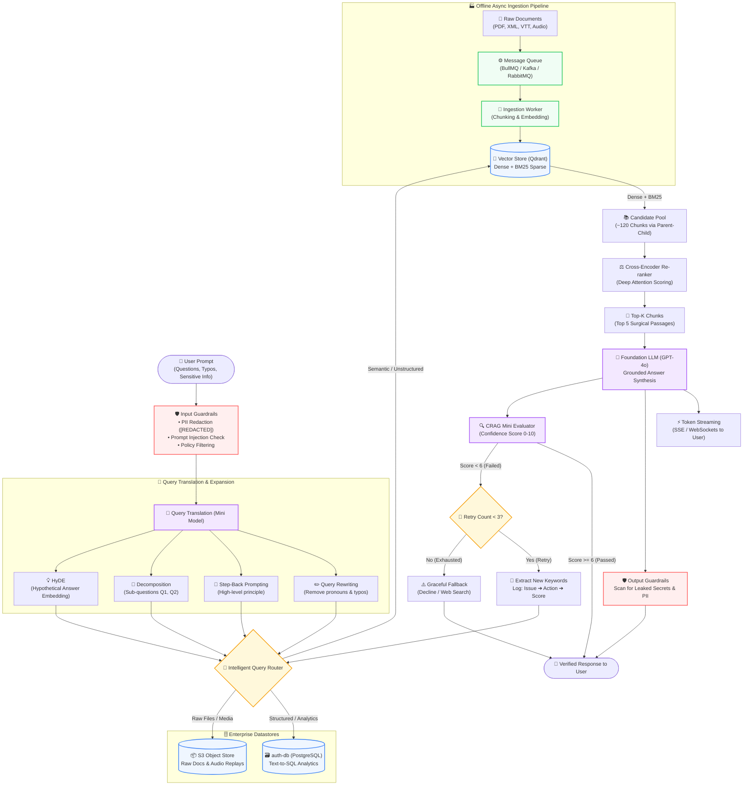

# 08 — Advanced RAG Patterns & Production Architectures

> **Cohort Series**: Generative AI Notes  
> **Topic**: Overcoming Naive RAG Pitfalls, Input & Output Guardrails, Background Worker Ingestion (BullMQ, Kafka, RabbitMQ), Query Translation (Step-Back Prompting, Query Rewriting, Sub-Question Decomposition, HyDE), Hybrid Search (BM25 + Dense Vectors), Parent-Child Chunking, Cross-Encoder Re-ranking, Intelligent Query Routing, Streaming Delivery, and Corrective RAG (CRAG) with Telemetry & Circuit Breakers (`Max Rewrites = 3`).  
> **Golden Rule**: Naive RAG is a toy demo. Advanced RAG is how production enterprise systems handle messy human queries, noisy documents, background async processing, and strict compliance constraints.

---

## 💥 1. Why Naive RAG Fails in the Real World

In simple RAG, we took the user's raw prompt, embedded it, retrieved the top-3 nearest vectors, and stuffed them into GPT-4o.  
In production, this naive pipeline breaks in **6 disastrous ways**:

```
┌────────────────────────────────────────────────────────────────────────────────────────┐
│                              THE 6 FATAL FLAWS OF NAIVE RAG                            │
├──────────────────────────┬─────────────────────────────────────────────────────────────┤
│ 1. Messy User Queries    │ Users write typos, pronouns ("how does it work?"), or vague │
│                          │ multi-part questions that fail vector cosine search.        │
├──────────────────────────┼─────────────────────────────────────────────────────────────┤
│ 2. The Asymmetry Problem │ A question ("Why is my sky blue?") does NOT look like an   │
│                          │ answer ("Rayleigh scattering of light occurs when...").     │
├──────────────────────────┼─────────────────────────────────────────────────────────────┤
│ 3. Keyword Blindness     │ Vector embeddings are awful at exact match codes, SKUs,    │
│                          │ error IDs (e.g., "ERR_AUTH_902"), and proper nouns.         │
├──────────────────────────┼─────────────────────────────────────────────────────────────┤
│ 4. Chunk Size Dilemma    │ Small chunks = great search precision, terrible context.   │
│                          │ Large chunks = great context, terrible search precision.    │
├──────────────────────────┼─────────────────────────────────────────────────────────────┤
│ 5. Wrong Data Source     │ Asking "How many users signed up today?" to a Vector DB    │
│                          │ fails; that belongs in a SQL database!                      │
├──────────────────────────┼─────────────────────────────────────────────────────────────┤
│ 6. Hallucination on Junk │ If the Vector DB returns 5 irrelevant chunks, the LLM will │
│                          │ still try to synthesize an answer and hallucinate wildly.   │
└──────────────────────────┴─────────────────────────────────────────────────────────────┘
```

**Advanced RAG** introduces pre-retrieval processing, asynchronous background indexing, intelligent routing, hybrid retrieval, post-retrieval re-ranking, output guardrails, and self-correcting evaluation loops.

---

## 📐 2. The Master Architecture: Rebuilding the Complete Production Diagram

Here is the full interactive flowchart showing how every stage connects:



### Detailed ASCII Architecture Map

```
═══════════════════════════════════════════════════════════════════════════════════════════════════════════════════════════════
                                      ADVANCED RAG: PRODUCTION PIPELINE ARCHITECTURE
═══════════════════════════════════════════════════════════════════════════════════════════════════════════════════════════════

 [ ASYNC INGESTION WORKERS ]  ──> [ BullMQ / Kafka / RabbitMQ ] ──> Document Parsing, Chunking & Embedding ──> [ Vector DB ]
 (Heavy PDFs / Transcripts)

                                User Prompt: "What is the policy for refund on order #9482 and my SSN is 000-12-3456?"
                                                                   │
                                                                   ▼
┌──────────────────────────────────────────────────────────────────────────────────────────────────────────────────────────────┐
│ STAGE 1: INPUT GUARDRAILS & PII FILTERING                                                                                    │
│ • Detect & Redact PII (SSN, credit cards, API keys) ──> Replaces with token [REDACTED_SSN]                                   │
│ • Prompt Injection Defense & Competitor Detection ──> Rejects jailbreaks or toxic inputs                                     │
│ • Tools: Guardrails AI, NeMo Guardrails, AWS Bedrock Guardrails                                                              │
└──────────────────────────────────────────────────────────────────────────────────────────────────────────────────────────────┘
                                                                   │
                                                                   ▼
┌──────────────────────────────────────────────────────────────────────────────────────────────────────────────────────────────┐
│ STAGE 2: QUERY TRANSLATION & EXPANSION (Fast Mini Model / gpt-4o-mini)                                                       │
│                                                                                                                              │
│  ┌───────────────────────┐   ┌───────────────────────┐   ┌────────────────────────┐   ┌────────────────────────────────────┐ │
│  │ A. QUERY REWRITE      │   │ B. STEP-BACK PROMPT   │   │ C. DECOMPOSITION       │   │ D. HyDE (Hypothetical Doc)         │ │
│  │ Fixes typos & slang,  │   │ Takes a step back to  │   │ Splits multi-question  │   │ Hallucinates a fake answer;        │ │
│  │ clarifies pronouns    │   │ ask high-level        │   │ into parallel sub-     │   │ embeds the fake answer             │ │
│  │ into standalone query │   │ conceptual principle  │   │ questions: Q1 and Q2   │   │ (matches answer vectors!)          │ │
│  └───────────────────────┘   └───────────────────────┘   └────────────────────────┘   └────────────────────────────────────┘ │
└──────────────────────────────────────────────────────────────────────────────────────────────────────────────────────────────┘
                                                                   │
                                                                   ▼
┌──────────────────────────────────────────────────────────────────────────────────────────────────────────────────────────────┐
│ STAGE 3: INTELLIGENT QUERY ROUTING (Traffic Cop)                                                                             │
│ • Inspects question intent and routes to the correct datastore:                                                              │
│                                                                                                                              │
│   ├── If User Analytics / Transaction ──────> [ SQL / auth-db ] (Text-to-SQL Query)                                          │
│   ├── If Policy, Manuals, Unstructured ─────> [ Vector DB (Qdrant) + BM25 Sparse Search ]                                   │
│   └── If Large Raw Log / Asset ─────────────> [ S3 / Object Store ]                                                          │
└──────────────────────────────────────────────────────────────────────────────────────────────────────────────────────────────┘
                                                                   │
                                                                   ▼
┌──────────────────────────────────────────────────────────────────────────────────────────────────────────────────────────────┐
│ STAGE 4: HYBRID RETRIEVAL & PARENT-CHILD EXPANSION                                                                           │
│ • Dense Vector Search (semantic similarity) + Sparse BM25 Search (exact keyword match) via RRF                               │
│ • Parent-Child Chunking: Search against small 150-token child chunks; retrieve entire 1000-token parent chunk!              │
│ • Yields initial broad candidate pool: ~120 Candidate Documents                                                              │
└──────────────────────────────────────────────────────────────────────────────────────────────────────────────────────────────┘
                                                                   │
                                                                   ▼
┌──────────────────────────────────────────────────────────────────────────────────────────────────────────────────────────────┐
│ STAGE 5: RE-RANKING (Cross-Encoder / Cohere Rerank / BGE-Reranker)                                                           │
│ • Reads [Query + Document] simultaneously with deep cross-attention.                                                         │
│ • Filters 120 candidates down to TOP-5 highest-scoring, hyper-relevant passages.                                             │
└──────────────────────────────────────────────────────────────────────────────────────────────────────────────────────────────┘
                                                                   │
                                                                   ▼
┌──────────────────────────────────────────────────────────────────────────────────────────────────────────────────────────────┐
│ STAGE 6: GENERATION & STREAMING                                                                                              │
│ • Final LLM (GPT-4o) synthesizes grounded answer with source citations.                                                      │
│ • Tokens stream to UI via SSE/WebSockets for instant user perceived responsiveness.                                         │
└──────────────────────────────────────────────────────────────────────────────────────────────────────────────────────────────┘
                                         │                                                   │
                                         ▼                                                   ▼
┌───────────────────────────────────────────────────────┐   ┌──────────────────────────────────────────────────────────────────┐
│ STAGE 7: OUTPUT GUARDRAILS                            │   │ STAGE 8: CRAG EVALUATION & CIRCUIT BREAKER LOOP                  │
│ • Checks generated response for leaked credentials,   │   │ • Mini Evaluator scores output (0 to 10)                         │
│   confidential employee data, or internal server info │   │     ├── If Score >= 6 ──> Output approved!                       │
│ • Intercepts & Redacts before reaching the user!      │   │     └── If Score < 6  ──> Extract keywords & re-query            │
└───────────────────────────────────────────────────────┘   │         [ Circuit Breaker: Max Rewrites = 3 ]                    │
                                                            │         Logs: What went wrong ──> Action taken ──> Score change  │
                                                            └──────────────────────────────────────────────────────────────────┘
```

---

## ⚡ 3. Production Ingestion: Background Workers (BullMQ, Kafka, RabbitMQ)

In a real enterprise, you cannot parse a 500-page PDF and calculate 2,000 OpenAI embeddings inside a synchronous HTTP request handler (`app.post('/upload', ...)`). The HTTP request will time out after 30 seconds.

```
┌─────────────────┐       ┌─────────────────┐       ┌────────────────────────┐       ┌─────────────────┐
│ User uploads    │       │ Fast HTTP API   │       │ Message Queue          │       │ Background      │
│ 200 MB PDF      │ ────> │ Returns 202     │ ────> │ [ BullMQ (Redis) /     │ ────> │ Ingestion       │
│                 │       │ Accepted        │       │   Kafka / RabbitMQ ]   │       │ Workers (Node)  │
└─────────────────┘       └─────────────────┘       └────────────────────────┘       └─────────────────┘
                                                                                              │
                                                                                              ▼
                                                                                     • Chunk & Split
                                                                                     • Batch Embeddings
                                                                                     • Upsert to Qdrant
```

* **BullMQ (Redis-based Queue for Node.js)**: Perfect for managing rate-limited batches, automatic exponential backoff retries when OpenAI hits rate limits (`429 Too Many Requests`), and progress bars.
* **Apache Kafka**: Used in enterprise architectures where document updates are emitted as high-throughput event streams across microservices.
* **RabbitMQ**: Reliable AMQP task distribution for heterogeneous worker pools.

---

## 🛡️ 4. Input & Output Guardrails (Two-Way Shield)

Security in RAG is a **two-way street**:

```
┌─────────────────────────────────────────────────────────────────────────────────────────────┐
│                                    THE TWO-WAY GUARDRAIL                                    │
├─────────────────────────────────────────────┬───────────────────────────────────────────────┤
│          INPUT GUARDRAILS (Ingress)         │          OUTPUT GUARDRAILS (Egress)           │
├─────────────────────────────────────────────┼───────────────────────────────────────────────┤
│ • Protects the LLM & Vector DB from users   │ • Protects users & company from the LLM       │
│ • Redacts incoming PII (SSN, credit cards)  │ • Prevents LLM from leaking internal secrets  │
│ • Blocks prompt injections & jailbreaks     │ • Scans response for accidental PII leakage   │
│ • Flags competitor queries                  │ • Ensures brand policy compliance             │
└─────────────────────────────────────────────┴───────────────────────────────────────────────┘
```

### The Output Guardrail Threat:
Suppose your vector database retrieved an internal HR document containing a compensation formula or employee IDs (`{id3rs}`). Even if the user didn't ask for it, the LLM might casually include it in its answer.
* The **Output Guardrail** inspects `{Response}` before it leaves the backend.
* If sensitive credentials, raw system prompt text, or unauthorized data patterns are found, it blocks or redacts them on the fly.

---

## 🔄 5. Query Translation & Expansion

Raw user questions are notoriously poor for vector search. Advanced RAG translates them first:

```
┌─────────────────────────────────────────────────────────────────────────────────────────────────┐
│                                 THE 4 QUERY TRANSLATION STRATEGIES                              │
└─────────────────────────────────────────────────────────────────────────────────────────────────┘

1. QUERY REWRITING
   Raw:       "What about its battery life?"  (Follow-up in chat)
   Rewritten: "What is the battery life of the Apple MacBook Pro M3 16-inch?"

2. STEP-BACK PROMPTING (More Abstraction)
   Raw:       "Why did my Node.js worker thread crash when accessing buffer offset 1024?"
   Step-Back: "How do Node.js Buffer bounds checks and SharedArrayBuffer memory access work?"

3. SUB-QUESTION DECOMPOSITION
   Raw:       "Compare pricing and rate limits between Pinecone and Qdrant."
   Sub-Q 1:   "What is the pricing model of Pinecone vector database?"
   Sub-Q 2:   "What is the pricing model of Qdrant vector database?"
   Sub-Q 3:   "What are the API rate limits of Pinecone vs Qdrant?"

4. HyDE (Hypothetical Document Embeddings)
   Raw Query: "What causes the Temporal Dead Zone in JavaScript?"
   Step 1:    LLM writes a hypothetical answer (even if it makes up minor details).
   Step 2:    Vectorize the hypothetical answer and search Qdrant with that!
```

---

### Deep Dive: Step-Back Prompting
Instead of searching for an overly narrow question where exact words may not match, we ask the LLM to **step back and retrieve the high-level principle or concept first**:

```
Specific Question:
"Can an employee claim taxi reimbursement for travel to an offsite dinner in Chicago?"

Step-Back Question:
"What is the company policy regarding travel and entertainment meal expense reimbursements?"
```
By retrieving the broad policy first, the model gains the fundamental rulebook before deciding on the specific case.

---

### Deep Dive: HyDE (Hypothetical Document Embeddings)
* **The Problem**: A short question vector does not mathematically align with a dense, technical answer vector in cosine space.
* **The Solution**: Have a fast model generate a **hypothetical answer** first. Even if factually imperfect, its grammar, vocabulary, and semantic density match real documentation. Embed the hypothetical document, and your vector search lands directly on the true answer passages!

---

## 🚦 6. Intelligent Query Routing

A single user query should not blindly hit a vector database:

```
                                  Incoming User Query
                                           │
                                           ▼
                             [ LLM ROUTING CLASSIFIER ]
                                           │
      ┌────────────────────────────────────┼────────────────────────────────────┐
      ▼                                    ▼                                    ▼
[ ROUTE: SQL / RELATIONAL ]         [ ROUTE: VECTOR STORE ]             [ ROUTE: S3 OBJECTS ]
• "How many orders shipped?"        • "What is the return policy?"      • "Fetch the raw PDF"
• "What is John's account balance?" • "Explain our refund guidelines"   • "Download video replay"
      │                                    │                                    │
      ▼                                    ▼                                    ▼
LLM generates SQL query              Vector Embeddings & Semantic         Direct S3 Pre-signed URL
SELECT COUNT(*) FROM orders...       Search in Qdrant                     download
```

If the source is `auth-db`, the LLM generates a SQL query (`SELECT ...`). If it is unstructured text, it calls vector embeddings.

---

## 🔍 7. Hybrid Search (BM25 Sparse + Dense Vectors)

* **Dense Vector Search (Cosine on Embeddings)**: Master of semantics and concept similarity (*"car"* = *"automobile"*), but terrible at exact IDs, error codes, and SKUs (`ERR_CONN_TIMEOUT_401`).
* **Sparse Search (BM25 / Full-Text Search)**: Master of exact keyword frequency, but blind to synonyms.

Combining them via **Reciprocal Rank Fusion (RRF)**:
$$\text{RRF Score}(d) = \sum_{m \in M} \frac{1}{60 + \text{rank}_m(d)}$$
Documents matching both semantic concept and exact keyword identifiers receive the highest score.

---

## 👨‍👦 8. Parent-Child (Hierarchical) Chunking

### The Dilemma:
* **Small Chunks (100–150 tokens)**: Razor-sharp vector precision, but lacks necessary surrounding context.
* **Large Chunks (1,000+ tokens)**: Rich context, but embedding vectors become blurry and diluted.

### The Solution:
```
┌────────────────────────────────────────────────────────────────────────────────────────┐
│                        PARENT CHUNK (Full Page / 1,000 Tokens)                         │
│                                                                                        │
│   ┌────────────────────────┐  ┌────────────────────────┐  ┌────────────────────────┐   │
│   │ Child Chunk 1 (150 tk) │  │ Child Chunk 2 (150 tk) │  │ Child Chunk 3 (150 tk) │   │
│   │ [Vectorized in Qdrant] │  │ [Vectorized in Qdrant] │  │ [Vectorized in Qdrant] │   │
│   └────────────────────────┘  └────────────────────────┘  └────────────────────────┘   │
└────────────────────────────────────────────────────────────────────────────────────────┘
                                     ▲
                                     │ Query matches Child Chunk 2!
                                     │
                 System fetches and injects the ENTIRE PARENT CHUNK
                 into the LLM context prompt!
```

Index **Child Chunks** into Qdrant for surgical search; retrieve and feed the **Parent Chunk** into the LLM context!

---

## 🎯 9. Re-Ranking with Cross-Encoders

* **Bi-Encoders (Embeddings)**: Embed query and documents separately. Super fast (10ms over millions of vectors), but shallow comparison.
* **Cross-Encoders (Re-rankers)**: Feed `[Query + Document]` together through multi-head self-attention. Highly accurate, but computationally expensive.

**The 2-Stage Funnel**:
1. Retrieve **120 candidate documents** using fast Bi-Encoder vector search.
2. Cross-Encoder reranks the 120 candidates and picks the **Top-5** for the LLM.

---

## 🔁 10. CRAG (Corrective RAG) with Telemetry & Circuit Breaker

What if the 120 retrieved documents still don't contain the answer?

```
                     LLM generates tentative {Response}
                                     │
                                     ▼
                    ┌─────────────────────────────────┐
                    │     MINI EVALUATOR MODEL        │
                    │   (Evaluates Context Fit 0-10)  │
                    └─────────────────────────────────┘
                                     │
            ┌────────────────────────┴────────────────────────┐
            ▼                                                 ▼
     SCORE >= 6 (Accept)                               SCORE < 6 (Reject)
            │                                                 │
            ▼                                                 ▼
   Send to Output Guardrail                        Extract new KEYWORDS from query
   and stream response!                                       │
                                                              ▼
                                                   [ CIRCUIT BREAKER CHECK ]
                                                   Attempts < Max Rewrites (3)?
                                                              │
                                       ┌──────────────────────┴──────────────────────┐
                                       ▼                                             ▼
                                     YES (Retry)                                 NO (Exhausted)
                              Re-query datastore with new               Gracefully respond:
                              keywords & re-run ranking                 "I cannot find this in our
                                                                        documents after 3 attempts."
```

### Telemetry & Audit Observability:
Each CRAG iteration logs an audit event:
* **What was going wrong**: Missing specific error code context in initial retrieval.
* **What we did**: Extracted fallback keywords `["auth", "timeout", "cluster"]` and re-queried.
* **Score change**: Confidence jumped from `4.2/10` to `8.7/10`.

---

## 💻 11. Code Implementation: Advanced RAG in Node.js

### A. CRAG Loop with Max Retry Circuit Breaker

```javascript
import OpenAI from "openai";
const openai = new OpenAI();

async function correctiveRAGLoop(userQuery, vectorRetriever, maxRetries = 3) {
  let currentQuery = userQuery;
  let attempts = 0;

  while (attempts < maxRetries) {
    attempts++;
    console.log(`[Attempt ${attempts}] Querying with: "${currentQuery}"`);

    // 1. Retrieve candidate chunks
    const docs = await vectorRetriever.invoke(currentQuery);

    // 2. Evaluate relevance with mini model
    const evalResponse = await openai.chat.completions.create({
      model: "gpt-4o-mini",
      messages: [
        {
          role: "system",
          content: `Evaluate if the provided documents can answer the question.
Output JSON: { "score": number (0-10), "reason": string, "betterKeywords": string[] }`,
        },
        {
          role: "user",
          content: `Question: ${userQuery}\nDocs: ${JSON.stringify(docs.map((d) => d.pageContent))}`,
        },
      ],
      response_format: { type: "json_object" },
    });

    const evaluation = JSON.parse(evalResponse.choices[0].message.content);
    console.log(`[Telemetry] Score: ${evaluation.score}/10 | Reason: ${evaluation.reason}`);

    // 3. Check pass threshold
    if (evaluation.score >= 6) {
      console.log(`[CRAG Passed] Proceeding to generation!`);
      return { docs, attempts };
    }

    // 4. Refine query with extracted keywords for next loop
    if (evaluation.betterKeywords?.length) {
      currentQuery = evaluation.betterKeywords.join(" ");
    }
  }

  throw new Error(`[CRAG Failure] Could not find relevant context after ${maxRetries} attempts.`);
}
```

---

## ⚡ 12. Summary Comparison Matrix

| Component | Naive RAG | Advanced Production RAG |
| :--- | :--- | :--- |
| **Ingestion** | Synchronous HTTP blocking | Async Workers via BullMQ / Kafka / RabbitMQ |
| **Input Security** | Direct prompt pass-through | PII Masking & Prompt Injection Guardrails |
| **Query Preprocessing** | Raw user string | Query Rewrite, Step-Back Prompting & HyDE |
| **Storage Targeting** | Dump all into 1 Vector DB | Intelligent Router (SQL vs Vector DB vs S3) |
| **Retrieval Engine** | Dense vector similarity only | Hybrid Search (BM25 + Dense) + Parent-Child Chunks |
| **Ranking** | Top-k cosine distance | Cross-Encoder Re-ranker (120 candidates -> Top 5) |
| **Delivery** | Blocking wait | Token Streaming via SSE/WebSockets |
| **Output Security** | Unchecked LLM response | Output Guardrail scanning for leaked secrets/PII |
| **Self-Correction** | Hallucinates when missing info | CRAG Loop (`score < 6`, `Max Rewrites = 3`, Telemetry) |
