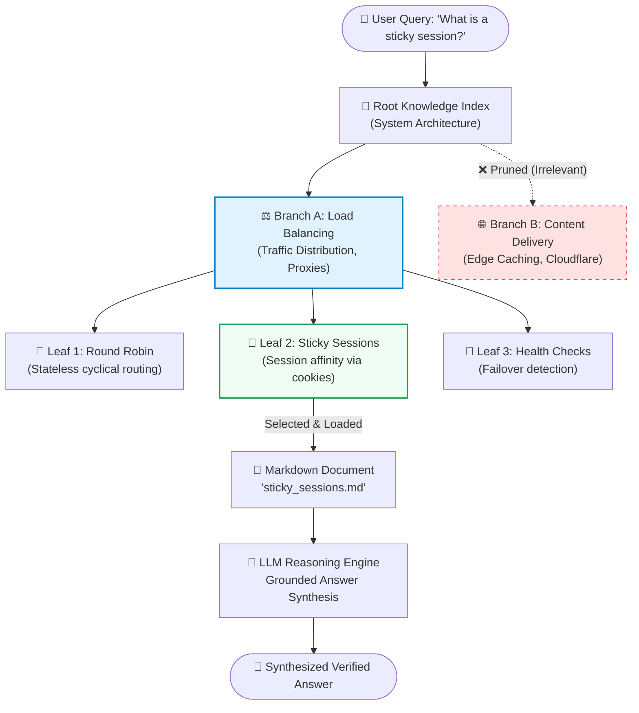

# 09 — Vectorless RAG: Reasoning-Based Trees, LLM Wikis & Graph Traversal

> **Cohort Series**: Generative AI Notes  
> **Topic**: Why "Vector RAG is Flawed" (Abrupt Chunking, Update Contradictions, Blindness to Global Context), The Rise of Vectorless RAG (LLM Wikis, Tree/Graph Traversal, PageIndex), The Cricketer Update Problem, Tree Search Pruning (The Sticky Sessions Case Study), Real-Time Voice Streaming Pipelines (STT ➔ TTS ➔ Tripwires), and the Real Cost Breakdown ($0.02 vs $1.00).  
> **Core Mental Model**: *"Instead of slicing books into blind mathematical vector confetti, organize knowledge like a human Wikipedia tree and let the LLM reason its way down the branches."*

---

## 🧭 1. The Controversy: "Is Vector RAG Dead?"

Between 2021 and 2023, the entire AI industry rallied behind one formula:  
$$\text{Chunk Text} \longrightarrow \text{Embed to Floats} \longrightarrow \text{Store in Vector DB} \longrightarrow \text{Cosine Similarity Search}$$

It worked as a flashy demo, but in serious enterprise production, engineers ran straight into the **3 Fatal Flaws of Vector RAG**:

```
┌────────────────────────────────────────────────────────────────────────────────────────┐
│                              THE 3 FATAL FLAWS OF VECTOR RAG                           │
├──────────────────────────┬─────────────────────────────────────────────────────────────┤
│ 1. Abrupt Chunking       │ Blindly slicing documents every 500 tokens cuts sentences, │
│    & Context Murder      │ tables, code blocks, and logical ideas in half.             │
├──────────────────────────┼─────────────────────────────────────────────────────────────┤
│ 2. The Update Problem    │ Vector DBs cannot "update" knowledge like humans do; they   │
│    (Colliding Truths)    │ accumulate conflicting historical vectors forever.          │
├──────────────────────────┼─────────────────────────────────────────────────────────────┤
│ 3. Global Context Blind  │ Vector search cannot answer: "What are the 5 core themes of │
│                          │ this 400-page book?" (It only matches localized phrases).   │
└──────────────────────────┴─────────────────────────────────────────────────────────────┘
```

---

### The "Cricketer Update" Dilemma (Why Vectors Accumulate Contradictions)

Imagine how knowledge evolves over time:

#### In a Vector Database:
1. In 2020, you index an article:  
   `[Chunk A: "Virat Kohli is the best batsman in the world."]` $\longrightarrow$ Stored as Vector `[0.12, 0.88, ...]`
2. In 2024, you index a new article:  
   `[Chunk B: "Rohit Sharma is the best batsman in the world."]` $\longrightarrow$ Stored as Vector `[0.13, 0.87, ...]`
3. A user asks: *"Who is the best batsman in the world?"*
4. **The Disaster**: Cosine similarity matches **both Chunk A and Chunk B** because mathematically they are 99% identical in meaning! The vector DB returns both to the LLM, and the model either contradicts itself or hallucinates a confusing mashup.

```
═══════════════════════════════════════════════════════════════════════════════════════════════
                      VECTOR DB vs. VECTORLESS WIKI UPDATE
═══════════════════════════════════════════════════════════════════════════════════════════════

   VECTOR DB (Accumulates Junk Chunks)        VECTORLESS LLM WIKI (Human-Like Synthesis)
  ┌───────────────────────────────────┐      ┌───────────────────────────────────┐
  │ [2020] "X is the best cricketer"  │      │ [Updated Node: Cricket_Rankings]  │
  │ [2024] "Y is the best cricketer"  │      │                                   │
  │                                   │      │ "Historically, X was recognized   │
  │ Result: Two competing vectors in  │ ───> │  as the best until 2023, when Y   │
  │ the same collection. Cosine search│      │  surpassed him in 2024."          │
  │ returns both. LLM gets confused!  │      │                                   │
  └───────────────────────────────────┘      │ Result: 1 Truth. Fully unified!   │
                                             └───────────────────────────────────┘
```

#### How Humans (and Vectorless RAG) Solve This:
When a human edits Wikipedia, they don't paste a new paragraph at the bottom that contradicts paragraph 1. They **read the existing document, modify the facts, and reconcile the timeline**:  
> *"Historically, X held the title of best batsman until 2023; in 2024, Y took over the title."*

Vectorless RAG treats documents as **living, structured knowledge pages (an LLM Wikipedia)** instead of static bags of numbers.

---

## 🌳 2. What is Vectorless RAG? (The LLM OS & Knowledge Trees)

As highlighted by AI pioneer **Andrej Karpathy**, thinking of an LLM as a chatbot is too small. Think of the LLM as the **CPU of a new Operating System**:
* RAM = The Context Window
* Hard Drive = Structured Markdown Files / Knowledge Trees
* File System Navigation = The LLM reasoning across folders and hierarchy nodes

Instead of converting raw text into float arrays, **Vectorless RAG** builds a **Hierarchical Decision Tree** (like a book's Table of Contents or a structured Markdown directory):

```
                                      ROOT (R)
                                  [All Knowledge]
                                         │
                    ┌────────────────────┴────────────────────┐
                    ▼                                         ▼
            [ Load Balancers ]                       [ Content Delivery ]
             (LB Concepts)                              (CDN / Caching)
                    │                                         │
         ┌──────────┴──────────┐                              ▼
         ▼                     ▼                       [ Edge Caching ]
  [ Round Robin ]      [ Sticky Sessions ]             [ TTL Invalidation ]
```

### The Standard Markdown Node Format:
Every document or subtopic is stored as a clean, standardized Markdown file containing structured frontmatter:

```markdown
---
title: "Sticky Sessions in Application Load Balancers"
category: "Infrastructure / Load Balancing"
summary: "Session affinity mechanism binding client requests to specific backend instances."
path: ["infrastructure", "networking", "load_balancers", "sticky_sessions.md"]
related_nodes: ["round_robin.md", "distributed_redis_sessions.md"]
---

# Sticky Sessions (Session Affinity)
Sticky sessions ensure that all requests from a specific user session are consistently 
routed to the exact same backend server instance...
```

---

## 🔍 3. The Tree Traversal Engine (Reasoning Over Vectors)

When a user asks a question, we don't calculate cosine dot-products. We perform an **LLM-Guided Tree Traversal (Branch Pruning)**:



### Step-by-Step Traversal Walkthrough

```
═══════════════════════════════════════════════════════════════════════════════════════════════
                      HOW VECTORLESS TREE TRAVERSAL WORKS
═══════════════════════════════════════════════════════════════════════════════════════════════

 User Query: "What is a sticky session and when should I use it?"
                     │
                     ▼
 ┌────────────────────────────────────────────────────────────────────────┐
 │ LEVEL 1: ROOT NODE EVALUATION                                          │
 │ The LLM inspects top-level categories:                                │
 │   Branch A: [Load Balancers & Traffic Routing]                         │
 │   Branch B: [Content Delivery Networks & Edge Caching]                 │
 │                                                                        │
 │ REASONING: "Sticky sessions relate to server affinity, not CDNs."     │
 │ DECISION: PRUNE Branch B ❌  |  EXPLORE Branch A ✅                    │
 └────────────────────────────────────────────────────────────────────────┘
                     │
                     ▼
 ┌────────────────────────────────────────────────────────────────────────┐
 │ LEVEL 2: SUB-TOPIC DRILL-DOWN                                          │
 │ The LLM inspects children of Branch A:                                 │
 │   Leaf 1: [Round Robin Algorithm]                                      │
 │   Leaf 2: [Sticky Sessions / Session Affinity]                         │
 │   Leaf 3: [Health Checks & Failover]                                   │
 │                                                                        │
 │ REASONING: "Leaf 2 matches the user's exact query target."             │
 │ DECISION: SELECT Leaf 2 ✅                                             │
 └────────────────────────────────────────────────────────────────────────┘
                     │
                     ▼
 ┌────────────────────────────────────────────────────────────────────────┐
 │ LEVEL 3: TARGET DOCUMENT RETRIEVAL & SYNTHESIS                        │
 │ Read 'sticky_sessions.md' ──> Pass to LLM ──> Synthesize rich response! │
 └────────────────────────────────────────────────────────────────────────┘
```

### Why Tree Traversal Beats Vector Search:
1. **Zero Irrelevant Noise**: By pruning Branch B (CDN), we never accidentally pull in chunks about CDN cache cookies that confuse the prompt.
2. **Deterministic & Explainable**: We know the exact path traversed: `Root ➔ Load Balancers ➔ Sticky Sessions`.
3. **Hierarchy Awareness**: The leaf node inherits the context of its parent (`Load Balancers`).

---

## ⚙️ 4. System Design Concept: What is a "Sticky Session"?

In a modern web architecture, you have multiple backend servers behind a Load Balancer (ELB/Nginx):

```
                       User (Browser)
                             │
                             ▼
                   [ Application Load Balancer ]
                             │
            ┌────────────────┼────────────────┐
            ▼                ▼                ▼
       [ Server 1 ]     [ Server 2 ]     [ Server 3 ]
       (User Login)     (Empty State)    (Empty State)
```

### The Problem Without Sticky Sessions:
1. **Request 1**: User logs in. The Load Balancer routes them to **Server 1**. Server 1 creates an in-memory session.
2. **Request 2**: User clicks *"View Cart"*. The Load Balancer uses Round-Robin and routes them to **Server 2**.
3. **Server 2** has never seen this user before! It says: *"Who are you? Please log in again."*

### The Solution: Sticky Sessions (Session Affinity):
* When the user first visits, the Load Balancer assigns a special **cookie** (e.g., `AWSALB=Server-1`).
* On every subsequent request, the browser sends this cookie.
* The Load Balancer reads the cookie and **"sticks" the user to Server 1** for the duration of their session.

---

## 💰 5. The Real Cost Breakdown: Vector RAG vs. Vectorless RAG

Why hasn't everyone switched to Vectorless RAG? **Cost and Latency.**

```
┌─────────────────────────────────────────────────────────────────────────────────────────┐
│                                COST & LATENCY COMPARISON                                │
├────────────────────────────┬─────────────────────────────┬──────────────────────────────┤
│ METRIC                     │ VECTOR RAG (Standard)       │ VECTORLESS RAG (Tree/Wiki)   │
├────────────────────────────┼─────────────────────────────┼──────────────────────────────┤
│ Indexing Cost              │ 🟢 Very Cheap (~$0.50)      │ 🔴 Extremely High (~$50-$100)│
│                            │ (Only calls embedding model)│ (LLM reads & structures all) │
├────────────────────────────┼─────────────────────────────┼──────────────────────────────┤
│ Query Cost                 │ 🟢 ~$0.005 – $0.02          │ 🔴 ~$0.50 – $2.00 per query  │
│                            │ (1 embedding + 1 prompt)    │ (Multiple reasoning loops)   │
├────────────────────────────┼─────────────────────────────┼──────────────────────────────┤
│ Query Latency              │ ⚡ 300ms – 1s               │ 🐢 3s – 10s (Tree traversal) │
├────────────────────────────┼─────────────────────────────┼──────────────────────────────┤
│ Accuracy on Complex Topics │ ⚠️ 65% – 75% (Noisy Chunks) │ 🎯 95% – 99% (Surgical)      │
├────────────────────────────┼─────────────────────────────┼──────────────────────────────┤
│ Global Context Synthesis   │ ❌ Terrible                 │ 🌟 Flawless                  │
└────────────────────────────┴─────────────────────────────┴──────────────────────────────┘
```

### The Whiteboard Math:
* If you have **10,000 active users** making **4 queries/day** = **40,000 queries/day**.
  * **Vector RAG**: $40,000 \times \$0.01 = \mathbf{\$400/\text{day}}$
  * **Vectorless RAG**: $40,000 \times \$1.00 = \mathbf{\$40,000/\text{day}}$ (Astronomical for consumer apps!)
* **Enterprise Rule of Thumb**:
  * Use **Vector RAG** for high-volume, low-margin search (customer support FAQs, public search bars).
  * Use **Vectorless / Reasoning RAG** for high-stakes, zero-error enterprise intelligence (legal contracts, medical diagnostics, code refactoring).

---

## 📑 6. PageIndex: Reasoning-Based Document Indexing

**PageIndex** is a prominent implementation of vectorless, reasoning-based retrieval:

```
    [ 300-Page PDF Manual ]
              │
              ▼
   [ Background LLM Worker ] ──> Parses Document Layout & Table of Contents
              │
              ▼
   [ Hierarchical PageIndex ]
   ├── Chapter 1: Introduction (Pages 1-15)
   │     └── Summary: High-level overview of distributed architecture...
   ├── Chapter 2: Networking & Ingress (Pages 16-65)
   │     ├── Section 2.1: DNS Resolution (Pages 16-30)
   │     └── Section 2.2: Load Balancing (Pages 31-65)
   │           └── Subsection 2.2.4: Sticky Sessions (Pages 45-52)
   └── Chapter 3: Storage (Pages 66-120)
```

Instead of embedding every paragraph, PageIndex stores **Summaries and Boundaries**.  
When asked about sticky sessions:
1. The LLM queries the metadata: `SELECT section, pages FROM page_index WHERE topic = 'sticky sessions'`.
2. It jumps directly to **Pages 45–52**.
3. It extracts only those exact pages into the context window. Zero vector distance math required!

---

## 🎙️ 7. Real-Time Streaming & Audio Queues 

When building voice agents (Speech-to-Text $\longrightarrow$ RAG $\longrightarrow$ Text-to-Speech), normal RAG latencies (3–5 seconds) feel broken to humans. Conversations require **sub-500ms response times**.

```
═══════════════════════════════════════════════════════════════════════════════════════════════
                 REAL-TIME STREAMING VOICE RAG (THE 30-SECOND EVENT LOOP)
═══════════════════════════════════════════════════════════════════════════════════════════════

 [ User Audio ] ──> STT (Whisper Stream) ──> {Query Text}
                                                  │
                                                  ▼
                                       ┌───────────────────────┐
                                       │ Sentence Streaming    │
                                       │ Engine (Tripwires)    │
                                       └───────────────────────┘
                                                  │
                 ┌────────────────────────────────┴────────────────────────────────┐
                 ▼                                                                 ▼
   [ Fast In-Memory Queue (Redis) ]                              [ Asynchronous Background Worker ]
   • Streams first 5 words immediately                            • BullMQ / RabbitMQ
   • Pushes PCM audio chunks to TTS                               • Processes heavy HyDE & Sub-Queries
   • Perceived latency < 400ms!                                   • Updates long-term tree memory
```

### What is a "Tripwire" in Streaming?
If a user interrupts or asks a sensitive question while audio is streaming:
* A **Tripwire** is a lightweight token monitor running inside the stream.
* If it detects an interruption, safety violation, or topic pivot, it immediately **cuts the TTS audio stream** and dumps the queue, resetting the conversation loop without lag.

---

## 💻 8. Code Implementation: Tree Traversal RAG in Node.js

Here is a functional implementation of a Vectorless Tree Traversal search engine in Node.js:

```javascript
import OpenAI from "openai";

const openai = new OpenAI();

// 1. The Hierarchical Knowledge Tree (Stored in Memory / JSON / Postgres)
const knowledgeTree = {
  id: "root",
  name: "System Architecture",
  children: [
    {
      id: "networking",
      name: "Networking & Traffic Management",
      description: "Load balancers, reverse proxies, sticky sessions, and DNS routing.",
      children: [
        {
          id: "sticky_sessions",
          name: "Sticky Sessions (Session Affinity)",
          description: "Binding client requests to specific backend servers using session cookies.",
          content: `Sticky sessions (session affinity) ensure that all requests from a specific user 
are directed to the same target server instance for the duration of their session. 
This is crucial for stateful legacy applications that store session data in local server memory.`,
        },
        {
          id: "round_robin",
          name: "Round Robin Load Balancing",
          description: "Distributing requests sequentially across a pool of available servers.",
          content: `Round Robin is a stateless load balancing algorithm that distributes traffic evenly 
in a cyclical order. It works best for stateless microservices.`,
        },
      ],
    },
    {
      id: "cdn_caching",
      name: "Content Delivery Networks (CDNs)",
      description: "Edge caching, static asset distribution, and cache invalidation.",
      children: [
        {
          id: "edge_cache",
          name: "Edge Cache Invalidation",
          description: "Techniques for purging outdated static content from global points of presence.",
          content: `Edge cache invalidation purges stale assets from CDN nodes using TTLs, cache tags, or instant purge APIs.`,
        },
      ],
    },
  ],
};

// 2. The Decision-Tree Router (Prunes Non-Matching Branches)
async function traverseTree(node, userQuery) {
  // If we reached a leaf node with content, return it!
  if (node.content) {
    return node;
  }

  // Ask LLM to pick the single most relevant child branch
  const choices = node.children.map((c) => ({
    id: c.id,
    name: c.name,
    description: c.description,
  }));

  const response = await openai.chat.completions.create({
    model: "gpt-4o-mini",
    temperature: 0,
    messages: [
      {
        role: "system",
        content: `You are a tree search navigator. Given a user query and a list of category branches,
pick the single branch ID that contains the answer.
Output JSON: { "selectedBranchId": string, "reasoning": string }`,
      },
      {
        role: "user",
        content: `Query: "${userQuery}"\nBranches: ${JSON.stringify(choices, null, 2)}`,
      },
    ],
    response_format: { type: "json_object" },
  });

  const decision = JSON.parse(response.choices[0].message.content);
  console.log(`[Tree Traversal] At '${node.name}' ➔ Selected '${decision.selectedBranchId}': ${decision.reasoning}`);

  const nextNode = node.children.find((c) => c.id === decision.selectedBranchId);
  if (!nextNode) {
    throw new Error(`Branch ${decision.selectedBranchId} not found.`);
  }

  // Recursively drill down the chosen branch!
  return traverseTree(nextNode, userQuery);
}

// 3. Execution
async function run() {
  const query = "What is a sticky session and why do stateful apps need it?";
  console.log(`\n🔍 Searching without vectors for: "${query}"\n`);

  const matchedLeaf = await traverseTree(knowledgeTree, query);

  console.log("\n🎯 Target Leaf Found:", matchedLeaf.name);
  console.log("📄 Content Retrieved:\n", matchedLeaf.content);
}

run();
```

---

## ⚡ 9. Summary & Cheat Sheet Matrix

| Feature             | Naive Vector RAG            | Advanced Vector RAG           | Vectorless / Wiki RAG                     |
| :------------------ | :-------------------------- | :---------------------------- | :---------------------------------------- |
| **Data Format**     | Blind token chunks          | Hybrid chunks + Parent/Child  | Hierarchical Markdown Tree / Graphs       |
| **Search Engine**   | Cosine Similarity           | BM25 + Vector + Cross-Encoder | LLM Reasoning & Tree Traversal            |
| **Fact Updates**    | Appends conflicting vectors | Replaces chunks via IDs       | Rewrites & reconciles node facts          |
| **Context Quality** | Fragmented                  | Good                          | Pristine & Whole                          |
| **Query Cost**      | $0.005                      | $0.02                         | $0.50 – $2.00                             |
| **Latency**         | ~300ms                      | ~1.2s                         | ~4s – 8s                                  |
| **Best Used For**   | Fast FAQ searches           | Broad enterprise knowledge    | High-stakes legal, medical & architecture |
