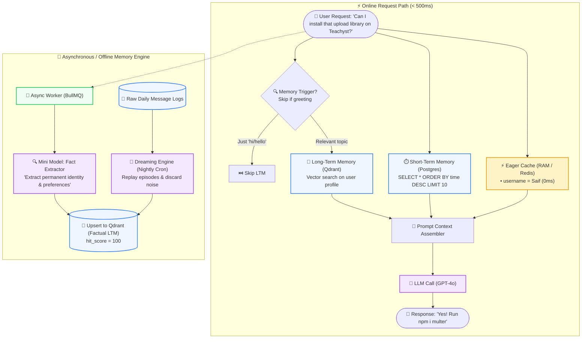

# 10 — Memory in AI Agents: Short-Term, Long-Term, Episodic & The Dreaming Engine

> **Cohort Series**: Generative AI Notes  
> **Topic**: Why LLMs are 100% Stateless Functions, The Naive Array Trap (Network Bloat, `JSON.parse` Freezes, 3,000 Message Crash), Short-Term Memory (Sliding Windows in SQL), Long-Term Memory (Factual vs. Episodic), The "Hi/Hello" Problem, Eviction Policies (Hit-Rate Scoring), Eager Loading Caches, Graph Memory (Neo4j), and The "Dreaming Engine" (Memory Consolidation).  
> **Core Mental Model**: *"LLMs are completely stateless APIs. Human brains are not. Building memory for AI is not magic—it is a distributed systems engineering problem of caching, time-series indexing, eviction, and consolidation."*

---

## 🧭 1. The Core Nature of LLMs: Stateless Functions & The Naive Array Trap

Every time you call an LLM (whether GPT-4o, Claude 3.5, or Llama 3):
$$\text{POST } \texttt{https://api.openai.com/v1/chat/completions}$$

The LLM is a **pure, stateless mathematical function**. It has **zero RAM**, zero persistent disk, and zero memory of who you are or what you said 2 seconds ago.

```
       Turn 1: "Hi, my name is Saif."   ───> [ LLM ] ───> "Hello Saif!"
       Turn 2: "What is my name?"          ───> [ LLM ] ───> "I don't know your name."
```

---

### The Beginner's Naive Fix: The Bloated Messages Array

To create the illusion of memory, beginner tutorials tell developers to store an array and keep appending to it:

```javascript
// NAIVE APPROACH
const messages = [];

// Turn 1
messages.push({ role: "user", content: "My name is Saif" });
const res1 = await callLLM(messages);
messages.push({ role: "assistant", content: res1 });

// Turn 2
messages.push({ role: "user", content: "What is my name?" });
const res2 = await callLLM(messages); // Sends all previous turns!
```

```
┌─────────────────────────────────────────────────────────────────────────────────────────┐
│                        THE 3,000-MESSAGE NAIVE ARRAY CRASH                              │
└─────────────────────────────────────────────────────────────────────────────────────────┘

 User Message #3,001 ──> App attempts to JSON.stringify & transmit 3,000 messages!
                                       │
            ┌──────────────────────────┼──────────────────────────┐
            ▼                          ▼                          ▼
   [ NETWORK BOTTLENECK ]     [ EVENT LOOP FREEZE ]      [ FINANCIAL EXPLOSION ]
   • Payload size: 5MB–10MB   • Node.js JSON.parse()     • 3,000 messages = ~150k
   • High latency on every      blocks the single          tokens per API call!
     single HTTP click.         thread event loop.       • Costs $1.50 per "hello".
```

### The 4 Fatal Flaws of the Naive Array:
1. **Payload Explosion**: At message 3,000, sending the entire transcript over HTTP adds seconds of network latency.
2. **CPU Starvation**: Parsing megabyte-sized JSON arrays on every request freezes the Node.js event loop.
3. **Astronomical Token Cost**: You pay for every past message on **every single click**. Chatting for 2 weeks burns thousands of dollars.
4. **Attention Degradation ("Lost in the Middle")**: When context reaches 100,000+ tokens, LLMs start ignoring facts buried in the middle of the chat history.

---

## ⏱️ 2. Short-Term Memory (STM): The Sliding Window

The first production optimization is **Short-Term Memory (STM)** using a **Sliding Window**.

```
═══════════════════════════════════════════════════════════════════════════════════════════════
                         SHORT-TERM MEMORY: SLIDING WINDOW
═══════════════════════════════════════════════════════════════════════════════════════════════

 PostgreSQL: `messages` Table (Stores 10,000 lifetime messages for audit)
 ┌─────────┬──────────────┬────────────┬─────────────────────────────┬────────────────────────┐
 │ msg_id  │ conv_id      │ role       │ content                     │ created_at             │
 ├─────────┼──────────────┼────────────┼─────────────────────────────┼────────────────────────┤
 │ 1042    │ conv_abc     │ user       │ "How do I install multer?"  │ 2026-10-14 10:15:00    │
 │ 1043    │ conv_abc     │ assistant  │ "Run npm install multer..." │ 2026-10-14 10:15:02    │
 └─────────┴──────────────┴────────────┴─────────────────────────────┴────────────────────────┘
                                          │
                                          ▼
                      SLIDING WINDOW RETRIEVAL (Last 10 Messages)
                      SELECT role, content FROM messages 
                      WHERE conv_id = 'conv_abc' 
                      ORDER BY created_at DESC LIMIT 10;
                                          │
                                          ▼
                      Reversed Chronologically ──> Injected into LLM Context!
```

### The Limitation of STM Alone:
If your sliding window is `LIMIT 10`:
* In Turn 1, the user says: *"My name is Saif and I am a backend architect."*
* 15 messages later, the user asks: *"What is my name?"*
* **The name has slid out of the window!** The database still has it, but the LLM cannot see it.

---

## 🧠 3. Long-Term Memory (LTM): Designing the Human Brain

When you meet your best friend for coffee, your brain does **not** load a verbatim transcript of all 10,000 sentences you spoke over the last 5 years.
* You remember **Key Distilled Facts**: his name, his allergies, his car, his anniversary.
* Even though he didn't state his name in today's 10-minute chat, you know it instantly!



### Detailed ASCII Architecture Map

```
═══════════════════════════════════════════════════════════════════════════════════════════════
                 THE DUAL-ENGINE ARCHITECTURE: STM + LTM TOGETHER
═══════════════════════════════════════════════════════════════════════════════════════════════

 User Query: "Can I install that upload library on Teachyst?"
                     │
                     ├─────────────────────────────────────────┐
                     ▼                                         ▼
   [ Short-Term Memory (Postgres) ]             [ Long-Term Memory (Qdrant) ]
   SELECT * FROM messages                       Search vector embeddings for
   ORDER BY time DESC LIMIT 10;                 relevant user profile facts:
   (Yields: "that upload library" = multer)     (Yields: "Teachyst runs Node.js 20")
                     │                                         │
                     └────────────────────┬────────────────────┘
                                          ▼
                           PROMPT AUGMENTATION & GROUNDING
                           "You are an assistant.
                            USER FACTS:
                            - User is developing 'Teachyst' (Node.js/Express)
                            
                            RECENT CONVERSATION:
                            - User: How do I handle file uploads?
                            - Assistant: Use multer.
                            
                            CURRENT QUESTION: Can I install that upload library on Teachyst?"
                                          │
                                          ▼
                           [ LLM Call (GPT-4o) ] ──> "Yes! Run npm i multer in Teachyst."
```

---

## 🪤 4. The "Hi / Hello" Problem: When NOT to Search Memory

A massive architectural mistake junior developers make is:  
**Querying the vector DB and stuffing 50 Long-Term Memory facts on every single message.**

```
User says: "Hi!"
Agent injects:
- User is 27 years old
- User drives a Mahindra Thar
- User's favorite food is Butter Chicken
- User was born in Delhi
Agent responds: "Hello Saif! Happy 27th year! How is your Mahindra Thar and butter chicken?"
```
* **It feels creepy and robotic.**
* When a human says *"Hi"*, your brain doesn't search your memory for their blood type or favorite pizza.
* You only activate memory when the **conversation topic demands it**.

### The Solution: Triggered & Agentic Memory Retrieval
1. **Keyword / Intent Trigger**: If message is greeting (`"hi"`, `"good morning"`), bypass LTM search entirely.
2. **Semantic Similarity Threshold**: Only inject facts if the cosine similarity score is $\ge 0.82$.
3. **Agentic Memory Tools**: Give the model a tool: `search_user_memory({ query: "car details" })`. The model decides when to fetch memory!

---

## 🏛️ 5. The Two Pillars of Long-Term Memory: Factual vs. Episodic

Human cognitive psychology splits memory into two distinct systems. Modern AI agent memory architectures (like Mem0 and MemGPT) mirror this exact structure:

```
                                  LONG-TERM MEMORY (LTM)
                                            │
                     ┌──────────────────────┴──────────────────────┐
                     ▼                                             ▼
          [ FACTUAL MEMORY ]                             [ EPISODIC MEMORY ]
          (Semantic / Identity)                          (Events / Time-Series)
  ┌─────────────────────────────────────┐        ┌─────────────────────────────────────┐
  │ • Permanent facts about entities    │        │ • Time-stamped event log of past    │
  │ • "Saif is 27 years old"          │        │   experiences and actions           │
  │ • "Saif drives a Mahindra Thar"   │        │ • "In 2024, user went to the US"    │
  │ • Stored in Vector DB / Graph DB    │        │ • "In 2025, user built Teachyst"    │
  │ • Search: Vector Cosine Similarity  │        │ • Search: Vector + Time-Window      │
  └─────────────────────────────────────┘        └─────────────────────────────────────┘
```

```
┌─────────────────────────────────────────────────────────────────────────────────────────┐
│                               FACTUAL vs. EPISODIC MEMORY                               │
├──────────────────────────┬─────────────────────────────┬────────────────────────────────┤
│ DIMENSION                │ FACTUAL MEMORY              │ EPISODIC MEMORY                │
├──────────────────────────┼─────────────────────────────┼────────────────────────────────┤
│ Nature of Data           │ Declarative attributes      │ Chronological event streams    │
│ Storage Model            │ Key-Value / Vector / Graph  │ Immutable Append-Only Log      │
│ Query Pattern            │ Semantic Search (Cosine)    │ Vector + Time-Window Filter    │
│ Update Mechanism         │ Upsert / Reconcile facts    │ Never overwrite; append event  │
│ Example Query            │ "What car does the user own?"│ "What did I work on last May?" │
└──────────────────────────┴─────────────────────────────┴────────────────────────────────┘
```

---

## 🌙 6. The "Dreaming Engine" (Memory Consolidation)

How does a human brain turn daily experiences into long-term knowledge?  
**Through Sleep (Memory Consolidation).**  
During deep sleep, the hippocampus replays the day's raw events, discards 90% of the useless noise, and transfers distilled knowledge to the neocortex as permanent facts.

```
═══════════════════════════════════════════════════════════════════════════════════════════════
                   THE DREAMING ENGINE: OFFLINE MEMORY CONSOLIDATION
═══════════════════════════════════════════════════════════════════════════════════════════════

 Raw Daily Chat Logs ──> [ BullMQ / Redis Queue ] (Runs at 2:00 AM Cron)
                               │
                               ▼
                   ┌───────────────────────┐
                   │  Mini Evaluator LLM   │ ──> "Dreaming / Replay Phase"
                   │  (Fact Extractor)     │
                   └───────────────────────┘
                               │
             ┌─────────────────┴─────────────────┐
             ▼                                   ▼
   DISCARD NOISE                       DISTILL PERMANENT FACTS
   • "Where is the button?"            • "User uses Mac OS Sonoma"
   • "Thanks, bye!"                    • "User prefers TypeScript over JS"
   • "Can you check line 4?"           • "User is founder of Teachyst"
                                                 │
                                                 ▼
                                       [ Upsert to Factual LTM ]
                                       (Qdrant / Postgres Graph)
```

---

## ⚡ 7. Production Optimizations: Eager Loading & Eviction Policies

### 1. Eager Loading (Zero-Latency Cache)
Certain memories have an astronomical hit-rate:
* `user_name` (Hit rate: 98%)
* `user_timezone` (Hit rate: 95%)
* `active_project_id` (Hit rate: 90%)

Instead of running a vector search on every query, **eager-load these top-hit memories into Redis or in-memory RAM** when the user session connects. They are injected into the prompt in **0 milliseconds**!

### 2. Eviction Policy (LRU + Hit-Rate Scoring)
Over 6 months, a user accumulates 500+ memory points. If you search all 500, vector DB latency increases and stale memories pollute the prompt.

$$\text{Memory Retention Score} = (\text{Hit Count} \times 0.4) + (\text{Recency Weight} \times 0.4) + (\text{Importance Score} \times 0.2)$$

```
                                  EVICTION ENGINE
                                         │
        ┌────────────────────────────────┴────────────────────────────────┐
        ▼                                                                 ▼
 HIGH HIT-RATE / RECENT                                          LOW HIT-RATE / STALE
 • "User is allergic to peanuts"                                 • "User bought bread in 2023"
 • Hit score: 95 | Keep in LTM!                                  • Hit score: 1 | EVICT & DELETE!
```

---

## 🕸️ 8. Knowledge Graph Memory (Neo4j / Cypher BFS)

Vector embeddings know that words are related, but they do **not** understand relationship hierarchies.  
For complex organizational or personal memories, enterprise agents use **Knowledge Graphs**:

```
                       (Saif:Person)
                        │           │
           WORKS_ON     │           │    DRIVES
      ┌─────────────────┘           └─────────────────┐
      ▼                                               ▼
 (Teachyst:Startup)                             (Mahindra Thar:Vehicle)
      │                                               │
      │ BUILT_WITH                                    │ FUEL_TYPE
      ▼                                               ▼
 (Node.js:Technology)                           (Diesel:Fuel)
```

When the user asks: *"What fuel does my car use?"*:
1. Graph search looks up entity `(Saif)`.
2. Follows edge `DRIVES ➔ (Mahindra Thar)`.
3. Follows edge `FUEL_TYPE ➔ (Diesel)`.
4. Returns exact factual traversal with **zero vector hallucinations**!

---

## 💻 9. Code Implementation: Complete Agent Memory in Node.js

Here is a production-grade memory module implementing Short-Term Memory (Sliding Window), Background Fact Extraction, and Eager Loading:

```javascript
import OpenAI from "openai";

const openai = new OpenAI();

// In-Memory Database Simulation
const database = {
  messages: [], // Postgres table: { id, role, content, timestamp }
  factualMemory: new Map(), // Vector DB / Redis: { key, fact, hitScore }
};

// 1. SHORT-TERM MEMORY: Sliding Window
function getShortTermMemory(conversationId, limit = 6) {
  return database.messages
    .filter((m) => m.conversationId === conversationId)
    .slice(-limit); // Last N turns
}

// 2. EAGER LOADING: Retrieve Top Identity Facts (< 1ms)
function getEagerLoadedMemory(userId) {
  const profile = [];
  for (const [key, record] of database.factualMemory.entries()) {
    if (record.hitScore > 50) {
      profile.push(record.fact);
    }
  }
  return profile;
}

// 3. BACKGROUND FACT EXTRACTOR (Few-Shot Parsing)
async function extractLongTermMemory(userMessage) {
  const response = await openai.chat.completions.create({
    model: "gpt-4o-mini",
    temperature: 0,
    messages: [
      {
        role: "system",
        content: `You are a memory extraction engine. Analyze the user statement.
If it contains a permanent fact about identity, preferences, or relationships, extract it.
If it is just casual chatter or temporary questions, return {"hasFact": false}.
Output JSON: { "hasFact": boolean, "factKey": string, "fact": string }`,
      },
      { role: "user", content: userMessage },
    ],
    response_format: { type: "json_object" },
  });

  const parsed = JSON.parse(response.choices[0].message.content);
  if (parsed.hasFact) {
    console.log(`🧠 [LTM Stored] ${parsed.factKey}: "${parsed.fact}"`);
    database.factualMemory.set(parsed.factKey, {
      fact: parsed.fact,
      hitScore: 100,
      timestamp: Date.now(),
    });
  }
}

// 4. MAIN AGENT EXECUTION
async function chat(userQuery, conversationId = "conv_1") {
  // A. Record user query
  database.messages.push({ role: "user", content: userQuery, conversationId });

  // B. Eager-load core facts & fetch sliding window
  const eagerFacts = getEagerLoadedMemory("user_123");
  const shortTermHistory = getShortTermMemory(conversationId, 6);

  // C. Assemble prompt
  const systemPrompt = `You are a personal AI assistant.
KNOWN USER FACTS:
${eagerFacts.map((f) => `• ${f}`).join("\n") || "No profile facts known yet."}

Answer concisely.`;

  const completion = await openai.chat.completions.create({
    model: "gpt-4o-mini",
    messages: [
      { role: "system", content: systemPrompt },
      ...shortTermHistory.map((m) => ({ role: m.role, content: m.content })),
    ],
  });

  const reply = completion.choices[0].message.content;
  database.messages.push({ role: "assistant", content: reply, conversationId });

  // D. Asynchronously extract memory in background (zero user latency!)
  extractLongTermMemory(userQuery).catch(console.error);

  return reply;
}

// --- Verification Simulation ---
async function runDemo() {
  console.log("Turn 1:", await chat("Hey, my name is Saif and I drive a red Thar."));
  console.log("\n--- (Simulating 20 messages pass, sliding window flushes) ---\n");
  
  // Wipe short-term window to simulate time lapse
  database.messages = [];

  console.log("Turn 2:", await chat("What is my name and what vehicle do I drive?"));
}

runDemo();
```

---

## ⚡ 10. Summary Cheat Sheet Matrix

| Memory Layer | Storage Tech | Retrieval Speed | Lifetime | Purpose |
| :--- | :--- | :--- | :--- | :--- |
| **Short-Term (STM)** | PostgreSQL / Redis List | ⚡ < 5ms | Session / Window | Immediate conversation flow & pronoun resolution |
| **Factual LTM** | Qdrant / pgvector / Key-Value| 🚀 ~15ms | Permanent | Core identity, preferences & tools |
| **Episodic LTM** | Time-series Vector Store | 🔍 ~50ms | Multi-year | Historical event playback ("what happened last year?")|
| **Graph Memory** | Neo4j / Knowledge Graph | 🕸️ ~30ms | Permanent | Entity relationships (works on, owns, married to) |
| **Eager Cache** | In-Memory RAM / Redis | ⚡ 0ms | Session | Zero-cost injection of highest hit-rate facts |
