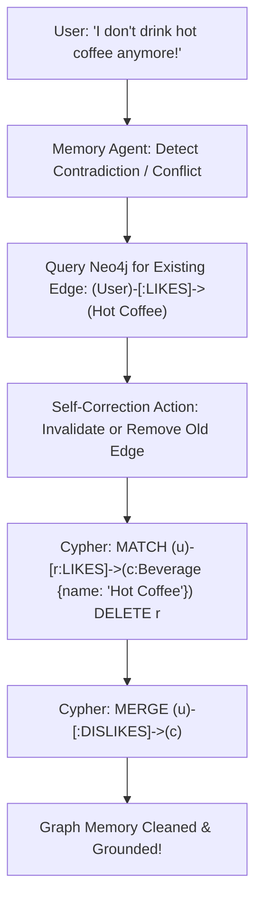

# 11 — Graph Databases, Cypher Queries & Knowledge Graph Memory in LLMs

> **Cohort Series**: Generative AI Notes  
> **Topic**: Why SQL & NoSQL Fail at Dynamic Multi-Hop Relationships, Native Graph Database Fundamentals (Nodes, Edges, Properties, BFS/DFS), Cypher Query Language Deep-Dive, Autonomous LLM Cypher Generation, Asynchronous Background Memory Pipelines in Node.js, Graph Complexity Challenges (The "Hairball" Problem), and The Self-Correction Invalidation Loop.  
> **Core Mental Model**: *"Relational tables join by scanning foreign keys; document stores embed by duplicating; Graph databases connect by pointer-hopping. For an AI agent to truly understand multi-hop human relationships ('Alice likes Jane, Jane drinks CCD coffee, recommend CCD to Alice'), Graph databases turn chaotic conversational memory into an interconnected, queryable web of truth."*

---

## 🧭 1. The Core Problem: Why SQL & NoSQL Fail at Conversational Memory

When building long-term memory for an AI companion, agent, or assistant, you need to store facts and relationships extracted from user conversations over weeks and months.

Consider this real-world human scenario from conversation history:
1. **Fact 1**: *"Alice likes Jane."*
2. **Fact 2**: *"Jane likes Hot Coffee."*
3. **Fact 3**: *"Hot Coffee is served at Cafe Coffee Day (CCD)."*
4. **Fact 4**: *"Alice hates generic restaurants, but wants a cafe to meet Jane."*

When Alice asks the AI: *"Where should I meet Jane for a catch-up?"*, a human assistant instantly reasons:
$$\text{Alice} \xrightarrow{\text{likes}} \text{Jane} \xrightarrow{\text{likes}} \text{Hot Coffee} \xrightarrow{\text{served\_at}} \text{CCD}$$
The AI should recommend: **"Take Jane to Cafe Coffee Day (CCD) for hot coffee!"**

Now, how do traditional databases handle this?

---

### Attempt 1: Relational SQL (Tables & Foreign Keys) ❌

In a relational database, you define rigid schemas ahead of time.

```
┌─────────────────────────────────────────────────────────────────────────────────────────┐
│                               THE SQL RELATIONSHIP BOTTLENECK                           │
└─────────────────────────────────────────────────────────────────────────────────────────┘

  TINDER SCENARIO (Homogeneous: User -> User)       AI AGENT MEMORY (Heterogeneous & Dynamic)
  ───────────────────────────────────────────       ─────────────────────────────────────────
  Works fine in SQL with a Join Table:              FAILS in SQL! What table connects to what?
  
  ┌─────────────┐       ┌─────────────┐             Jane (User Table)
  │  user_id_1  │ ────► │  user_id_2  │                    │ [LIKES]
  └─────────────┘       └─────────────┘                    ▼
  Simple Join: users JOIN matches                   Hot Coffee (Beverage Table)
  ON users.id = matches.user_id_2                          │ [AVAILABLE_AT]
                                                           ▼
                                                    CCD (Restaurant / Cafe Table)
```

#### Why SQL Breaks Down for Dynamic Agent Memory:
1. **Polymorphic Relationship Anti-Pattern**:
   In conversational AI, relationships are **heterogeneous** (connecting different types of things). To store this in SQL, developers often resort to a messy "Generic Mapping Table":
   ```sql
   -- Anti-pattern: The EAV / Polymorphic Join Table
   CREATE TABLE dynamic_relationships (
       id SERIAL PRIMARY KEY,
       from_table VARCHAR(50),  -- 'users'
       from_id VARCHAR(50),     -- 'alice_123'
       relation_type VARCHAR(50),-- 'LIKES'
       to_table VARCHAR(50),    -- 'beverages'
       to_id VARCHAR(50)        -- 'hot_coffee_42'
   );
   ```
   * **No Foreign Key Integrity**: PostgreSQL cannot enforce foreign keys across dynamic table names.
   * **Schema Rigidity**: If tomorrow the user mentions an airport, a flight, a hobby, or a book, you must alter schemas or add new tables.
2. **Exponential Join Explosion**:
   Finding a 4-hop connection (`Alice -> Jane -> Coffee -> CCD`) in SQL requires **4 recursive joins** or a complex `WITH RECURSIVE` Common Table Expression (CTE). With millions of rows, recursive SQL joins freeze the database engine ($O(N^k)$ complexity).

---

### Attempt 2: Document NoSQL (MongoDB) ❌

In MongoDB, you store documents inside collections. But conversational facts do not fit cleanly into hierarchical trees:

```javascript
// MongoDB Document: Alice
{
  "_id": "alice_1",
  "name": "Alice",
  "likes": [
    { "type": "person", "name": "Jane" }
  ]
}

// MongoDB Document: Jane
{
  "_id": "jane_2",
  "name": "Jane",
  "preferences": [
    { "item": "Hot Coffee", "source": "CCD" }
  ]
}
```

#### Why MongoDB Fails for Multi-Hop Graph Traversal:
1. **Data Duplication & Sync Anomalies**: If you embed Jane's coffee preference inside Alice's document, what happens when Jane stops drinking coffee? You now have stale, conflicting memory across dozens of documents.
2. **Horrendous `$lookup` Pipelines**: To traverse from Alice to Jane to Coffee to CCD, MongoDB must run multiple unindexed `$lookup` stages with `$unwind`, `$match`, and `$project`. This is computationally slow and memory-intensive for multi-hop graph queries.

---

### The Verdict: Enter Graph Databases (Neo4j) ⭐

Graph databases eliminate tables, foreign keys, and document nesting entirely. They treat **entities** and **relationships** as first-class citizens:

| Dimension | Relational (SQL) | Document (NoSQL) | Graph Database (Neo4j) |
| :--- | :--- | :--- | :--- |
| **Core Primitive** | Tables & Rows | Collections & Documents | **Nodes & Edges (Relationships)** |
| **Schema** | Rigid (Fixed upfront) | Flexible per document | **Completely Dynamic / Schema-Free** |
| **Relationships** | Expensive Foreign Key Joins | Embedded arrays or `$lookup` | **Native Direct Pointers (Index-Free Adjacency)** |
| **Query Mechanism** | `SELECT ... JOIN` | Aggregation Pipeline (`$match`, `$lookup`) | **Graph Traversal (Cypher: BFS / DFS)** |
| **Best For** | Financial transactions, fixed accounting | Unstructured catalogs, blogging | **Social networks, fraud detection, AI Agent Memory** |

---

## 🕸️ 2. Graph Database Fundamentals: Nodes, Edges & Index-Free Adjacency

```
┌─────────────────────────────────────────────────────────────────────────────────────────┐
│                              THE PROPERTY GRAPH DATA MODEL                              │
└─────────────────────────────────────────────────────────────────────────────────────────┘

        (:User {name: "Alice", age: 28})
           │                       │
           │ [LIKES]               │ [HATES]
           ▼                       ▼
   (:User {name: "Jane"})      (:Beverage {name: "Cold Tea"})
           │
           │ [LIKES]
           ▼
   (:Beverage {name: "Hot Coffee"})
           │
           │ [AVAILABLE_AT]
           ▼
   (:Brand {name: "Cafe Coffee Day", type: "Cafe"})
```

### 1. Nodes (The Nouns / Entities)
* A node represents an entity in the real world: a Person, a Product, a City, a Company, or a Concept.
* **Labels**: Categorize the node (e.g. `:User`, `:Beverage`, `:Brand`, `:Hotel`).
* **Properties**: Key-value pairs stored directly inside the node (e.g. `{ name: "Alice", age: 28 }`).

### 2. Edges / Relationships (The Verbs)
* Directed connections between two nodes: `(:User)-[:LIKES]->(:Beverage)`.
* **Direction**: Always directional (from Source $\rightarrow$ Target), but can be queried in either direction.
* **Relationship Type**: The category of connection (`[:LIKES]`, `[:WORKS_AT]`, `[:FRIEND_OF]`, `[:HATES]`).
* **Relationship Properties**: Edges can store data too! (e.g. `[:LIKES { since: 2024, intensity: "high" }]`).

### 3. The Secret Weapon: Index-Free Adjacency
In SQL, to find Jane's favorites, the engine searches a B-Tree index of foreign keys ($O(\log N)$).  
In a native Graph DB (like Neo4j), **each node stores direct physical memory pointers to its neighboring nodes**.
* Moving from `Alice` to `Jane` does **not** query an index. It simply follows a memory pointer!
* Graph traversal speed is **independent of the total database size**. Whether you have 1,000 nodes or 100,000,000 nodes, hopping 1 edge takes the same constant time ($O(1)$ pointer hop).
* Under the hood, graph engines execute standard graph algorithms like **BFS (Breadth-First Search)** to find nearby neighbors and **DFS (Depth-First Search)** to trace deep dependency chains.

---

## 🔤 3. Mastering Cypher: The SQL of Graph Databases

Just as SQL has `SELECT`, `INSERT`, `UPDATE`, and `DELETE`, Graph Databases use **Cypher**—a declarative, visual query language built with ASCII-art syntax:

* `( )` Parentheses represent **Nodes** (circles).
* `[ ]` Square brackets represent **Relationships / Edges** (lines/arrows).
* `->` Arrows indicate **Direction**.

```
┌─────────────────────────────────────────────────────────────────────────────────────────┐
│                               CYPHER ASCII-ART QUERY SYNTAX                             │
└─────────────────────────────────────────────────────────────────────────────────────────┘

       Node Variable & Label          Relationship Type            Target Node Variable & Label
              │                              │                                 │
              ▼                              ▼                                 ▼
           (u:User)                 -[:INTERESTED_IN]->                 (i:Interest)
        ──────┬──────               ───────────────────                 ──────┬─────
              │                                                               │
     Node with Properties                                              Node with Properties
  (u:User {name: "Alice"})                                          (i:Interest {topic: "AI"})
```

---

### Cypher vs. SQL Syntax Comparison

#### 1. Creating Nodes & Relationships
* **SQL**: Requires multiple `INSERT INTO` statements across different tables and manual foreign key matching.
* **Cypher**:
  ```cypher
  // Create two nodes and the relationship connecting them in one breath!
  CREATE (u:User { name: "Alice", age: 30 })-[:LIKES]->(h:Hotel { businessName: "Taj Palace", city: "Mumbai" });
  ```

#### 2. Querying (Read)
* **SQL**:
  ```sql
  SELECT * FROM users AS a WHERE a.name = 'Alice';
  ```
* **Cypher**:
  ```cypher
  MATCH (a:User { name: "Alice" })
  RETURN a;
  ```

#### 3. Finding Multi-Hop Friends / Recommendations
* **Cypher (Traversing multi-hop relationships)**:
  ```cypher
  // Find everything Alice's friends like
  MATCH (alice:User { name: "Alice" })-[:FRIEND_OF]->(friend:User)-[:LIKES]->(item)
  RETURN friend.name, item.name;
  ```

#### 4. Removing / Deleting Relationships
* **Cypher**:
  ```cypher
  // Remove only the LIKES edge, without deleting the users themselves
  MATCH (a:User { name: "Alice" })-[r:LIKES]->(j:User { name: "Jane" })
  DELETE r;
  ```

#### 5. Upserting Safely (`MERGE`)
In production AI agent loops, you rarely use `CREATE` because running it twice creates duplicate nodes. Instead, use **`MERGE`** (Cypher's equivalent to `UPSERT`):
```cypher
// If Alice already exists, match her; if not, create her. Then attach the preference.
MERGE (u:User { id: "user_saif" })
ON CREATE SET u.name = "Saif", u.createdAt = timestamp()
MERGE (c:Beverage { name: "Cold Brew" })
MERGE (u)-[r:PREFERS]->(c)
SET r.lastUpdated = timestamp();
```

---

## 🤖 4. Why LLMs Excel at Cypher (The Autonomous Graph Engine)

In the pre-AI era, developers had to hand-write Cypher queries for recommendation engines (e.g., Tinder matching algorithms, LinkedIn *"People You May Know"*, Twitter follow graphs).

```
Pre-AI Era (Hand-coded rules):
Tinder / Social Networks ───> Backend Dev writes fixed Cypher queries (x-[:FOLLOWS]->y)

AI Era (Autonomous Agent Engine):
User speaks natural English ───> LLM autonomously writes & executes Cypher on Neo4j!
```

### Why LLMs Are Naturally Great at Graph Cypher:
1. **Pre-Training Alignment**: Leading LLMs (Claude 3.5 Sonnet, GPT-4o) were pre-trained on millions of lines of GitHub code containing Neo4j documentation and Cypher queries. They understand Cypher grammar almost as natively as SQL.
2. **Visual Semantic Correspondence**: Natural language statements map 1-to-1 to Cypher patterns:
   * *"Saif drives a Thar"* $\longleftrightarrow$ `(:User {name: "Saif"})-[:DRIVES]->(:Vehicle {model: "Thar"})`
   * *"Jane ordered coffee at CCD"* $\longleftrightarrow$ `(:User {name: "Jane"})-[:ORDERED]->(:Drink {name: "Coffee"})-[:AT]->(:Cafe {name: "CCD"})`
3. **No Human in the Middle**: You do not need to build hundreds of specialized REST endpoints for every possible relationship. The LLM acts as an **autonomous Graph query generator and traverser**!

---

## ⚙️ 5. Production Architecture: The 3 Background Processes in Node.js

How do enterprise agents keep Knowledge Graphs synchronized and accurate in real-time without freezing or degrading the user's chat experience?

Instead of running slow database queries during the user's synchronous turn, we use a **Foreground-Background Hybrid Architecture** powered by **3 distinct asynchronous background processes**:

```
┌────────────────────────────────────────────────────────────────────────────────────────────────────────┐
│                        THE 3 BACKGROUND PROCESSES ARCHITECTURE (NODE.JS + NEO4J)                       │
└────────────────────────────────────────────────────────────────────────────────────────────────────────┘

                                     [ USER CHAT CLIENT ]
                                              │  ▲
                         1. User Message (t)  │  │  2. Instant Response (< 1 sec)
                                              ▼  │
  ┌──────────────────────────────────────────────────────────────────────────────────────────────────┐
  │                           SYNCHRONOUS FOREGROUND CHAT HANDLER                                    │
  │  • Pushes turns to `GLOBAL_HISTORY` buffer                                                       │
  │  • Reads hot `RUNNING_CONTEXT` from RAM (0ms latency!)                                           │
  │  • Reads dynamic `SYSTEM_PROMPT` (with self-corrected guardrails)                                │
  │  • Calls LLM & returns instant response to user                                                  │
  └──────────────────────────────────────────────────────────────────────────────────────────────────┘
                                              │
              ┌───────────────────────────────┼───────────────────────────────┐
              ▼                               ▼                               ▼
  ┌───────────────────────┐       ┌───────────────────────┐       ┌───────────────────────┐
  │ BACKGROUND PROCESS 1  │       │ BACKGROUND PROCESS 2  │       │ BACKGROUND PROCESS 3  │
  │ (Every 3 Minutes)     │       │ (Every 1 Minute)      │       │ (Event/Feedback Loop) │
  ├───────────────────────┤       ├───────────────────────┤       ├───────────────────────┤
  │ Continuously Updating │       │ Updating Running      │       │ Updating System       │
  │ the Graph             │       │ Context Cache         │       │ Prompt (Self-Correct) │
  │                       │       │                       │       │                       │
  │ • Batches new turns   │       │ • Queries Neo4j for   │       │ • Detects conflicts   │
  │ • Private Memory Agent│       │   active topics       │       │   or contradictions   │
  │ • Executes Cypher     │       │ • Pre-fetches 2-hop   │       │ • Deletes stale edges │
  │   MERGE statements    │       │   subgraph            │       │ • Injects explicit    │
  │ • Keeps Neo4j in sync │       │ • Stores in Node.js   │       │   negative guardrails │
  │   with conversations  │       │   RAM: RUNNING_CONTEXT│       │   into active prompt  │
  └───────────┬───────────┘       └───────────┬───────────┘       └───────────┬───────────┘
              │                               │                               │
              ▼                               ▼                               ▼
      [ Neo4j Database ]             [ In-Memory RAM Cache ]         [ Dynamic System Prompt ]
```

---

### Process 1: Continuously Updating the Graph (Interval: ~3 Mins)
* **What it does**: Ingests fresh conversational data into the Knowledge Graph asynchronously.
* **How it works**:
  1. The background worker fires every 3 minutes (or after a batch of 5 new messages).
  2. It reads un-consolidated chat turns from `GLOBAL_HISTORY`.
  3. It invokes the **Private Memory Agent** equipped with a specialized system prompt and the `EXECUTE_CYPHER_QUERY` tool.
  4. The agent inspects existing nodes to prevent duplication and executes idempotent Cypher `MERGE` queries:
     ```cypher
     MERGE (u:User {id: "user_saif"})
     MERGE (b:Brand {name: "Blue Tokai"})
     MERGE (d:Beverage {name: "Cold Brew"})
     MERGE (u)-[:LOVES]->(d)
     MERGE (d)-[:SERVED_AT]->(b);
     ```
* **Why this is critical**: Writing to a graph database and running extraction prompts takes 2–4 seconds. By isolating it into Background Process 1, the end-user **never feels this latency**!

---

### Process 2: Updating the Running Context (Interval: ~1 Min)
* **What it does**: Pre-fetches relevant graph knowledge and keeps a hot, distilled text summary in Node.js memory (`RUNNING_CONTEXT`).
* **How it works**:
  1. While the user is chatting, this worker looks at the current active topics (e.g. coffee, travel, weekend plans).
  2. It runs a lightweight graph traversal on Neo4j for the user's 1-hop and 2-hop connected preferences.
  3. It formats the graph results into a concise string and stores it in a fast in-memory variable:
     ```javascript
     RUNNING_CONTEXT = `User enjoys Cold Brew. Best friend is Jane (who drinks CCD Hot Coffee). Dislikes generic chains.`;
     ```
* **Why this is critical**: If you wait for the user to hit "Send" before querying Neo4j, you add 200–500ms of database round-trip time. By pre-fetching every 60 seconds into `RUNNING_CONTEXT`, the foreground chat loop injects it in **0 milliseconds**!

---

### Process 3: Updating System Prompt via Self-Correction Loop (Feedback / Event Loop)
* **What it does**: Handles direct user corrections, invalidates false/outdated graph edges, and dynamically rewrites the **System Prompt** so the agent never repeats mistakes.
* **The Scenario**:
  * *Turn 1*: Agent says: *"Would you like to visit CCD for hot coffee?"*
  * *User*: *"I told you no! I don't drink hot coffee anymore, I only drink cold brew! Why do you keep suggesting that?"*
* **The Action Plan**:
  1. **Graph Invalidation**: Finds the old relationship in Neo4j and marks it inactive or deletes it:
     ```cypher
     MATCH (u:User {id: "user_1"})-[r:LIKES]->(b:Beverage {name: "Hot Coffee"})
     DELETE r;
     ```
  2. **System Prompt Dynamic Update**: Simply updating the graph is sometimes not enough because LLMs can fall back on general training priors. Process 3 injects an explicit **Negative Guardrail** into the active system prompt:
     ```text
     ### DYNAMIC USER RULES & CORRECTIONS (Auto-Updated):
     - DO NOT suggest Hot Coffee or CCD. The user explicitly stated they only drink Cold Brew!
     ```
* **Result**: The agent apologizes and on the very next turn recommends cold brew at Blue Tokai. As you talk more, the agent gets progressively more personal, accurate, and aligned!

---

## ⚠️ 6. Complexities & Pitfalls of Graph DBs in LLMs

While Knowledge Graphs are incredibly powerful, naive implementations crash and burn in production. Here are the 3 major pitfalls and how to solve them:

```
┌─────────────────────────────────────────────────────────────────────────────────────────┐
│                              THE 3 GRAPH MEMORY PITFALLS                                │
└─────────────────────────────────────────────────────────────────────────────────────────┘

   1. THE "HAIRBALL" EXPLOSION          2. ENTITY RESOLUTION CRISIS        3. QUERY LATENCY BLOWUP
   ───────────────────────────          ───────────────────────────        ───────────────────────
   Free-flow LLM makes endless          Creates separate nodes for         Unconstrained multi-hop
   useless, noisy relations:            identical entities:                queries cause infinite
                                                                           loops / timeouts:
   Alice ──[SAID]──> "Hello"            (:Brand {name: "CCD"})
   Alice ──[SAT_ON]──> "Chair"                     ≠                       MATCH (a)-[*1..10]->(x)
   Alice ──[BREATHED]──> "Air"          (:Brand {name: "Cafe Coffee Day"}) 💥 Scans 5,000,000 paths!
```

### 1. The "Hairball" / Free-Flow Explosion
* **Problem**: Because natural language is free-flow, an unconstrained LLM will extract every trivial verb as an edge: `[MENTIONED]`, `[SAID_HELLO_TO]`, `[LOOKED_AT]`. Within a month, the graph becomes an unnavigable spiderweb of low-value junk.
* **Solution: Enforce an Ontology / Allowed Relation Whitelist**:
  In your Private Memory Agent's system prompt, restrict permissible relationship types:
  ```text
  Allowed Relationships:
  - PREFERS, DISLIKES, ALLERGIC_TO, OWNS, WORKS_AT, LOCATED_IN, FRIEND_OF, INTERACTION_GOAL
  Do NOT create relationships for temporary conversational pleasantries.
  ```

### 2. Entity Disambiguation (The "CCD" Problem)
* **Problem**: In Turn 1, the user says *"I like CCD"*. In Turn 10, they say *"Take me to Cafe Coffee Day"*. The LLM creates two distinct nodes: `(:Brand {name: "CCD"})` and `(:Brand {name: "Cafe Coffee Day"})`. The connection breaks!
* **Solution**:
  1. The Memory Agent must first run a vector similarity search or fuzzy text search on existing entity names before creating a new node (`First check if existing node`).
  2. If similarity $> 0.88$, attach to the existing node and add an alias:
     ```cypher
     MATCH (b:Brand { name: "Cafe Coffee Day" })
     SET b.aliases = coalesce(b.aliases, []) + ["CCD"];
     ```

### 3. Query Time Complexity
* **Problem**: An autonomous LLM might generate open-ended wildcard path traversals: `MATCH (u)-[*]->(result)`. This searches the entire graph recursively, freezing your database.
* **Solution**: Always cap traversal depth (e.g. `-[*1..3]->`) and set query timeouts on the Neo4j driver (e.g. 2,000 ms limit).

---

## 🔄 7. The Self-Correction Loop: Handling Outdated & Wrong Memory

Human preferences change. What happens when a user explicitly corrects the AI?

```
Turn 1 (Last Month):  "I love hot coffee, it's my favorite."
                      ──> Graph created: (Alice)-[:LIKES]->(Hot Coffee)

Turn 45 (Today):      "I told you already, I don't drink hot coffee anymore! I only drink cold brew!"
```

If your memory engine only appends facts, the graph now has:
* `(Alice)-[:LIKES]->(Hot Coffee)`
* `(Alice)-[:DISLIKES]->(Hot Coffee)`
* `(Alice)-[:LIKES]->(Cold Brew)`

The agent gets confused and may still recommend hot coffee!



### Self-Correction Cypher Strategies:
1. **Hard Deletion (When fact was totally false)**:
   ```cypher
   MATCH (u:User {id: "alice"})-[r:LIKES]->(b:Beverage {name: "Hot Coffee"})
   DELETE r;
   ```
2. **Soft Deletion / Temporal Invalidation (Preserving historical truth)**:
   ```cypher
   MATCH (u:User {id: "alice"})-[r:LIKES]->(b:Beverage {name: "Hot Coffee"})
   SET r.active = false, r.deprecatedAt = timestamp(), r.reason = "User updated preference";
   ```

---

## 💻 8. Complete Working Implementation: Node.js + Neo4j Memory Engine

Here is the production implementation demonstrating the **Synchronous Chat Loop** alongside the **3 Distinct Asynchronous Background Processes**:

```javascript
import neo4j from "neo4j-driver";
import OpenAI from "openai";

const openai = new OpenAI({ apiKey: process.env.OPENAI_API_KEY });

// 1. Initialize Neo4j Driver
const driver = neo4j.driver(
  process.env.NEO4J_URI || "bolt://localhost:7687",
  neo4j.auth.basic(
    process.env.NEO4J_USER || "neo4j",
    process.env.NEO4J_PASSWORD || "password123"
  )
);

// 2. In-Memory Buffers & Live Caches
const GLOBAL_HISTORY = [];
let lastProcessedIndex = 0;

// Hot in-memory running context (Refreshed by Background Process 2 every 1 min)
let RUNNING_CONTEXT = "No graph context loaded yet.";

// Dynamically updated system prompt (Mutated by Background Process 3 on corrections)
let ACTIVE_SYSTEM_PROMPT = `You are a personalized AI assistant.
Always align with user preferences and never repeat corrected mistakes.`;

/**
 * Execute a Cypher query safely on Neo4j
 */
async function executeCypher(cypherQuery, params = {}) {
  const session = driver.session();
  try {
    const result = await session.run(cypherQuery, params);
    return result.records.map((record) => record.toObject());
  } finally {
    await session.close();
  }
}

/**
 * ══════════════════════════════════════════════════════════════════════════
 * FOREGROUND CHAT HANDLER (Fast, 0ms latency from cached RUNNING_CONTEXT)
 * ══════════════════════════════════════════════════════════════════════════
 */
export async function handleUserMessage(userId, userText) {
  // Check immediately if this message contains an explicit user correction
  if (detectCorrection(userText)) {
    // Trigger Background Process 3 immediately (event-driven self-correction)
    setImmediate(() => process3_selfCorrectionLoop(userId, userText));
  }

  // 1. Build Prompt using pre-warmed RUNNING_CONTEXT and ACTIVE_SYSTEM_PROMPT
  const messages = [
    {
      role: "system",
      content: `${ACTIVE_SYSTEM_PROMPT}\n\n[Active Graph Memory]:\n${RUNNING_CONTEXT}`,
    },
    ...GLOBAL_HISTORY.slice(-4), // Last 4 turns
    { role: "user", content: userText },
  ];

  // 2. Call Frontier LLM
  const response = await openai.chat.completions.create({
    model: "gpt-4o",
    messages,
  });

  const reply = response.choices[0].message.content;

  // 3. Save to global history buffer (Non-blocking)
  GLOBAL_HISTORY.push({ role: "user", content: userText, userId, timestamp: Date.now() });
  GLOBAL_HISTORY.push({ role: "assistant", content: reply, userId, timestamp: Date.now() });

  return reply;
}

/**
 * Simple heuristic to flag correction signals (can also use an evaluator LLM)
 */
function detectCorrection(text) {
  const triggers = ["i told you", "i don't like", "i quit", "stop recommending", "i hate", "no longer"];
  return triggers.some((t) => text.toLowerCase().includes(t));
}

/**
 * ══════════════════════════════════════════════════════════════════════════
 * BACKGROUND PROCESS 1: Continuously Updating the Graph (Every 3 Mins)
 * ══════════════════════════════════════════════════════════════════════════
 */
async function process1_updateGraph() {
  if (GLOBAL_HISTORY.length <= lastProcessedIndex) return;

  const newTurns = GLOBAL_HISTORY.slice(lastProcessedIndex);
  lastProcessedIndex = GLOBAL_HISTORY.length;

  console.log(`[Process 1: Graph Ingestion] Consolidating ${newTurns.length} messages into Neo4j...`);

  const memoryPrompt = `
You are the Private Knowledge Graph Memory Agent.
Extract entities and relationships from these messages. Output ONLY Cypher statements separated by semicolons.
Always use MERGE to prevent duplicates. Example:
MERGE (u:User {id: "user_saif"}) MERGE (b:Brand {name: "CCD"}) MERGE (u)-[:VISITED]->(b);

CONVERSATION:
${JSON.stringify(newTurns, null, 2)}
`;

  const completion = await openai.chat.completions.create({
    model: "gpt-4o",
    messages: [{ role: "system", content: memoryPrompt }],
    temperature: 0.1,
  });

  const cypherScript = completion.choices[0].message.content.trim();
  const statements = cypherScript.split(";").map((s) => s.trim()).filter((s) => s.length > 5);

  for (const statement of statements) {
    try {
      await executeCypher(statement);
      console.log(`[Process 1 Cypher Executed]: ${statement.slice(0, 80)}...`);
    } catch (err) {
      console.error(`[Process 1 Cypher Error]: ${err.message}`);
    }
  }
}

/**
 * ══════════════════════════════════════════════════════════════════════════
 * BACKGROUND PROCESS 2: Updating the Running Context Cache (Every 1 Min)
 * ══════════════════════════════════════════════════════════════════════════
 */
async function process2_updateRunningContext() {
  if (GLOBAL_HISTORY.length === 0) return;

  const lastUserTurn = [...GLOBAL_HISTORY].reverse().find((m) => m.role === "user");
  if (!lastUserTurn) return;

  console.log("[Process 2: Context Pre-fetch] Refreshing in-memory RUNNING_CONTEXT...");

  // Query Neo4j for 1-hop and 2-hop facts connected to user
  const cypher = `
    MATCH (u:User {id: $userId})-[r]->(target)
    WHERE NOT r.active = false
    OPTIONAL MATCH (target)-[r2]->(subtarget)
    RETURN target.name AS entity, type(r) AS relation, subtarget.name AS connectedTo, type(r2) AS subRelation
    LIMIT 10;
  `;

  try {
    const records = await executeCypher(cypher, { userId: lastUserTurn.userId });
    if (records.length > 0) {
      RUNNING_CONTEXT = records
        .map((rec) => {
          let line = `• User ${rec.relation} ${rec.entity}`;
          if (rec.connectedTo) line += ` (${rec.subRelation} ${rec.connectedTo})`;
          return line;
        })
        .join("\n");
      console.log("[Process 2: Context Updated in RAM]:\n" + RUNNING_CONTEXT);
    }
  } catch (err) {
    console.error(`[Process 2 Error]: ${err.message}`);
  }
}

/**
 * ══════════════════════════════════════════════════════════════════════════
 * BACKGROUND PROCESS 3: Self-Correction Loop (Updating Graph & System Prompt)
 * ══════════════════════════════════════════════════════════════════════════
 */
async function process3_selfCorrectionLoop(userId, correctionText) {
  console.log(`[Process 3: Self-Correction] Detected conflict: "${correctionText}"`);

  const correctionPrompt = `
The user just provided a correction or contradiction: "${correctionText}".
1. Generate a Cypher statement to DELETE or invalidate (SET r.active = false) the outdated relationship in Neo4j.
2. Formulate a crisp negative instruction rule for the agent's system prompt (e.g. "NEVER suggest X. User dislikes X.").

Respond in JSON format:
{
  "cypher": "MATCH (u:User {id: $userId})-[r:LIKES]->(b:Beverage {name: 'Hot Coffee'}) DELETE r",
  "negativeRule": "NEVER recommend Hot Coffee or CCD. The user explicitly stated they stopped drinking hot coffee."
}
`;

  try {
    const res = await openai.chat.completions.create({
      model: "gpt-4o",
      messages: [{ role: "system", content: correctionPrompt }],
      response_format: { type: "json_object" },
    });

    const { cypher, negativeRule } = JSON.parse(res.choices[0].message.content);

    // 1. Invalidate or delete the old relationship in Neo4j
    if (cypher) {
      await executeCypher(cypher, { userId });
      console.log(`[Process 3: Outdated Graph Edge Invalidated]: ${cypher}`);
    }

    // 2. Dynamically update the active System Prompt with the new guardrail
    if (negativeRule && !ACTIVE_SYSTEM_PROMPT.includes(negativeRule)) {
      ACTIVE_SYSTEM_PROMPT += `\n- ${negativeRule}`;
      console.log(`[Process 3: System Prompt Updated with Guardrail]: ${negativeRule}`);
    }
  } catch (err) {
    console.error(`[Process 3 Error]: ${err.message}`);
  }
}

// ══════════════════════════════════════════════════════════════════════════
// REGISTER BACKGROUND INTERVALS
// ══════════════════════════════════════════════════════════════════════════
setInterval(process1_updateGraph, 180000);          // Process 1: Every 3 minutes
setInterval(process2_updateRunningContext, 60000);  // Process 2: Every 1 minute
```

---

## 📋 The 1-Minute Layman Cheat Sheet

| Term | What is it in plain English? | Everyday Analogy |
| :--- | :--- | :--- |
| **Node** | An entity or noun in your universe (User, Cafe, Beverage). | A person or place card on an investigation detective board. |
| **Edge / Relationship** | A labeled, directed connection between two nodes (`[:LIKES]`). | The red yarn string pinned between two cards on the board. |
| **Index-Free Adjacency** | Nodes hold direct memory pointers to connected neighbors without table index lookups. | Having your best friend's direct phone number instead of searching the entire city phonebook. |
| **Cypher** | The declarative graph query language using visual ASCII art (`(node)-[:EDGE]->(node)`). | Drawing arrows between circles on a whiteboard. |
| **`MATCH`** | Finds existing graph patterns (Graph DB's `SELECT`). | Scanning the red yarn board to see who Jane is connected to. |
| **`MERGE`** | Upserts a node or relationship (creates if missing, matches if exists). | Checking if a card is already on the board before pinning a new one. |
| **Process 1: Graph Sync** | Asynchronous worker (every 3 min) extracting turns and writing Cypher `MERGE`. | The back-office clerk filing paperwork into the main database. |
| **Process 2: Running Context** | Pre-fetching graph facts (every 1 min) into Node.js RAM (`RUNNING_CONTEXT`). | The butler keeping your favorite briefing notes on the desk before you ask. |
| **Process 3: Self-Correction** | Event loop detecting contradictions, invalidating edges, and updating the System Prompt. | Crossing out an outdated restaurant in your address book and writing a sticky note *"Never go here"*. |
| **The Hairball Problem** | A graph cluttered with millions of trivial, noisy edges. | A tangled ball of Christmas lights you can never untangle. |
| **Self-Correction Loop** | Updating or deleting outdated relationships when a user contradicts past statements. | Erasing an old pencil note when a friend tells you they quit drinking alcohol. |
