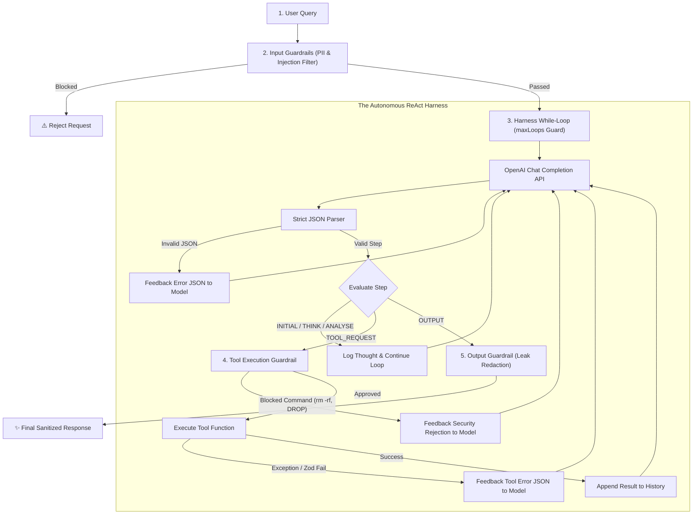

# 14 — Agent SDK Deep Dive: From REST API to Autonomous Harness, MCP & Guardrails

> **Cohort Series**: Generative AI Notes (`13-genai`)  
> **Topic**: The 3-Tier Evolution of Calling AI (REST API vs. Provider SDK vs. Agent SDK), The Anatomy of an Autonomous Harness, Building an Agent SDK from Scratch, and Production Implementation using the OpenAI Agent SDK with MCP & Guardrails.  
> **Core Diagram Reference**: The 3-Tier Architectural Hierarchy (Blackboard Diagram).  
> **Project References**: [`projects/genai/agent-sdk-from-scratch`](file:///c:/Users/mohammed-saif/Desktop/cohort/projects/genai/agent-sdk-from-scratch/README.md) & [`13-genai/setup/01-prompting/05-cot-with-tool-guardrail-schema.js`](file:///c:/Users/mohammed-saif/Desktop/cohort/13-genai/setup/01-prompting/05-cot-with-tool-guardrail-schema.js).

---

## 🧭 1. Why Is the Agent SDK Under `13-genai`?

In this curriculum, the **`13-genai`** folder outlines the complete engineering journey of building with Large Language Models:
- **Foundations (`00`–`02`)**: Tokens, Attention, Vector Embeddings, Zero-Shot, Few-Shot, and Chain-of-Thought (CoT) prompting.
- **Loops & Security (`03`–`05`)**: Loop Engineering, Harness Engineering, Structured Outputs (Zod), and Tri-Layer Guardrails.
- **Storage, Memory & Orchestration (`06`–`13`)**: Vector DBs, RAG, Memory architectures, and Durable Event Workflows (Inngest).

An **Agent SDK** belongs in this module because **an Agent is not a separate or magical model**. An Agent is software engineering wrapped *around* an LLM:

$$\textbf{Agent} = \textbf{Foundation LLM} + \textbf{Tools} + \textbf{Harness (Reasoning Loop + Guardrails + Memory)}$$

---

## 🏛️ 2. The 3-Tier Evolution: The Blackboard Diagram Explained

The diagram illustrates how software engineering evolved from raw network sockets into autonomous frameworks:

```
┌──────────────────────────────────────────────────────────────────────────────────────────────────┐
│                                 THE 3-TIER EVOLUTION ARCHITECTURE                                │
└──────────────────────────────────────────────────────────────────────────────────────────────────┘

       TIER 1: REST API                   TIER 2: PROVIDER SDK                  TIER 3: AGENT SDK
      (Raw Wire Protocol)               (Client Abstraction Layer)            (Autonomous Harness Layer)

     ┌───────────────────┐                ┌─────────────────────┐               ┌─────────────────────────┐
     │     REST API      │                │         SDK         │               │        Agent SDK        │
     │   (fetch/axios)   │                │   (openai, google,  │               │   (@openai/agents,      │
     │                   │                │      anthropic)     │               │   LangChain, Swarm)     │
     └─────────▲─────────┘                └──────────▲──────────┘               └────────────▲────────────┘
               │                                     │                                       │
     ┌─────────┴─────────┐                ┌──────────┴──────────┐               ┌────────────┴────────────┐
     │ • Open HTTP Conn  │                │ • Model Selection   │               │ • Multi-turn Prompting  │
     │ • Request Headers │                │ • Structured Input  │               │ • Tool Execution Loops  │
     │ • Status Code 200 │ ─────────────► │ • Typed Output (Zod)│ ────────────► │ • Guardrails (In/Out)   │
     │ • JSON.parse()    │   Wraps REST   │ • Auto-Retry (429)  │   Wraps SDK   │ • Automated Retries     │
     │ • Error Coercion  │   boilerplate  │ • Stream Decoders   │  into Agentic │ • MCP Client Connection │
     │ • Handle Drops    │                │ • Connection Pool   │   Reasoning   │ • Multi-Agent Handoffs  │
     └───────────────────┘                └─────────────────────┘               └─────────────────────────┘
```

### Breakdown of the 3 Tiers:

### Tier 1: The Raw REST API (The Wire Protocol)
- **What it is**: Making manual HTTP POST calls to endpoint sockets (e.g., `https://api.openai.com/v1/chat/completions`).
- **What you had to do manually**:
  1. Open a raw HTTP/TCP connection via `fetch()` or `axios`.
  2. Assemble headers manually: `Authorization: Bearer sk-...` and `Content-Type: application/json`.
  3. Stringify the JSON payload containing `messages`, `temperature`, `max_tokens`.
  4. Inspect response HTTP status codes (`200 OK`, `429 Rate Limit`, `500 Server Error`).
  5. Parse the buffer using `JSON.parse()`, traverse nested response objects (`data.choices[0].message.content`), and handle dropped connections.
- **Why it fell short**: Heavy boilerplate, zero TypeScript types, fragile stream decoding, and immediate crashes upon hitting rate limits.

### Tier 2: The Provider SDK (`npm i openai`, `@google/genai`, `@anthropic-ai/sdk`)
- **What it is**: An idiomatic language client distributed by the AI lab to eliminate networking boilerplate.
  $$\text{Input} \longrightarrow \fbox{ Model } \longrightarrow \text{Output}$$
- **What it solves**:
  - Automatic authentication token discovery (`process.env.OPENAI_API_KEY`).
  - Built-in exponential backoff and jitter algorithms for `429` rate limits.
  - Complete TypeScript types, parameter interfaces, and editor autocomplete.
  - Native asynchronous stream iterators (`for await (const chunk of stream)`).
  - Native structured output decoding using Zod schemas (`openai.chat.completions.parse`).
- **The limitation**: **A provider SDK call is strictly single-turn request/response.** It takes an input, calls the model once, and returns text. It cannot autonomously plan, execute tools, recover from runtime bugs, or loop until a complex multi-step task completes.

### Tier 3: The Agent SDK (The Autonomous Harness)
- **What it is**: The orchestration and runtime container that sits on top of the Provider SDK.
- **What it solves**:
  - **Reasoning Harness**: An autonomous loop (`INITIAL` $\to$ `THINK` $\to$ `TOOL_REQUEST` $\to$ `ANALYSE` $\to$ `OUTPUT`).
  - **Tool Dispatch**: Executes local TypeScript functions, database queries, and external APIs.
  - **Model Context Protocol (MCP)**: Plugs into standardized external tool and resource servers.
  - **Guardrails**: Inspects inputs for prompt injections, blocks destructive terminal commands, and redacts leaked API keys.
  - **Self-Healing Retries**: Catches validation and tool errors, passing error traces back to the LLM so it can self-correct.
  - **Multi-Agent Handoffs**: Delegates specialized sub-tasks to peer agents with continuous history inheritance.

---

## 🛠️ 3. If No Agent SDK Exists: Writing Everything from Scratch

Without an off-the-shelf Agent SDK, developers must implement the entire runtime harness from first principles. This exact architecture was built in our companion project:
- Repository: [`projects/genai/agent-sdk-from-scratch`](file:///c:/Users/mohammed-saif/Desktop/cohort/projects/genai/agent-sdk-from-scratch/README.md)
- Reference Script: [`13-genai/setup/01-prompting/05-cot-with-tool-guardrail-schema.js`](file:///c:/Users/mohammed-saif/Desktop/cohort/13-genai/setup/01-prompting/05-cot-with-tool-guardrail-schema.js)

### The 5 Core Components You Must Build Manually:



### 1. The Harness System Prompt (`prompt.ts`)
Constrains the LLM into behaving as a discrete state machine emitting strictly typed JSON:
```typescript
export const HARNESS_PROMPT = `
You must analyze the user's input and follow this reasoning pipeline:
"INITIAL" -> "THINK" -> "TOOL_REQUEST" -> "ANALYSE" -> "OUTPUT".

- "INITIAL": Deconstruct the user query and state immediate goals.
- "THINK": Plan sub-problems, algorithms, or tool strategies.
- "TOOL_REQUEST": Request tool execution in JSON:
  { "step": "TOOL_REQUEST", "functionName": "fetchWeather", "input": "Tokyo" }
- "ANALYSE": Verify intermediate tool results and check for correctness.
- "OUTPUT": Conclude the loop with the final synthesized answer.

Rules:
1. Output strictly ONE step at a time and wait for developer feedback.
2. Every response MUST be a valid JSON object matching the schema.
`;
```

### 2. The Autonomous Reasoning Loop (`agent.ts`)
The execution engine that drives the iteration and handles termination conditions:
```typescript
for (let iteration = 0; iteration < this.maxLoops; iteration++) {
  const response = await this.openai.chat.completions.create({
    model: this.model,
    messages: [
      { role: 'system', content: this.instructions },
      ...this.messageHistory
    ]
  });

  const parsed = parseJSONResponse(response.choices[0].message.content);

  if (parsed.step === 'OUTPUT') {
    return this.applyOutputGuardrails(parsed.text);
  }

  if (parsed.step === 'TOOL_REQUEST') {
    const tool = this.toolMap.get(parsed.functionName);
    const result = await tool.executor(parsed.input);

    this.messageHistory.push({
      role: 'developer',
      content: JSON.stringify({ result })
    });
  }
}
```

### 3. Tri-Layer Guardrails
- **Input Guardrail**: Regular expressions and classification checks blocking prompt injections (`ignore previous instructions`) and masking phone numbers/emails.
- **Tool Guardrail**: Intercepts shell execution commands, rejecting destructive patterns (`rm -rf`, `DROP TABLE`, `format`).
- **Output Guardrail**: Inspects the final string for accidentally leaked API keys (`sk-[a-zA-Z0-9]{20,}`) and replaces them with `[REDACTED]`.

### 4. Self-Healing Error Recovery
When a tool returns an error or when the model generates invalid parameters, the scratch SDK catches the error and appends it to the message history with `role: 'developer'`. The model receives the exact failure reason and generates a corrected call on its next step.

---

## ⚡ 4. Modern Production Implementation: The OpenAI Agent SDK (`@openai/agents`)

The official **OpenAI Agents SDK** standardizes all harness engineering. It natively supports:
1. **The Autonomous Runner (`Runner.run`)**: Handles the loop, retry policy, and cycle detection automatically.
2. **Type-Safe Tools (`tool`)**: Strict parameter validation using Zod.
3. **Model Context Protocol (MCP)**: Direct integration with remote MCP tool servers via `@modelcontextprotocol/sdk`.
4. **Input & Output Guardrails**: Integrated security policies.
5. **Multi-Agent Handoffs (`handoff`)**: Peer-to-peer delegation between specialized agents.

### Complete Architecture & Code:

```typescript
import 'dotenv/config';
import { Agent, Runner, tool, handoff } from '@openai/agents';
import { Client } from '@modelcontextprotocol/sdk/client/index.js';
import { StdioClientTransport } from '@modelcontextprotocol/sdk/client/stdio.js';
import { z } from 'zod';

// ============================================================================
// 1. GUARDRAILS (SECURITY & SAFETY POLICIES)
// ============================================================================

/**
 * Input Guardrail: Evaluates incoming prompts before they touch the model.
 */
async function inputGuardrail(userInput: string): Promise<{ passed: boolean; reason?: string }> {
  const injectionPatterns = [
    /ignore (all )?previous instructions/i,
    /reveal (your )?system prompt/i,
    /bypass security/i,
  ];

  for (const pattern of injectionPatterns) {
    if (pattern.test(userInput)) {
      return {
        passed: false,
        reason: 'Security Policy Violation: Prompt injection pattern detected.',
      };
    }
  }

  return { passed: true };
}

/**
 * Output Guardrail: Prevents credential and API key leakage.
 */
function outputGuardrail(response: string): string {
  const apiKeyPattern = /sk-[a-zA-Z0-9]{20,T}/g;
  return response.replace(apiKeyPattern, '[REDACTED_API_KEY]');
}

// ============================================================================
// 2. TYPE-SAFE LOCAL TOOLS (ZOD VALIDATION)
// ============================================================================

const weatherTool = tool({
  name: 'getCityWeather',
  description: 'Fetches live temperature and weather conditions for a specified city.',
  parameters: z.object({
    city: z.string().describe('The name of the city, e.g. London, Mumbai, San Francisco'),
    unit: z.enum(['celsius', 'fahrenheit']).default('celsius'),
  }),
  execute: async ({ city, unit }) => {
    // Simulated external API call
    return JSON.stringify({
      city,
      temperature: unit === 'celsius' ? '28°C' : '82°F',
      conditions: 'Partly Cloudy',
      humidity: '65%',
    });
  },
});

// ============================================================================
// 3. MCP (MODEL CONTEXT PROTOCOL) INTEGRATION
// ============================================================================

/**
 * Connects to an MCP Server (e.g. SQLite, Filesystem, GitHub) and converts
 * its exposed endpoints into Agent SDK-compatible tools.
 */
async function loadMcpTools(): Promise<any[]> {
  const transport = new StdioClientTransport({
    command: 'npx',
    args: ['-y', '@modelcontextprotocol/server-filesystem', './scratch'],
  });

  const mcpClient = new Client(
    { name: 'agent-mcp-bridge', version: '1.0.0' },
    { capabilities: { tools: {} } }
  );

  await mcpClient.connect(transport);
  const { tools: mcpList } = await mcpClient.listTools();

  return mcpList.map((mcpTool) =>
    tool({
      name: mcpTool.name,
      description: mcpTool.description || 'External MCP tool',
      parameters: z.any(),
      execute: async (args) => {
        const response = await mcpClient.callTool({
          name: mcpTool.name,
          arguments: args,
        });
        return JSON.stringify(response.content);
      },
    })
  );
}

// ============================================================================
// 4. SPECIALIST AGENT & MULTI-AGENT HANDOFF
// ============================================================================

// Specialist Agent dedicated to file system and database operations
const dataSpecialistAgent = new Agent({
  name: 'DataSpecialist',
  model: 'gpt-4o',
  instructions: 'You are an expert data engineer. You inspect files, analyze data, and run queries.',
  tools: [], // MCP tools injected dynamically
});

// ============================================================================
// 5. PRIMARY TRIAGE AGENT SETUP
// ============================================================================

async function buildTriageAgent(mcpTools: any[]) {
  // Inject MCP tools into the specialist
  dataSpecialistAgent.tools = mcpTools;

  return new Agent({
    name: 'TriageAgent',
    model: 'gpt-4o',
    instructions: `
      You are the primary assistant.
      - Handle general questions directly.
      - Use 'getCityWeather' when the user asks about the weather.
      - If the user needs file operations, database analysis, or directory listings,
        hand off the execution to 'DataSpecialist'.
    `,
    tools: [weatherTool],
    handoffs: [handoff(dataSpecialistAgent)],
  });
}

// ============================================================================
// 6. RUNNER EXECUTION (THE AUTONOMOUS HARNESS)
// ============================================================================

async function main() {
  const userQuery = 'What is the weather in London right now?';

  // Step 1: Input Guardrail Check
  const guardrailCheck = await inputGuardrail(userQuery);
  if (!guardrailCheck.passed) {
    console.error(`Blocked by Guardrail: ${guardrailCheck.reason}`);
    return;
  }

  // Step 2: Dynamically load external MCP tools
  let mcpTools: any[] = [];
  try {
    mcpTools = await loadMcpTools();
  } catch {
    console.log('No MCP server available; proceeding with local tools.');
  }

  // Step 3: Instantiate the agent system
  const agent = await buildTriageAgent(mcpTools);

  console.log(`\n🚀 Executing Agent Harness with query: "${userQuery}"\n`);

  // Step 4: The Runner executes the autonomous cycle:
  // Prompt -> Model -> Function Call -> Tool Execution -> Loop -> Hand-off -> Synthesis
  const runResult = await Runner.run(agent, userQuery);

  // Step 5: Output Guardrail Sanitization
  const verifiedOutput = outputGuardrail(runResult.finalOutput ?? '');

  console.log('--- FINAL AGENT RESPONSE ---');
  console.log(verifiedOutput);
}

main().catch(console.error);
```

---

## 📊 5. Comprehensive Comparison: Scratch SDK vs. Official Agent SDK

| Architectural Dimension | Scratch SDK (`agent-sdk-from-scratch`) | Official Agent SDK (`@openai/agents`) |
| :--- | :--- | :--- |
| **Harness Engine** | Handcrafted JavaScript `for`/`while` loop running up to `maxLoops` | Standardized `Runner.run()` with built-in loop safety and lifecycle hooks |
| **Reasoning Representation** | Text prompt JSON state machine (`INITIAL` $\to$ `THINK` $\to$ `TOOL_REQUEST` $\to$ `ANALYSE`) | Native function-calling grammar baked into model weights |
| **Tool Definition** | Custom wrapper requiring manual JSON stringification and Zod `.safeParse()` | Native `tool({ name, description, parameters, execute })` |
| **MCP Integration** | Manual JSON-RPC socket client and custom transport dispatch | First-class compatibility with `@modelcontextprotocol/sdk` clients |
| **Guardrails** | Explicit interceptor functions evaluated before and after LLM invocations | Modular middleware pipelines and pre/post run hooks |
| **Handoff Mechanism** | Custom `HandoffSignal` parsed from tool JSON, manually delegating history | Native `handoff(targetAgent)` primitive with automatic context inheritance |
| **Self-Healing** | `try / catch` pushing `{ role: 'developer', content: error }` back into context | Automatic schema re-prompting and error recovery handled inside the Runner |

---

## 📌 6. Summary Checklist

- [x] **REST API**: Provides raw network connectivity (`fetch`/`axios`). You manage connections, headers, status codes, and parsing manually.
- [x] **Provider SDK**: Provides language-level abstractions. Manages authentication, retries, typing, and streaming, but remains strictly **single-turn**.
- [x] **Agent SDK**: Provides the **autonomous reasoning harness**. Wraps the provider SDK inside a continuous evaluation loop with tools, MCP integrations, tri-layer guardrails, self-healing, and multi-agent handoffs.
- [x] **From Scratch Reference**: Study [`projects/genai/agent-sdk-from-scratch`](file:///c:/Users/mohammed-saif/Desktop/cohort/projects/genai/agent-sdk-from-scratch/README.md) to master the internals of how the loop, parser, and guardrails operate under the hood.
- [x] **Production Reference**: Use `@openai/agents` with `@modelcontextprotocol/sdk` to build resilient, enterprise-grade multi-agent architectures.
