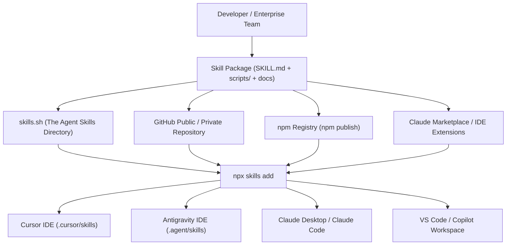

# 16 — Claude Skills Deep Dive: Packaging, Execution Sandboxes, Plugins & The Battle: Skills vs. MCP

> **Topic**: What are Agent / Claude Skills? The MCP Server-Side Scalability Crisis, Client-Side Sandboxed Execution, Vectorless Indexing ("LLM Wiki" Pattern), Vibe Coding with Skills, The Anatomy of `SKILL.md`, Plugins (Skills + MCP Combo), Distribution (`skills.sh`, Claude Marketplace, npm, GitHub), and Core Conceptual Distinctions (Agent vs. Skill, Agent vs. Agentic Workflow, AI Agents vs. Agentic AI).  
> **Core Architecture**: Client-Side Sandboxed Capabilities, On-Demand Metadata Activation, and The Plugin Super-Package.  

---

## 🧭 1. The Big Picture: What is an Agent / Claude Skill?

An **Agent Skill** (standardized by Anthropic's Claude and implemented across modern AI IDEs like Cursor, Antigravity, and Copilot) is a **self-contained, distributable package of procedural knowledge, executable scripts, reference documentation, and operational rules** designed to give an AI agent an immediate, specialized capability.

```
┌────────────────────────────────────────────────────────────────────────────────────────┐
│                              THE PACKAGE MANAGER PARADIGM                              │
├──────────────────────────┬─────────────────────────────────────────────────────────────┤
│ Ecosystem                │ Installation Command & Concept                              │
├──────────────────────────┼─────────────────────────────────────────────────────────────┤
│ **JavaScript / Node**    │ `npm i express` ──► Adds an HTTP routing package.           │
│ **Python**               │ `pip install pandas` ──► Adds data manipulation library.    │
│ **Agentic AI**           │ `npx skills add stripe` ──► Adds complete Stripe capability │
│                          │ (Prompts, SOPs, Local Scripts, and Type Signatures).        │
└──────────────────────────┴─────────────────────────────────────────────────────────────┘
```

> **The Core Formula**:  
> $$\textbf{Skill} = \textbf{Procedural SOPs (How to Think)} + \textbf{Local Scripts (How to Act)} + \textbf{Reference Docs (What to Know)} + \textbf{Client Sandbox}$$

---

## 🚨 2. The MCP Server Scalability Crisis: Why Skills Emerged

In raw Model Context Protocol (MCP), tools typically execute as **server-side remote processes** (communicating over HTTP Server-Sent Events or remote endpoints). In enterprise deployments, this model hits severe architectural bottlenecks:

```
┌────────────────────────────────────────────────────────────────────────────────────────┐
│                       THE 1 MILLION REQUEST MCP SERVER BOTTLENECK                      │
└────────────────────────────────────────────────────────────────────────────────────────┘

    1,000,000 Active Users / Agents
         │        │        │
         ▼        ▼        ▼
    ┌─────────────────────────────────────────────────────────┐
    │                REMOTE MCP TOOL SERVERS                  │
    │  • 1,000,000 concurrent network HTTP SSE requests!      │
    │  • High network latency on every intermediate tool step │
    │  • Massive cloud server hosting, compute, & egress bills│
    │  • Stateless: Disconnected from developer's local files │
    └─────────────────────────────────────────────────────────┘
```

### The 4 Major Failure Modes of Pure Remote MCP:
1. **The 1 Million User Scalability Bottleneck**:  
   If 1 million developers run agents that call an MCP tool 5 times per task, the tool provider's central servers must withstand 5,000,000 remote executions. Scaling, autoscaling, and securing those server processes becomes prohibitively expensive.
2. **Network Round-Trip Latency**:  
   Every single tool invocation requires an outbound network trip over HTTP/SSE. For multi-step agent reasoning loops with 10 tool calls, network latency alone adds 5 to 15 seconds of waiting time.
3. **Context Poisoning & System Prompt Bloat**:  
   Raw MCP registers all tool schemas into the LLM system prompt upfront. Connecting 10 MCP servers pushes 200+ tool definitions into every prompt, burning tens of thousands of tokens even for a simple `"Hi"`.
4. **Stateless Disconnection**:  
   An external cloud server does not know about your local project's `package.json`, local environment variables, Git branches, or project-specific coding conventions.

---

## ⚡ 3. The Solution: Client-Side Sandboxed Execution

Claude and the modern agent community introduced **Skills** to fundamentally shift the compute model from **centralized server-side execution** to **decentralized client-side execution**:

```
┌────────────────────────────────────────────────────────────────────────────────────────┐
│                     CLIENT-SIDE SANDBOXED EXECUTION (SKILLS)                           │
└────────────────────────────────────────────────────────────────────────────────────────┘

    Developer Machine / Agent Host (Cursor, Antigravity, Claude Desktop)
    ┌────────────────────────────────────────────────────────────────────────┐
    │ 1. Download Skill Package (once): `npx skills add stripe`              │
    │ 2. Local Directory: `.agent/skills/stripe-skill/`                       │
    │    ├── SKILL.md (Instructions & SOPs)                                  │
    │    ├── scripts/ (Local Node.js / Python scripts)                       │
    │    └── references/ (Offline schemas & docs)                            │
    │                                                                        │
    │ 3. Execution: Agent runs scripts locally inside a secure local sandbox  │
    │    Zero remote server burden • Zero network latency • Direct file access│
    └────────────────────────────────────────────────────────────────────────┘
```

### Why Client-Side Sandboxing Wins:
- **Infinite Scalability for Providers**: Stripe or Expo does not need to host compute servers for millions of agent executions. The code runs on the user's machine.
- **Zero Latency**: Scripts execute in milliseconds as local child processes.
- **Direct Workspace Integration**: Local scripts can directly inspect project files, run linters, and generate project-tailored assets.

---

## 🧠 4. The "LLM Wiki" Pattern: Vectorless Indexing for Skills

How do you install 100 skills without exploding the LLM's context window?  
Modern agent harnesses use a **Vectorless Indexing / LLM Wiki Pattern**:

```
┌────────────────────────────────────────────────────────────────────────────────────────┐
│                              THE VECTORLESS INDEXING PATTERN                           │
└────────────────────────────────────────────────────────────────────────────────────────┘

  [ 100 Installed Skills on Disk ]
         │
         ▼
  [ Metadata Registry ] ──► ONLY Frontmatter loaded into System Prompt:
                            • stripe: "Create checkouts, manage refunds, webhooks"
                            • nextjs: "App router, server actions, route handlers"
                            • d365:   "Dual-theme, SDK controls, data sources"
                            (Total: < 250 tokens!)
         │
  User Prompt: "Set up a Stripe checkout session with webhook verification."
         │
         ▼
  [ On-Demand Activation ]
  Agent matches intent ──► Reads full `SKILL.md` + `references/` just-in-time!
```

1. **Lightweight Registry**: On startup, the agent only reads the YAML frontmatter (`name` and `description`) of each skill. A registry of 50 skills consumes less than 200 tokens.
2. **Zero Context Poisoning**: Full operational guidelines and code scripts remain on disk until explicitly needed.
3. **Just-in-Time Loading**: When the user query relates to a skill, the agent calls its internal `view_file` or skill loader to pull the relevant `SKILL.md` into memory, exactly like navigating an internal Wikipedia.

---

## 🎨 5. "Vibe Coding" with Skills vs. Traditional Prompting

### Without a Skill (The Hard Way):
When attempting to "vibe code" an integration with a raw LLM, the developer must micro-manage every architectural detail in the prompt:
> *"Use Stripe API version 2025-01-01. Don't use deprecated tokens. Make sure amounts are converted to integer cents. Validate the `stripe-signature` header using the raw buffer, not parsed JSON, or the HMAC verification will fail. Add an idempotency key so we don't double charge..."*

If you forget to specify any detail, the model hallucinates or writes insecure, broken code.

### With a Skill (The Enterprise Way):
The provider (e.g. Stripe, Expo, Next.js, or Microsoft D365) writes the skill once. The developer installs it:
```bash
npx skills add stripe-payment-skill
```
The developer now simply prompts:
> *"Add payment gateway checkout with webhook verification."*

The agent reads `SKILL.md`, references the exact local API specs, executes the validation script, handles raw buffer webhooks, enforces idempotency keys, and writes production-ready code on the first attempt!

---

## 📂 6. The Anatomy of a Skill Package: What's Inside?

A skill package is a clean, structured directory containing markdown instructions, sandboxed scripts, and domain references:

```
payment-gateway-skill/
├── SKILL.md                  ◄── Main Entry Point: Frontmatter + Step-by-Step SOPs
├── prompts/                  ◄── Specialized prompt templates & Few-Shot patterns
│   ├── system-instructions.md
│   └── webhook-rules.md
├── scripts/                  ◄── Sandboxed executable scripts (run locally)
│   ├── create-checkout.js
│   ├── verify-webhook.js
│   └── refund-transaction.js
├── references/               ◄── Offline API schemas & documentation
│   ├── api-reference.json
│   └── error-codes.md
└── package.json              ◄── Local script dependencies (e.g., stripe, zod)
```

### The Anatomy of `SKILL.md` (The Main Entry Point)

The `SKILL.md` file defines when and how the agent should activate its capabilities:

```markdown
---
name: stripe-payment-specialist
description: Complete skill for creating checkout links, verifying webhooks, and managing refunds in Node.js.
version: 1.2.0
author: Payments Core Team
triggers:
  - "create payment"
  - "stripe checkout"
  - "verify webhook"
  - "refund transaction"
---

# Stripe Payment Specialist Skill

## When to Activate
Activate this skill when the user requests payment processing, checkout links,
webhook event handling, or Stripe API integration.

## Standard Operating Procedures (SOPs)
1. **Currency Handling**: Always convert dollar amounts to the smallest currency unit (e.g., $10.00 = 1000 cents).
2. **Webhook Security**: Webhook endpoints MUST receive raw request bodies (e.g., `express.raw({type: 'application/json'})`) to preserve HMAC signature validity.
3. **Idempotency**: Pass a unique `Idempotency-Key` header on all mutation requests to prevent duplicate charges.
4. **Local Verification**: Execute `./scripts/verify-webhook.js` in the local sandbox to validate signatures before committing code.
```

---

## 🔌 7. Plugins: The Combination of Skills + MCP

What is the relationship between an MCP Server, a Skill, and a **Plugin**?

```
┌─────────────────────────────────────────────────────────────────────────────┐
│                         THE PLUGIN SUPER-PACKAGE                            │
└─────────────────────────────────────────────────────────────────────────────┘

                  ┌─────────────────────────────────────────┐
                  │             PLUGIN BUNDLE               │
                  │   (Zipped directory / npm package)      │
                  │                                         │
                  │    ┌───────────────────────────────┐    │
                  │    │         AGENT SKILL           │    │
                  │    │  (SOPs, Prompts, Guidelines)  │    │
                  │    │                               │    │
                  │    │    ┌─────────────────────┐    │    │
                  │    │    │      MCP SERVER     │    │    │
                  │    │    │  (Live Protocol for │    │    │
                  │    │    │   External Systems) │    │    │
                  │    │    └─────────────────────┘    │    │
                  │    └───────────────────────────────┘    │
                  └─────────────────────────────────────────┘
```

> **The Unified Formula**:  
> $$\textbf{Plugin} = \textbf{Skill (Intelligence, SOPs, Local Scripts)} + \textbf{MCP (Live Protocol Connector)}$$

When an organization bundles procedural documentation, local scripts, and a live MCP server into a single zip archive containing a `plugin.js` or root manifest, that full bundle is called a **Plugin**.
- The **Skill** instructs the agent *how to think, what architecture to pick, and when to act*.
- The **MCP Server** provides the *active communication pipe* to the database, cloud, or third-party API.

---

## 🌍 8. Distribution: How Skills Are Shared, Installed & Hosted

Just as package managers revolutionized programming libraries, a standardized distribution ecosystem has emerged for Agent Skills:



### 1. Installation via CLI (`npx skills add`)
```bash
# Install directly from GitHub or skills.sh directory
npx skills add vercel/nextjs-app-router-skill

# Install mobile app development skill
npx skills add expo/expo-router-skill

# Install enterprise e-commerce skill
npx skills add organization/d365-commerce-skill
```

### 2. The Agent Skills Directory (`skills.sh`)
- Hosted on modern web platforms (like Vercel), **skills.sh** serves as the public directory where developers discover, rate, and download skills for Expo, Next.js, Tailwind, Kubernetes, D365, and Stripe to instantly multiply coding productivity.

---

## 🏛️ 9. Core Conceptual Distinctions: Clearing the Terminology Confusion

```
┌────────────────────────────────────────────────────────────────────────────────────────┐
│                              CORE TERMINOLOGY CLARIFIED                                │
├──────────────────────────┬─────────────────────────────┬───────────────────────────────┤
│ Concept A                │ Concept B                   │ Core Difference               │
├──────────────────────────┼─────────────────────────────┼───────────────────────────────┤
│ **Agent**                │ **Skill**                   │ An **Agent** is the actor     │
│                          │                             │ (LLM + reasoning loop).       │
│                          │                             │ A **Skill** is a modular      │
│                          │                             │ cartridge plugged into it.    │
├──────────────────────────┼─────────────────────────────┼───────────────────────────────┤
│ **Agent**                │ **Agentic Workflow**        │ An **Agent** makes dynamic,   │
│                          │                             │ autonomous decisions in loops.│
│                          │                             │ An **Agentic Workflow** is a  │
│                          │                             │ structured, pre-defined DAG   │
│                          │                             │ (Prompt Chain, Router, Judge).│
├──────────────────────────┼─────────────────────────────┼───────────────────────────────┤
│ **AI Agents**            │ **Agentic AI**              │ **AI Agents** are discrete,   │
│                          │                             │ individual software programs. │
│                          │                             │ **Agentic AI** is the broad   │
│                          │                             │ paradigm of autonomous systems│
│                          │                             │ with goal-directed behavior.  │
├──────────────────────────┼─────────────────────────────┼───────────────────────────────┤
│ **MCP**                  │ **Skills**                  │ **MCP** is an external wire   │
│                          │                             │ protocol for tools/APIs.      │
│                          │                             │ **Skills** are client-side    │
│                          │                             │ packages of SOPs and scripts. │
└──────────────────────────┴─────────────────────────────┴───────────────────────────────┘
```

### Deep Dive on Each Pair:

#### 1. Agent vs. Skill
- **Agent**: The active runtime entity that runs the reasoning harness (`INITIAL` $\to$ `THINK` $\to$ `TOOL_REQUEST` $\to$ `OUTPUT`).
- **Skill**: A passive knowledge and script package sitting in `.agent/skills/`. An agent can acquire 20 skills to become multi-disciplinary without changing its core engine.

#### 2. Agent vs. Agentic Workflow
- **Agent**: Has open-ended autonomy. You say "Build an authentication flow", and the agent decides how many loops, tool calls, and retries are required.
- **Agentic Workflow**: A deterministic state machine (like Inngest steps, LangGraph, or multi-model fan-out judge) where prompts and LLM evaluations occur at predictable checkpoints.

#### 3. AI Agents vs. Agentic AI
- **AI Agents**: The concrete software instances (e.g. Devin, Cursor Composer, Antigravity Agent, coding bots).
- **Agentic AI**: The industry-wide architectural movement transitioning from passive, single-turn text generation (chatbots) to proactive, autonomous systems capable of planning, executing tools, and self-correcting.

---

## ⚖️ 10. When to Use Skills vs. MCP: Decision Matrix

```
                          DECISION TREE
                                │
                 Does the agent need to connect
                 to a live external database or
                 remote cloud service protocol?
                                │
                 ┌──────────────┴──────────────┐
                YES                            NO
                 │                             │
    Does it also need local             Does it need procedural
    domain SOPs & coding rules?         rules, offline docs, and
                 │                      sandboxed local scripts?
         ┌───────┴───────┐                     │
        YES              NO                   YES
         │               │                     │
    Use a PLUGIN     Use pure MCP          Use a SKILL
    (Skill + MCP)       Server             Package
```

| Use Case | Recommended Architecture | Reason |
| :--- | :--- | :--- |
| **Framework Best Practices** (Next.js, Expo, React) | **Skill** (`SKILL.md` + scripts) | Needs procedural coding rules, linting scripts, and offline schemas; no cloud server needed. |
| **Live Database Access** (PostgreSQL, Redis) | **MCP Server** | Needs a secure, live socket connection to execute SQL queries. |
| **Enterprise Payment Gateway** (Stripe) | **Plugin** (Skill + MCP) | Skill provides webhook verification SOPs and idempotency logic; MCP provides live API transaction calls. |
| **Local File Operations / Linter** | **Skill** | Runs locally in the IDE sandbox with zero network latency. |
| **Centralized SaaS with Auth** (Jira, Salesforce) | **MCP Gateway / Server** | Centralizes OAuth keys, rate limiting, and enterprise role-based access control. |

---

## 📌 11. Summary Checklist

- [x] **Why Skills Emerged**: Overcame the MCP server scalability crisis (1 million users calling remote server tools), eliminated network latency, and prevented context poisoning.
- [x] **Client-Side Execution**: Skills download locally and run in the client’s sandboxed environment, providing zero-latency, private, and free compute for tool providers.
- [x] **Vectorless Indexing ("LLM Wiki")**: Agents load only frontmatter metadata initially, pulling full `SKILL.md` instructions into context on-demand.
- [x] **Vibe Coding**: Installing a skill (`npx skills add stripe`) allows developers to give high-level instructions while the agent follows strict enterprise SOPs automatically.
- [x] **Plugins**: A Plugin is the complete bundle containing an Agent Skill (intelligence/SOPs) plus an embedded MCP Server (live protocol connector).
- [x] **Terminology Clarity**: Clearly distinguished between Agent vs. Skill, Agent vs. Agentic Workflow, and AI Agents vs. Agentic AI.
