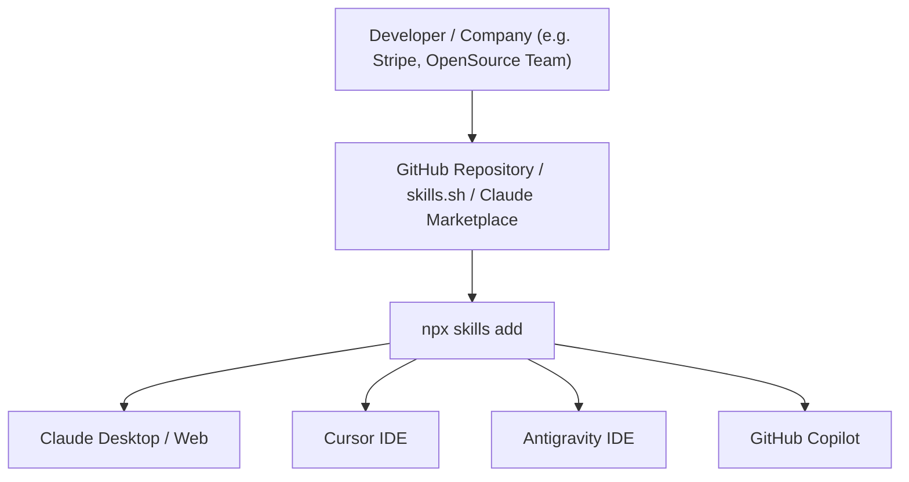

# 16 — Claude Skills Deep Dive: Packaging, Execution Sandboxes & The Battle: Skills vs. MCP

> **Topic**: What are Agent / Claude Skills? The Anatomy of a Skill Package (`SKILL.md` + `scripts/` + `prompts/`), The Package Manager Paradigm (`npx skills add`), Sandboxed Execution vs. Remote Servers, Distribution (`skills.sh`, Claude Marketplace, GitHub), and The Architectural Battle: Why Skills Fix MCP's Fatal Flaws.  
> **Core Architecture**: "Skills Wrap MCP" — The Onion Architecture (From Raw Wire Protocol to Packaged Intelligence).  

---

## 🧭 1. The Big Picture: What is an Agent / Claude Skill?

An **Agent Skill** (pioneered by Anthropic's Claude, and adopted across Cursor, Antigravity, and Copilot) is a **self-contained, distributable package of procedural intelligence, executable scripts, and context** designed to give an AI agent a specialized capability.

```
┌────────────────────────────────────────────────────────────────────────────────────────┐
│                              THE PACKAGE MANAGER ANALOGY                               │
├──────────────────────────┬─────────────────────────────────────────────────────────────┤
│ Ecosystem                │ Installation Command & Concept                              │
├──────────────────────────┼─────────────────────────────────────────────────────────────┤
│ **JavaScript / Node**    │ `npm i express` ──► Adds an HTTP routing package.           │
│ **Python**               │ `pip install pandas` ──► Adds data manipulation package.    │
│ **Agentic AI**           │ `npx skills add stripe` ──► Adds complete Stripe capability │
│                          │ (Prompts, SOPs, Local Scripts, and Type Signatures).        │
└──────────────────────────┴─────────────────────────────────────────────────────────────┘
```

> **The Core Formula**:  
> $$\textbf{Skill} = \textbf{Procedural Instructions (SOPs)} + \textbf{Executable Scripts} + \textbf{Reference Docs} + \textbf{Local Sandbox Execution}$$

---

## 📦 2. The Anatomy of a Skill Package: What's Inside?

When you inspect a modern skill package (e.g. `payment-gateway-skill`, `stripe-skill`, or `philips-hue-skill`), it is simply a directory of **Markdown files, executable scripts, and metadata** distributed as a Git repo or `.zip`:

```
payment-gateway-skill/
├── SKILL.md                  ◄── The Core Brain: Frontmatter + Step-by-Step SOPs
├── prompts/                  ◄── Specialized prompt templates & Few-Shot examples
│   ├── system-instructions.md
│   └── payment-intent-rules.md
├── scripts/                  ◄── Executable scripts run in a local sandbox
│   ├── create-checkout.js
│   ├── verify-webhook.js
│   └── refund-transaction.js
├── references/               ◄── Offline API reference docs & schemas (Zero hallucination)
│   ├── stripe-api-v2025.json
│   └── error-codes.md
└── package.json (or mcp)     ◄── Optional embedded local MCP server / dependencies
```

### The Anatomy of `SKILL.md`
The `SKILL.md` file serves as the manifest and operating procedure for the agent:

```markdown
---
name: stripe-payment-specialist
description: Complete skill for creating payment links, handling refunds, and verifying webhooks in Node.js.
version: 1.2.0
author: Payments Core Team
triggers:
  - "create payment"
  - "stripe checkout"
  - "issue refund"
---

# Stripe Payment Specialist Skill

## When to Activate
Activate this skill when the user requests generating Stripe checkout sessions,
implementing webhooks, or validating idempotency keys.

## Standard Operating Procedure (SOP)
1. Always verify the currency format (Stripe expects amounts in cents: $10.00 = 1000).
2. Never hardcode API keys; verify `process.env.STRIPE_SECRET_KEY` exists.
3. Before generating frontend checkout code, execute `./scripts/create-checkout.js`
   in the local sandbox to validate the payload against live schemas.
4. Enforce idempotency keys on all POST requests to eliminate double charges.
```

---

## 🥊 3. The Great Debate: "Is MCP Dead?"

In production AI discussions, a major architectural debate has emerged regarding raw MCP:

```
┌────────────────────────────────────────────────────────────────────────────────────────┐
│                              THE ARCHITECTURAL DEBATE                                  │
│                                                                                        │
│     ┌──────────────────────────────────────────────────────────────┐                   │
│     │  Skills                                                      │                   │
│     │    ┌──────────────────────────────────────────────────┐      │                   │
│     │    │  MCP (Model Context Protocol)                    │      │                   │
│     │    │  • Too many tools loading                        │      │                   │
│     │    │  • Network Latency?                              │      │                   │
│     │    │  • Server scalability bottleneck                 │      │                   │
│     │    │  • Statelessness & Disconnected from Workspace   │      │                   │
│     │    └──────────────────────────────────────────────────┘      │                   │
│     │                                                              │                   │
│     │    "MCP is dead!" (Why raw MCP alone breaks down)            │                   │
│     └──────────────────────────────────────────────────────────────┘                   │
└────────────────────────────────────────────────────────────────────────────────────────┘
```

### The 4 Fatal Flaws of Raw MCP in Production:

1. **Tool Overload & Context Bloat**:
   - An MCP server dumps all its tool definitions into the LLM prompt. If you connect 5 MCP servers (Stripe, Gmail, AWS, GitHub, Postgres), you inject 200+ tool schemas into every single prompt.
   - Even a greeting (`"Hi"`) burns 25,000 tokens of context!
2. **Network Latency & Server Scalability**:
   - Remote MCP servers (via SSE) require external HTTP round-trips. If 10,000 developers run agents simultaneously, who pays to host, autoscale, and secure those remote MCP servers?
3. **Stateless Disconnection**:
   - An external MCP server runs in isolation in the cloud. It doesn't know about your local project's `node_modules`, your local Git branch, or your project-specific coding standards.
4. **Zero Procedural Intelligence (APIs without Guidance)**:
   - MCP gives an agent raw tools: `chargeCard()`. It gives **zero advice** on *how* to use it safely, what edge cases to watch out for, or what architectural design to follow.

---

## 🏆 4. How Skills Solve MCP's Flaws: The Smart Fan vs. Claude Fan Analogy

Consider the architectural analogy comparing a **Smart Fan** (Raw MCP) to a **Claude Fan** (Agent Skill):

```
┌────────────────────────────────────────────────────────────────────────────────────────┐
│                        SMART FAN (MCP) vs. CLAUDE FAN (SKILL)                          │
├──────────────────────────┬─────────────────────────────────────────────────────────────┤
│ Feature                  │ Smart Fan (Pure MCP)        │ Claude Fan (Skill Package)    │
├──────────────────────────┼─────────────────────────────┼───────────────────────────────┤
│ **Setup**                │ Remote microservice running │ Local directory with scripts  │
│                          │ on the cloud (SSE transport)│ & instructions                │
│ **Context Impact**       │ Injects `turnOn()`,         │ **Zero tokens** until user    │
│                          │ `setSpeed()`, `setSwing()`  │ mentions "fan" or "room temp" │
│                          │ on every single turn!       │ (On-Demand Activation)        │
│ **Execution**            │ Outbound HTTP network call  │ Runs local script in sandboxed│
│                          │ to external IoT server      │ child process (`node turnon.js`)│
│ **Intelligence**         │ Dumb API endpoint:          │ High-level reasoning: Knows to│
│                          │ Just executes the command   │ check room temperature first, │
│                          │                             │ throttle speed at night, etc. │
└──────────────────────────┴─────────────────────────────┴───────────────────────────────┘
```

### 1. On-Demand Activation (No Context Poisoning)
Unlike MCP (which permanently loads all tools into context), **Skills are passive until triggered**. The agent only sees a one-line frontmatter description in its registry. When the user says *"Setup Stripe payment"*, only then does the agent read `SKILL.md`!

### 2. Local Sandboxed Script Execution
Instead of hosting a cloud server, the skill includes lightweight JavaScript/Python scripts inside `scripts/`. The agent runs them locally in a secure sandbox:
- Example: `philips-hue-skill` contains `scripts/turnon.js`, `scripts/turnoff.js`, and `scripts/change-color.js`. The agent executes the script via its local CLI tool runner. Zero cloud infrastructure required!

### 3. Vibe Coding & Context Completeness
A developer doesn't just want API calls; they want **architectural guidance**. A Skill packages the API together with best practices, boilerplate code templates, and security rules.

---

## 🧅 5. The True Relationship: "Skills Wrap MCP" (The Onion Architecture)

Is MCP actually dead? **No.** The provocative claim that "MCP is dead" simply highlights that **raw MCP alone is insufficient**.

In reality, **Skills and MCP are complementary**:

```
┌─────────────────────────────────────────────────────────────────────────────┐
│                       THE ONION ARCHITECTURE OF AGENTS                      │
└─────────────────────────────────────────────────────────────────────────────┘

                  ┌─────────────────────────────────────────┐
                  │             AGENT SKILL                 │
                  │  (Procedural SOPs, Guidance, Context)   │
                  │                                         │
                  │    ┌───────────────────────────────┐    │
                  │    │      LOCAL SANDBOX SCRIPTS    │    │
                  │    │   (scripts/test.js, run.py)   │    │
                  │    │                               │    │
                  │    │    ┌─────────────────────┐    │    │
                  │    │    │     MCP SERVER      │    │    │
                  │    │    │  (Wire Protocol to  │    │    │
                  │    │    │   External Systems) │    │    │
                  │    │    └─────────────────────┘    │    │
                  │    └───────────────────────────────┘    │
                  └─────────────────────────────────────────┘
```

- **MCP** is the low-level **wire protocol** (like TCP/HTTP).
- **A Skill** is the high-level **application package** (like a full Express framework + documentation).
- An enterprise skill (like `payment-gateway-skill`) can contain an embedded local MCP server inside its bundle!

---

## 🚀 6. Distribution: How Skills Are Shared and Installed

Just as npm revolutionized JavaScript with `npm i <package>`, the AI community has established standardized distribution channels for skills:



### Installation Workflow:
```bash
# Install a skill directly from GitHub or skills.sh
npx skills add mohammedsaif001/stripe-payment-skill

# Or install an official payment skill
npx skills add payment-infra/payment-gateway-skill
```

### What Happens Behind the Scenes:
1. `npx skills add` clones the skill repository into your workspace (`.agent/skills/<skill-name>/` or `.gemini/skills/`).
2. The agent client indexes the YAML frontmatter (`name`, `description`, `triggers`).
3. If the skill contains local dependencies (`scripts/package.json`), it runs a sandboxed `npm install`.
4. The skill is now immediately available for autonomous execution!

---

## 📊 7. Head-to-Head Comparison: Skills vs. MCP

| Feature | Model Context Protocol (MCP) | Agent / Claude Skills |
| :--- | :--- | :--- |
| **Primary Purpose** | Standardized protocol to expose tools & databases | Complete capability package (SOPs + Scripts + Docs) |
| **Context Overhead** | **High**: All tools permanently loaded in prompt | **Zero**: Loaded on-demand when user intent triggers it |
| **Execution Model** | Client-Server over STDIO or HTTP SSE | Local sandbox script runner (Node.js/Python) |
| **Procedural Guidance** | None (only parameter schemas) | High (step-by-step SOPs, best practices, edge cases) |
| **Infrastructure** | Requires hosting/managing an active server process | Static files (markdown + scripts) in a folder |
| **Distribution** | JSON config (`mcp_config.json`) pointing to commands | Package manager (`npx skills add <repo>`, `skills.sh`) |
| **Offline Support** | Only if server is running locally on STDIO | 100% offline (markdown + local scripts) |
| **Best Used For** | Live persistent connections (live SQL DB, webhooks) | Complex workflows, coding patterns, domain expertise |

---

## 📌 8. Summary Checklist

- [x] **What is a Skill?** A packaged capability combining procedural instructions (`SKILL.md`), executable sandbox scripts (`scripts/`), and reference docs.
- [x] **Package Manager Model**: Distributed just like npm packages using `npx skills add <repo>` or through `skills.sh` and the Claude Marketplace.
- [x] **Why Raw MCP Struggles**: Suffers from context bloat (loading hundreds of tools), network latency over remote SSE, server hosting overhead, and lack of procedural guidance.
- [x] **The Smart Fan vs. Claude Fan**: MCP gives dumb endpoints; Skills give intelligent, on-demand, contextual execution.
- [x] **The Architecture**: Skills do not kill MCP—**Skills wrap MCP**. Skills provide the outer intelligence and on-demand gating, while MCP provides the underlying wire standard when external connectivity is required.
