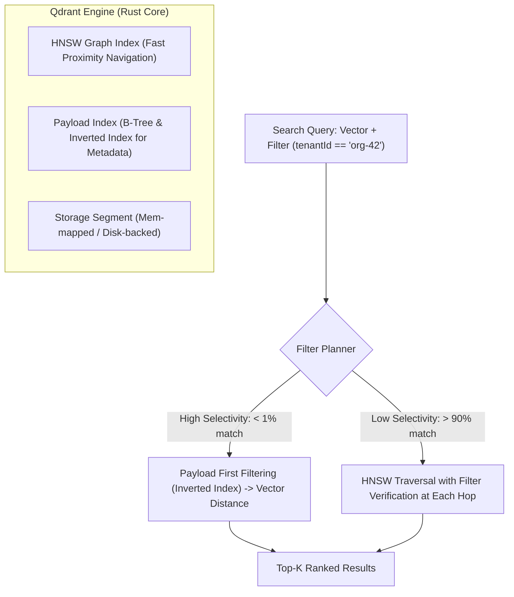

# 17 — Qdrant Vector Database: Architecture, Payload Filtering & Hands-On Setup

> **Topic**: What is Qdrant? Architecture, HNSW Graphs, Payload-Based Filtering, Vector Quantization (Scalar & Product), Docker & Cloud Setup, Node.js/TypeScript & Python SDKs, Hybrid Search, and Production Gotchas.  
> **Core Architecture**: Rust-Powered Vector Search Engine with Native Payload Storage and In-Memory / Disk-Backed Indexing.  

---

## 🧭 1. What is Qdrant?

**Qdrant** (pronounced *Quadrant*) is an open-source, high-performance vector similarity search engine and vector database written in **Rust**. It is designed specifically to handle dense vector representations (embeddings) produced by neural networks alongside rich JSON payload attributes.

```
┌────────────────────────────────────────────────────────────────────────────────────────┐
│                              THE QDRANT CORE MENTAL MODEL                              │
└────────────────────────────────────────────────────────────────────────────────────────┘

                         POINT (The Atomic Record)
     ┌───────────────────────────────────────────────────────────────┐
     │ ID: "doc-1049"                                                │
     │ Vector: [0.0142, -0.0821, 0.4419, ... (1536 float32)]        │
     │ Payload: {                                                    │
     │    "tenantId": "org-42",                                      │
     │    "author": "Engineering",                                   │
     │    "category": "security",                                    │
     │    "updatedAt": 1729440000                                    │
     │ }                                                             │
     └───────────────────────────────────────────────────────────────┘
```

### What Qdrant Is:
- A purpose-built, memory-efficient vector engine with native JSON filtering.
- Dual-deployment: Run self-hosted via Docker/Kubernetes or fully managed via Qdrant Cloud.
- Built-in **HNSW (Hierarchical Navigable Small World)** graphs for sub-millisecond Approximate Nearest Neighbor (ANN) search.
- Native support for **Scalar Quantization (SQ)** and **Product Quantization (PQ)** to reduce RAM footprint by up to 95%.

### What Qdrant Is NOT:
- **Not a Relational Database**: It does not replace PostgreSQL or MySQL; it does not support multi-table JOINs, foreign keys, or complex ACID multi-document transactions.
- **Not a Pure Full-Text Search Engine**: While it supports sparse vectors and keyword filtering, it is not a 1:1 drop-in for Elasticsearch/OpenSearch tokenization pipelines.
- **Not an LLM Memory Manager**: Qdrant stores and retrieves vectors; it does not extract facts, resolve conflicting user preferences, or manage conversation windows automatically (tools like Mem0 build *on top* of Qdrant for that).

---

## 🏗️ 2. Core Architecture & How Qdrant Works Under the Hood



### 1. Points, Collections & Vectors
- **Collection**: A named set of points (analogous to a table in SQL or a collection in MongoDB). Every point in a collection must share the same vector dimensionality (e.g., 1536 for OpenAI `text-embedding-3-small`, 768 for Gemini/Nomad).
- **Distance Metrics**:
  - **Cosine Similarity** ($\cos(\theta)$): Standard for semantic text search where vector magnitude is normalized.
  - **Dot Product**: High speed when embeddings are pre-normalized ($\|u\| = 1$).
  - **Euclidean (L2)**: Distance in metric space; commonly used in computer vision / audio.

### 2. Single-Stage Payload Filtering (No Post-Filtering Penalty!)
Many vector databases use "post-filtering" (find top 100 nearest vectors first, then discard records that do not match the metadata filter). If only 1% of your records match the filter, post-filtering returns empty results!
- **Qdrant solves this with Custom HNSW Filtering**: The metadata filter is evaluated *during* graph traversal hops. If a point doesn't match the condition `tenantId == 'org-42'`, the traversal path redirects instantly without failing.

### 3. Vector Quantization: Slashing RAM Costs
Vectors stored as raw `float32` require 4 bytes per dimension:
- $1,000,000\text{ vectors} \times 1536\text{ dimensions} \times 4\text{ bytes} \approx 6.14\text{ GB RAM}$ (just for vectors, excluding graph overhead).
- **Scalar Quantization (SQ)**: Compresses `float32` (4 bytes) to `uint8` (1 byte). Reduces RAM by $4\times$ with $< 1\%$ recall loss.
- **Binary Quantization (BQ)**: Compresses floats into single bits (1 bit per dimension) for models with high over-parameterization, achieving a $32\times$ memory reduction!

---

## 🚀 3. Setup & Installation

### Option A: Local Self-Hosted (Docker Compose)
Create `docker-compose.yml`:
```yaml
services:
  qdrant:
    image: qdrant/qdrant:latest
    container_name: qdrant-engine
    restart: always
    ports:
      - "6333:6333" # HTTP REST API & Web Dashboard
      - "6334:6334" # High-performance gRPC API
    volumes:
      - ./qdrant_storage:/qdrant/storage
    environment:
      - QDRANT__SERVICE__ENABLE_STATIC_CONTENT=true
```

Start the container:
```bash
docker compose up -d
```
Visit the visual Web Dashboard at `http://localhost:6333/dashboard`.

### Option B: Qdrant Cloud (Managed)
1. Sign up at [cloud.qdrant.io](https://cloud.qdrant.io).
2. Provision a free cluster (1GB storage included).
3. Copy your **Cluster URL** (`https://xyz-example.eu-central.aws.cloud.qdrant.io:6333`) and **API Key**.

---

## 💻 4. Hands-On Implementation: Node.js & TypeScript

### Step 1: Install Dependencies
```bash
npm install @qdrant/js-client-rest openai dotenv
```

### Step 2: Collection Setup, Upsert & Filtered Search
```typescript
import { QdrantClient } from "@qdrant/js-client-rest";
import OpenAI from "openai";
import dotenv from "dotenv";

dotenv.config();

const qdrant = new QdrantClient({
  url: process.env.QDRANT_URL || "http://localhost:6333",
  apiKey: process.env.QDRANT_API_KEY, // Optional for local Docker
});

const openai = new OpenAI({ apiKey: process.env.OPENAI_API_KEY });
const COLLECTION_NAME = "enterprise_knowledge_base";

async function main() {
  // 1. Create Collection with HNSW & Vector Configuration
  const collections = await qdrant.getCollections();
  const exists = collections.collections.some((c) => c.name === COLLECTION_NAME);

  if (!exists) {
    console.log(`Creating collection "${COLLECTION_NAME}"...`);
    await qdrant.createCollection(COLLECTION_NAME, {
      vectors: {
        size: 1536, // text-embedding-3-small dimension
        distance: "Cosine",
      },
      optimizers_config: {
        default_segment_number: 2,
      },
      quantization_config: {
        scalar: {
          type: "int8",
          quantile: 0.99,
          always_ram: true, // Keep quantized index in RAM for speed
        },
      },
    });
  }

  // 2. Helper to Generate Embeddings
  async function getEmbedding(text: string): Promise<number[]> {
    const res = await openai.embeddings.create({
      model: "text-embedding-3-small",
      input: text,
    });
    return res.data[0].embedding;
  }

  // 3. Upsert Vectors with Rich Metadata Payload
  console.log("Upserting knowledge points...");
  const doc1 = "Stripe charges 2.9% + 30 cents per successful card charge.";
  const doc2 = "Company vacation policy grants 20 days of paid time off per calendar year.";

  await qdrant.upsert(COLLECTION_NAME, {
    wait: true,
    points: [
      {
        id: "doc-stripe-01",
        vector: await getEmbedding(doc1),
        payload: {
          text: doc1,
          category: "billing",
          department: "finance",
          accessLevel: "public",
          timestamp: Date.now(),
        },
      },
      {
        id: "doc-hr-02",
        vector: await getEmbedding(doc2),
        payload: {
          text: doc2,
          category: "hr_policy",
          department: "human_resources",
          accessLevel: "internal",
          timestamp: Date.now(),
        },
      },
    ],
  });

  // 4. Perform Single-Stage Filtered Vector Search
  const userQuery = "How much does credit card processing cost?";
  console.log(`\nQuery: "${userQuery}" with filter [department == 'finance']\n`);

  const queryVector = await getEmbedding(userQuery);

  const searchResults = await qdrant.search(COLLECTION_NAME, {
    vector: queryVector,
    limit: 3,
    // Native Payload Filter: Applied during graph traversal
    filter: {
      must: [
        {
          key: "department",
          match: { value: "finance" },
        },
      ],
    },
    with_payload: true,
  });

  searchResults.forEach((hit, index) => {
    console.log(`Match #${index + 1} (Score: ${hit.score.toFixed(4)})`);
    console.log(`Text: ${hit.payload?.text}`);
    console.log(`Category: ${hit.payload?.category}\n`);
  });
}

main().catch(console.error);
```

---

## 🐍 5. Python Implementation Reference

```python
from qdrant_client import QdrantClient
from qdrant_client.models import Distance, VectorParams, PointStruct, Filter, FieldCondition, MatchValue

client = QdrantClient(url="http://localhost:6333")

# Create Collection
client.recreate_collection(
    collection_name="products",
    vectors_config=VectorParams(size=1536, distance=Distance.COSINE),
)

# Search with Payload Filter
hits = client.search(
    collection_name="products",
    query_vector=[0.01] * 1536,
    query_filter=Filter(
        must=[
            FieldCondition(key="in_stock", match=MatchValue(value=True))
        ]
    ),
    limit=5
)
```

---

## ⚖️ 6. Qdrant Pros, Cons & When to Use

| Strengths (Why Choose Qdrant) | Limitations (When to Look Elsewhere) |
| :--- | :--- |
| **Fully Open Source & Self-Hostable**: Complete control with no vendor lock-in. | **Operational Overhead**: Self-hosting clustered deployments requires managing Raft consensus & disk volumes. |
| **Rust Performance**: Low latency, deterministic memory usage, and zero GC pauses. | **Less Ecosystem Native for Serverless**: Requires an always-on Docker container/pod or Qdrant Cloud. |
| **Single-Stage Filtering**: Extremely accurate and fast on complex nested metadata filters. | **Not a General Search Engine**: Cannot handle deep lexical regex queries as effectively as Elasticsearch. |
| **Advanced Quantization**: Drastically lowers RAM costs for tens of millions of vectors. | |

### Best Used For:
- Enterprise RAG pipelines requiring on-premise or sovereign cloud hosting.
- Applications with heavy, strict metadata filtering (e.g. multi-tenant SaaS with `tenantId` isolation).
- Cost-conscious production deployments needing vector quantization to reduce RAM footprints.
