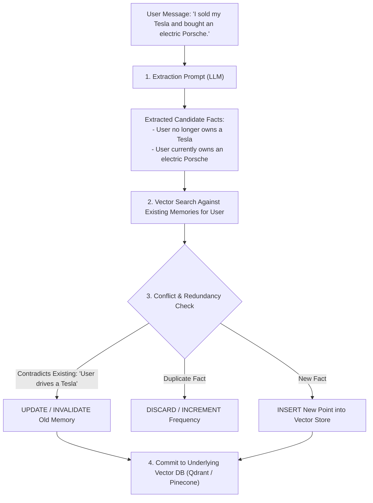

# 19 — Mem0: The Continuous Memory Layer for AI Agents & Personalized Applications

> **Topic**: What is Mem0? Why Vector Databases Alone Are Not Memory, The Multi-Level Memory Hierarchy (User, Session, Agent), Memory Consolidation & Conflict Resolution, Setup & Architecture, TypeScript & Python Implementation, and Qdrant/Pinecone Integration.  
> **Core Architecture**: The Self-Updating, Graph-Enhanced Adaptive Memory Layer Sitting Between LLMs and Vector Storage.  

---

## 🧭 1. What is Mem0?

**Mem0** (pronounced *Mem-Zero*) is an open-source, intelligent memory layer designed specifically for AI agents, personalized assistants, and multi-turn conversational systems.

While vector databases (like Qdrant and Pinecone) act as raw semantic search indices, **Mem0 is the cognitive layer that extracts, evaluates, updates, and consolidates memory over time**.

```
┌────────────────────────────────────────────────────────────────────────────────────────┐
│                              THE AGENT MEMORY STACK                                    │
└────────────────────────────────────────────────────────────────────────────────────────┘

     ┌──────────────────────────────────────────────────────────────┐
     │                       AI AGENT (LLM)                         │
     └──────────────────────────────▲───────────────────────────────┘
                                    │ Memory Retrieval / Extraction
     ┌──────────────────────────────▼───────────────────────────────┐
     │                       MEM0 MEMORY LAYER                      │
     │  • Fact Extraction Engine (identifies salient user info)     │
     │  • Conflict Resolution Engine (replaces stale preferences)   │
     │  • Multi-Tier Routing: User ID • Session ID • Agent ID       │
     └──────────────────────────────▲───────────────────────────────┘
                                    │ Vector CRUD Operations
     ┌──────────────────────────────▼───────────────────────────────┐
     │           UNDERLYING STORAGE (Qdrant / Pinecone / pgvector)  │
     └──────────────────────────────────────────────────────────────┘
```

### What Mem0 Is:
- A continuous, adaptive memory system that remembers user preferences, behavioral traits, facts, and past actions across multiple conversations.
- **Automatic Conflict Resolution**: If a user previously said *"I live in Seattle"* and later says *"I just relocated to Berlin"*, Mem0 automatically updates or invalidates the old memory instead of storing contradictory duplicates!
- **Hierarchical Scoping**: Organizes memory across 3 distinct dimensions:
  1. **User-Level (`user_id`)**: Long-term profile, preferences, and biographical facts.
  2. **Session-Level (`session_id`)**: Immediate context of the ongoing conversation.
  3. **Agent-Level (`agent_id`)**: What the agent learned about its own capabilities, domain rules, or task executions.

### What Mem0 Is NOT:
- **Not a standalone vector database**: Mem0 relies on an underlying vector store (such as Qdrant, Pinecone, Chroma, or pgvector) to hold embeddings.
- **Not a raw message dump**: It does not store entire conversational logs. It extracts atomic semantic facts and entities (e.g. `User prefers dark mode and TypeScript`).

---

## ⚖️ 2. Vector DBs vs. Agent Memory: Why Vector DBs Alone Fail

Many teams mistakenly believe that plugging a vector database into an agent solves long-term memory. In production, this naive approach fails:

```
┌────────────────────────────────────────────────────────────────────────────────────────┐
│                     RAW VECTOR DATABASE vs. MEM0 MEMORY LAYER                          │
├──────────────────────────┬─────────────────────────────┬───────────────────────────────┤
│ Dimension                │ Raw Vector Database (Qdrant/Pinecone)│ Mem0 Memory Layer     │
├──────────────────────────┼─────────────────────────────┼───────────────────────────────┤
│ **Storage Unit**         │ Raw text chunks / paragraphs│ Atomic distilled facts        │
│ **Contradictions**       │ Stores both: Retrieves both │ Resolves conflict: Updates old│
│                          │ "Lives in Seattle" & "Berlin"│ record to "Relocated to Berlin"│
│ **Deduplication**        │ None: Duplicate text chunks │ Semantic deduplication and    │
│                          │ bloat the context window    │ merging                       │
│ **Temporal Awareness**   │ Oblivious to time changes   │ Tracks recency, updates, & age│
│ **Extraction Engine**    │ Requires manual chunking code│ Built-in LLM extraction prompts│
│ **Retrieval Relevance**  │ Returns nearest text chunks │ Returns synthesized user facts│
└──────────────────────────┴─────────────────────────────┴───────────────────────────────┘
```

---

## 🧠 3. Under the Hood: How Mem0 Processes a Message

Whenever you feed a conversation or statement to Mem0, it executes a 4-step cognitive pipeline:



---

## 🚀 4. Setup & Installation

Mem0 can be used via its managed cloud platform or completely open-source with your own LLM and vector database:

```bash
# Python SDK
pip install mem0ai openai qdrant-client

# Or Node.js SDK
npm install mem0ai openai
```

---

## 💻 5. Hands-On Implementation: TypeScript / Node.js

```typescript
import { MemoryClient } from "mem0ai";
import dotenv from "dotenv";

dotenv.config();

// Initialize Mem0 Client (Managed Cloud API or Local Engine)
const client = new MemoryClient({
  apiKey: process.env.MEM0_API_KEY,
});

async function main() {
  const USER_ID = "user_saif_001";

  // ============================================================================
  // 1. ADDING MEMORIES ACROSS MULTIPLE SESSIONS
  // ============================================================================
  console.log("--- Storing Initial Facts ---");
  await client.add(
    [
      { role: "user", content: "I am a senior full-stack engineer specializing in TypeScript and Rust." },
      { role: "user", content: "I prefer working in dark mode and always want code examples in TypeScript." },
    ],
    { user_id: USER_ID }
  );

  // ============================================================================
  // 2. SIMULATING A PREFERENCE UPDATE (CONFLICT RESOLUTION)
  // ============================================================================
  console.log("--- Updating User Preferences ---");
  // Later in time, user changes preferred language:
  await client.add(
    [{ role: "user", content: "I have transitioned away from Rust; I now exclusively build systems in Go." }],
    { user_id: USER_ID }
  );

  // ============================================================================
  // 3. SEMANTIC MEMORY SEARCH
  // ============================================================================
  console.log("\n--- Searching User Memories for Coding Style ---");
  const memories = await client.search("What programming languages and editor settings does this user like?", {
    user_id: USER_ID,
    limit: 5,
  });

  console.log("Retrieved Atomic Memories:");
  memories.forEach((m, idx) => {
    console.log(`[Memory #${idx + 1}] ID: ${m.id} | Fact: "${m.memory}"`);
  });

  // ============================================================================
  // 4. INJECTING MEMORIES INTO AN AGENT PROMPT
  // ============================================================================
  const memoryContext = memories.map((m) => `- ${m.memory}`).join("\n");
  const agentSystemPrompt = `
You are a personalized AI engineering assistant.

User Profile Context (Retrieved from Long-Term Memory):
${memoryContext}

Respond to the user's inquiry strictly respecting their preferences.
  `.trim();

  console.log("\n--- Dynamic Personalized Agent Prompt ---");
  console.log(agentSystemPrompt);
}

main().catch(console.error);
```

---

## 🐍 6. Python Implementation with Custom Qdrant Backend

In Python, Mem0 can be configured to use self-hosted **Qdrant** or **Pinecone** as its underlying vector store with zero cloud dependencies:

```python
import os
from mem0 import Memory

# Configure Mem0 to use local Qdrant for storage & OpenAI for extraction
config = {
    "vector_store": {
        "provider": "qdrant",
        "config": {
            "host": "localhost",
            "port": 6333,
            "collection_name": "agent_memories"
        }
    },
    "llm": {
        "provider": "openai",
        "config": {
            "model": "gpt-4o-mini",
            "temperature": 0.1
        }
    }
}

m = Memory.from_config(config)

user_id = "engineer_alice"

# Add conversational turn
m.add(
    "I am allergic to peanuts and prefer vegan restaurants.",
    user_id=user_id,
    metadata={"category": "dietary"}
)

# Search relevant memories
memories = m.search("What should we order for dinner?", user_id=user_id)
for entry in memories:
    print(f"- {entry['memory']}")
```

---

## 📊 7. Comparative Master Matrix: Qdrant vs. Pinecone vs. Mem0

```
┌────────────────────────────────────────────────────────────────────────────────────────┐
│                        VECTOR DB & MEMORY LAYER MASTER MATRIX                          │
├──────────────────┬──────────────────────┬──────────────────────┬───────────────────────┤
│ Feature          │ Qdrant               │ Pinecone             │ Mem0                  │
├──────────────────┼──────────────────────┼──────────────────────┼───────────────────────┤
│ **Category**     │ Vector Database      │ Vector Database      │ AI Agent Memory Layer │
│ **License**      │ Open Source (Rust)   │ Proprietary SaaS     │ Open Source (Python/TS)│
│ **Deployment**   │ Self-Hosted / Cloud  │ Managed Cloud Only   │ Self-Hosted / Cloud   │
│ **Storage Core** │ HNSW on Disk/RAM     │ Decoupled Object/K8s │ Plugs into Qdrant/etc.│
│ **Filtering**    │ Single-stage payload │ Metadata filters     │ User, Session, Agent  │
│ **Quantization** │ SQ (int8), BQ (1-bit)│ Internal managed     │ Inherits from store   │
│ **Fact Conflict**│ ❌ Stores duplicates │ ❌ Stores duplicates │ ✅ Automatically      │
│ **Resolution**   │                      │                      │ resolves & updates    │
│ **Primary Role** │ Fast similarity      │ Zero-maintenance     │ Personalized memory   │
│                  │ search & filtering   │ serverless search    │ for AI agents         │
└──────────────────┴──────────────────────┴──────────────────────┴───────────────────────┘
```

---

## 📌 8. Summary Checklist

- [x] **Qdrant**: Choose when you need an open-source, high-performance, self-hostable Rust engine with single-stage payload filtering and vector quantization.
- [x] **Pinecone**: Choose when you want a completely hands-off, cloud-native serverless vector database with instant scaling, zero devops, and built-in multi-tenant namespaces.
- [x] **Mem0**: Choose when you are building an AI agent that needs **true personalized long-term memory**. It sits *on top* of Qdrant or Pinecone, automatically extracting atomic facts, deduplicating records, and resolving contradicting user statements over time.
