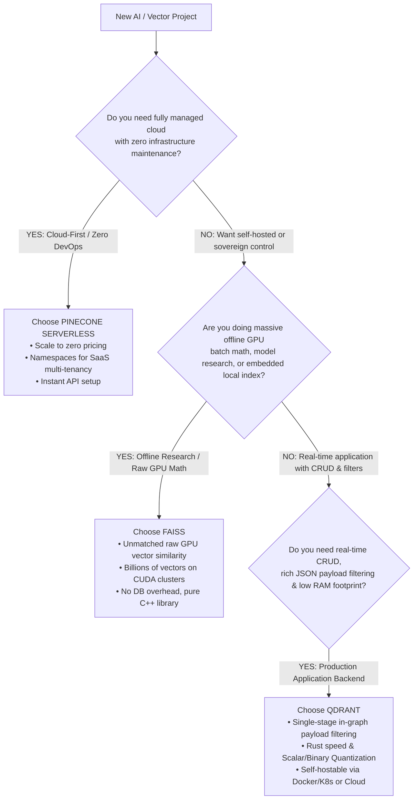

# 20 — Vector Engines Compared: Qdrant vs. Pinecone vs. FAISS

> **Topic**: Deep Architectural & Algorithmic Comparison: Qdrant vs. Pinecone vs. FAISS.  
> **Beyond Infrastructure**: How Payload Filtering actually works under the hood (In-Graph Traversal vs. Inverted Indices vs. IDSelector), Memory Management, Quantization, GPU vs. CPU, and Concrete Production Decision Scenarios.  
> **Core Mental Model**: Library (FAISS) vs. Managed Cloud Service (Pinecone) vs. Purpose-Built Native Engine (Qdrant).  

---

## 🧭 1. The Fundamental Architectural Categorization

Before comparing features, it is critical to understand that these three technologies belong to fundamentally different layers of the software stack:

```
┌─────────────────────────────────────────────────────────────────────────────────────────┐
│                                 THE 3-TIER SYSTEM HIERARCHY                             │
├──────────────────────────┬─────────────────────────────┬────────────────────────────────┤
│ Category                 │ Technology                  │ What It Actually Is            │
├──────────────────────────┼─────────────────────────────┼────────────────────────────────┤
│ **Algorithmic Library**  │ **FAISS** (Meta AI)         │ A low-level C++/CUDA library of│
│                          │                             │ ANN data structures & math ops.│
│                          │                             │ (No network, no database CRUD).│
├──────────────────────────┼─────────────────────────────┼────────────────────────────────┤
│ **Dedicated Database**   │ **Qdrant** (Open Source)    │ A full-featured vector database│
│                          │                             │ written in Rust with WAL, disk │
│                          │                             │ mmap, payload indices & REST.  │
├──────────────────────────┼─────────────────────────────┼───────────────────────────────┤
│ **Serverless SaaS**      │ **Pinecone** (Proprietary)  │ A fully managed cloud service  │
│                          │                             │ with decoupled blob storage    │
│                          │                             │ and scale-to-zero query nodes. │
└──────────────────────────┴─────────────────────────────┴────────────────────────────────┘
```

---

## 🔍 2. The Core Technical Difference: How Filtering Actually Works Under the Hood

Both Pinecone and Qdrant claim "metadata filtering," while FAISS claims "filtered search." However, **the algorithmic implementation is completely different**, directly affecting accuracy, latency, and recall.

### The 3 Classic Filtering Paradigms:

```
1. POST-FILTERING (Naive)
   [ Vector Search (Top 100) ] ──► Discard points where category != 'finance' ──► Often 0 results!

2. PRE-FILTERING (Naive)
   [ Run SQL / Metadata Filter ] ──► Vector Search on remaining subset ──► Breaks HNSW Graph connectivity!

3. IN-TRAVERSAL / SINGLE-STAGE FILTERING (State of the Art)
   Filter is evaluated simultaneously during vector index traversal.
```

---

### A. How Qdrant Does It: Single-Stage In-Graph Traversal & Query Planning

Qdrant stores payloads directly alongside vectors in custom storage segments and maintains **payload indices** (B-trees for numbers, Inverted Indices for keywords, Geo-indices for coordinates).

When you run a search with a filter:
```json
{
  "filter": { "must": [{ "key": "tenant_id", "match": { "value": "org-42" } }] }
}
```

Qdrant's **Query Planner** evaluates the **selectivity** of the filter before searching:
1. **High Selectivity (< 1% of points match the filter)**:  
   Graph traversal is inefficient because 99% of nodes are invalid. Qdrant dynamically bypasses the HNSW graph and runs **brute-force vector distance calculation directly on the matched payload IDs**. This is faster and guarantees 100% recall.
2. **Low Selectivity (> 90% of points match the filter)**:  
   Qdrant navigates the primary HNSW graph, but skips visiting neighbors whose payload IDs fail the inverted index check.
3. **Medium Selectivity (1% – 90% match)**:  
   Qdrant uses a specialized **Filtered HNSW traversal**, maintaining graph connectivity through payload links without falling into dead ends.

---

### B. How Pinecone Does It: Multi-Tenant Namespaces + Inverted Index

Pinecone separates data into two distinct filtering tiers:

1. **Physical / Partition Tier (Namespaces)**:  
   If you filter by tenant or customer ID, Pinecone recommends using a **Namespace**. A namespace is a hard logical shard. Searching inside `namespace: "org-42"` completely ignores all other vectors in the index, delivering maximum speed with zero filter penalty.
2. **Metadata Tier (Payload Attributes)**:  
   Pinecone maintains a separate distributed metadata index. In Pinecone Serverless, query nodes fetch metadata index segments from cloud storage. It evaluates boolean expressions (`$eq`, `$in`, `$gte`) against the metadata index, intersects the candidate IDs with vector chunks, and ranks them.

---

### C. How FAISS Does It: No Native Payload Storage (The `IDSelector` Approach)

FAISS **has no concept of JSON payloads or metadata**. It only knows integer IDs (`int64`) and float vectors (`float32`).

To filter in FAISS, you must:
1. Store all metadata and text in an external database (PostgreSQL, SQLite, Redis).
2. Query PostgreSQL first to get a list of matching vector IDs: `SELECT vector_id FROM docs WHERE category = 'finance'`.
3. Pass those IDs into FAISS using an `IDSelector`:
   ```python
   # FAISS with IDSelector
   import faiss
   
   id_selector = faiss.IDSelectorArray([10, 42, 99, 105])
   params = faiss.SearchParametersIVF(sel=id_selector)
   distances, indices = index.search(query_vector, k=5, params=params)
   ```
4. **The Critical Limitation**: In FAISS HNSW indexes, masking out nodes during search breaks the graph structure. If matching IDs are sparse, FAISS search either stalls or fails to reach the true nearest neighbors.

---

## ⚡ 3. Algorithmic & Hardware Acceleration Comparison

```
┌────────────────────────────────────────────────────────────────────────────────────────┐
│                              HARDWARE ACCELERATION & ENGINES                           │
├──────────────────┬──────────────────────┬──────────────────────┬───────────────────────┤
│ Dimension        │ FAISS                │ Qdrant               │ Pinecone Serverless   │
├──────────────────┼──────────────────────┼──────────────────────┼───────────────────────┤
│ **Language**     │ C++ / CUDA / Python  │ Rust                 │ Proprietary (Go/Rust/C++)│
│ **GPU Support**  │ **Best in Class**    │ Experimental / Cloud │ Managed Cloud         │
│                  │ (Native NVIDIA CUDA) │ GPU (CPU primary)    │ (CPU query nodes)     │
│ **Disk Support** │ Memory-only by       │ Native `mmap` disk   │ Decoupled Cloud Blob  │
│                  │ default (OnDiskIVF)  │ storage with WAL     │ (S3/GCS) + RAM cache  │
│ **Quantization** │ Native PQ, SQ,       │ Native Scalar (int8) │ Managed internally    │
│                  │ Binary (IVFPQ)       │ and Binary (1-bit)   │ transparently         │
│ **Concurrency**  │ Single process lock  │ Multi-threaded async │ Distributed horizontal│
│                  │ (GIL issues in Python)│ actor runtime (Tokio)│ microservices         │
└──────────────────┴──────────────────────┴──────────────────────┴───────────────────────┘
```

### Why FAISS Dominates on GPU:
- FAISS was built by Meta AI research to index billions of embeddings across clusters of multi-GPU servers (A100/H100).
- If your workload involves **massive batch re-indexing** (e.g. re-embedding 500 million product vectors every night), `faiss-gpu` is 10x to 50x faster and cheaper than running API calls against any hosted vector database.

### Why Qdrant Dominates on Cost-Efficiency (CPU + Disk):
- Qdrant was engineered in Rust with **memory-mapped files (`mmap`)**.
- Vectors and payload indices live on fast NVMe SSDs; only the quantized indices (e.g. 1-bit or int8 representations) are kept in RAM.
- You can search 50 million vectors on a single $80/month dedicated server without running out of RAM.

---

## 📊 4. Deep Feature Matrix: Architectural Head-to-Head

| Feature | FAISS | Qdrant | Pinecone Serverless |
| :--- | :--- | :--- | :--- |
| **Type** | C++ Library | Full Vector Database | Cloud Managed Database |
| **CRUD Operations** | ❌ Hard (Immutable index; deletes require rebuilding) | ✅ Full real-time point upsert, update, delete | ✅ Full real-time upsert and delete |
| **Payload Storage** | ❌ None (Vectors + integer IDs only) | ✅ Native JSON document payload storage | ✅ Key-value metadata storage |
| **Filtering Mechanism** | External DB + `IDSelector` | Integrated Single-Stage Query Planner | Partition Namespaces + Metadata Index |
| **Hybrid Search** | ❌ Manual (Must combine BM25 yourself) | ✅ Native (Dense vectors + Sparse BM25 vectors) | ✅ Native (Dense + Sparse SPLADE vectors) |
| **Multi-Tenancy** | ❌ Manual partition management | ✅ Payload filter (`tenant_id`) | ✅ Native isolated **Namespaces** |
| **Deployment** | `pip install faiss-cpu` / Embedded | Docker / Kubernetes / Qdrant Cloud | 100% Cloud SaaS (AWS/GCP/Azure) |
| **Disaster Recovery** | Manual file snapshots (`write_index`) | Built-in snapshot API & Raft clustering | Managed automated cloud replication |
| **Pricing** | Free (Compute costs only) | Free Open Source (or cloud tiers) | Pay-per-use (Read/Write Units + Storage) |

---

## 🎯 5. The Engineering Decision Framework: When to Pick What?



---

### Scenario 1: Multi-Tenant B2B SaaS Application
- **Use Case**: A Notion/Slack AI assistant where 5,000 corporate clients store enterprise documents.
- **Winner**: **Pinecone** (or **Qdrant** with Tenant ID payload filtering).
- **Why**: Pinecone's **Namespaces** give physical data isolation per customer with zero chance of cross-tenant data leakage. If data privacy laws require running in your own AWS VPC or on-premise, **Qdrant** is the superior self-hosted choice.

### Scenario 2: High-Frequency Metadata Filtering with Dynamic E-Commerce Attributes
- **Use Case**: An e-commerce product search with 5 million items and 30 dynamic attributes (`price < 50`, `size == 'M'`, `color IN ['red', 'blue']`, `in_stock == true`).
- **Winner**: **Qdrant**.
- **Why**: Qdrant's query planner dynamically switches between inverted index filtering and graph traversal based on selectivity. FAISS would choke on complex dynamic filters, and Pinecone's metadata syntax is less granular for complex nested JSON conditions.

### Scenario 3: Offline Model Evaluation, Clustering & GPU Embeddings
- **Use Case**: Training a new recommendation model or clustering 100 million user embeddings on an 8x NVIDIA H100 GPU machine.
- **Winner**: **FAISS**.
- **Why**: Zero networking overhead, direct GPU VRAM access, maximum possible matrix math throughput. No database can match FAISS running natively inside CUDA memory.

### Scenario 4: Cost-Sensitive High-Volume RAG (100M+ Vectors)
- **Use Case**: Indexing 100 million technical papers where budget is constrained.
- **Winner**: **Qdrant**.
- **Why**: Qdrant's **Binary Quantization (BQ)** and **Scalar Quantization (SQ)** compress 1536-dimensional embeddings from `float32` down to 1-bit or 8-bit representations, allowing 100 million vectors to fit into manageable NVMe disk and RAM tiers, saving tens of thousands of dollars compared to managed SaaS pricing.

---

## 📌 6. Summary Architectural Cheatsheet

1. **FAISS** is a **Math Engine**:
   - Best when you are writing Python/C++ code, running on GPUs, managing your own IDs, and doing raw search without network or database overhead.
2. **Pinecone** is a **Managed Service**:
   - Best when you want zero infrastructure maintenance, automatic scaling, built-in multi-tenant namespaces, and consumption-based cloud pricing.
3. **Qdrant** is a **Modern Vector Database**:
   - Best when you want high-performance open-source control, native JSON payload storage with intelligent in-graph query planning, vector quantization, and deployment flexibility (Docker, Kubernetes, or Cloud).
