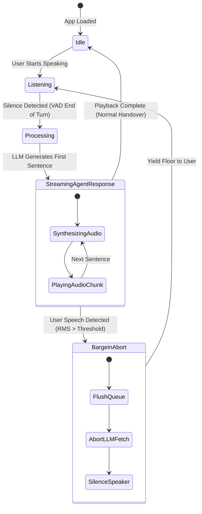

# 21 — Realtime Voice Agents: STT-TTS Chained Pipelines, Interruption Management, and Native Multimodal Voice

> **Topic**: Full-Stack Architecture of Realtime Voice Agents — From Cascaded Chained Pipelines (STT ➔ LLM ➔ TTS) to Native Multimodal Speech-to-Speech (OpenAI Realtime API).  
> **Core Architecture**: Audio Serialization, Sentence-Level Chunking Buffers, Web Audio API Queues, RMS/VAD Barge-in Interruption, Backchanneling vs. Floor Takeover, and OpenAI Realtime WebRTC/SDK Integration.  
> **Mental Model**: Cascaded Translation vs. Native Multimodal Stream; Conversational Turn-Taking as an Asynchronous Distributed State Machine.

---

## 🧭 Executive Overview: The Voice Paradigm Shift

Human conversation is one of the most complex distributed systems in existence. It operates on a sub-conscious, bidirectional loop characterized by **continuous streaming, sub-300ms latency, micro-intonations, and dynamic turn-taking**:

```
Traditional Text Chat:     [User Types] ──── Latency (2-5s) ────► [LLM Generates] ────► [User Reads]
                               (Half-Duplex, Turn-Based, Asynchronous)

Realtime Voice Agent:      [User Streams Audio] ◄─── Full-Duplex (Overlap / Barge-in) ───► [Agent Streams Audio]
                               (Sub-300ms, Prosody-Aware, Continuous Bidirectional)
```

Building a voice agent is **not** simply plugging an audio file into an LLM. It requires solving three interrelated engineering problems:
1. **Acoustic Serialization & Representation**: Converting continuous pressure waves into discrete computational units.
2. **Cascaded Latency Compounding**: Overcoming the delay of chaining three distinct AI models (Speech-to-Text $\rightarrow$ Text-to-Text $\rightarrow$ Text-to-Speech).
3. **Conversational Turn Dynamics & Psychology**: Managing interruptions (barge-in), distinguishing backchanneling (*"hmm"*, *"uh-huh"*) from floor takeover, and handling audio buffer starvation.

---

## 🎙️ 1. The Nature of Voice vs. Text in LLMs

### Audio is Continuous & Serializable; LLMs are Discrete & Symbolic

Audio in physical reality is a continuous mechanical vibration of air particles. To represent audio in computing:
* **Sampling Rate**: The analog wave is sampled thousands of times per second (e.g., $16\text{ kHz} = 16,000$ amplitude snapshots per second, $24\text{ kHz}$, $48\text{ kHz}$).
* **Quantization & Bit Depth**: Each snapshot is converted into a binary integer (typically 16-bit Pulse Code Modulation — PCM).
* **Serialization**: These PCM integers are flattened into byte arrays (`Uint8Array`, `Int16Array`, `ArrayBuffer`) that can be transmitted over network sockets (WebSocket frames, WebRTC RTP media streams).

```
   Analog Waveform               PCM Discretization                     Byte Serialization
   (Continuous)                  (16 kHz / 16-bit)                       (Binary Stream)
      ~~~/\~~~            ──►    | | | | | | | | | | | |    ──►   [ 0x1A, 0x02, 0xFE, 0x11, ... ]
```

### Why Couldn't LLMs Process Native Voice Historically?

Foundation LLMs (GPT-3, GPT-4, LLaMA) were trained on **discrete text tokens** using Byte-Pair Encoding (BPE). Text tokens are high-density, semantic abstractions. A single token like `" apple"` encapsulates the visual, conceptual, and linguistic properties of an apple.

Audio, by contrast, possesses a dramatically lower **semantic-to-data ratio**:
1. **High Dimensionality**: One second of clean speech at 16 kHz 16-bit generates $32,000\text{ bytes}$. One second of text is only 2 to 4 tokens ($\approx 8\text{ bytes}$). Processing raw audio through standard transformer self-attention ($O(N^2)$ complexity) explodes computational and memory requirements.
2. **Acoustic Entanglement**: An audio waveform does not just encode *what* was said (the semantics). It simultaneously encodes the speaker's vocal tract geometry, pitch, accent, emotional state, background noise, microphone distortion, and reverberation.
3. **Continuous Boundary Problem**: In text, words have spaces and punctuation. In raw acoustic signals, there are no discrete spaces between words; sounds blend together continuously (*coarticulation*).

Because training an end-to-end foundation model directly on raw audio tokens was computationally intractable and prone to hallucination in earlier years, the industry adopted the **Cascaded (Chained) Architecture**.

---

## 🧩 2. The Chained Voice Architecture (STT ➔ LLM ➔ TTS)

The cascaded approach decomposes the problem into three specialized pipeline stages:

```
┌──────────────────────────────────────────────────────────────────────────────────────────────────┐
│                                 THE CASCADED PIPELINE ARCHITECTURE                               │
└──────────────────────────────────────────────────────────────────────────────────────────────────┘

     AUDIO IN                                                                          AUDIO OUT
 (Microphone Stream)                                                               (Speaker Playback)
        │                                                                                  ▲
        ▼                                                                                  │
 ┌─────────────┐            ┌───────────────────┐             ┌─────────────┐             ┌┴────────────┐
 │  Stage 1:   │   Text     │     Stage 2:      │  Text Chunk │  Stage 3:   │ Binary PCM  │ Audio Queue │
 │ Speech-To-  │ ─────────► │  Text-To-Text     │ ──────────► │  Text-To-   │ ──────────► │ & Playback  │
 │ Text (STT)  │ Transcript │  (LLM Reasoning)  │  (Sentence) │ Speech(TTS) │ Audio Data  │ Buffer      │
 └─────────────┘            └───────────────────┘             └─────────────┘             └─────────────┘
  • Whisper API              • GPT-4o / GPT-4o-mini            • OpenAI TTS
  • Deepgram Nova-2          • Claude 3.5 Sonnet               • ElevenLabs Turbo v2
  • Web Speech API           • LLaMA 3.3                       • Cartesia Sonic
```

### Stage Breakdown:

| Stage | Input | Output | Responsibilities | Latency Profile |
| :--- | :--- | :--- | :--- | :--- |
| **Stage 1: STT** | Raw Audio (PCM / Opus) | Text Transcript | Acoustic feature extraction, language modeling, phoneme mapping, punctuation insertion. | $150\text{ms} - 800\text{ms}$ |
| **Stage 2: LLM** | Text Prompt + History | Output Text Tokens | Intent recognition, conversational context, tool execution, reasoning, response generation. | $300\text{ms} - 1500\text{ms}$ (TTFT) |
| **Stage 3: TTS** | Text String | Audio Waveform | Grapheme-to-phoneme conversion, prosody synthesis, vocal timbre modeling, audio encoding. | $200\text{ms} - 600\text{ms}$ |

---

## 🔍 3. The Naive Prototype (Deconstructing the Cohort Video Screenshots)

In the initial exploratory phase of building voice agents, developers frequently wire these three stages together using standard HTTP calls and browser APIs. Let's analyze the exact implementation from the cohort session screenshots:

### Screenshot Analysis & Code Reconstruction

```
┌─────────────────────────────────────────────────────────────────────────────────────────────────┐
│ SCREENSHOT 1: The LLM Request (`script.js`)                                                     │
│ - Uses OpenAI API to send prompt and parse text.                                                │
│ - In the video: `fetch('https://api.openai.com/v1/responses')` or `/v1/chat/completions`.      │
│ - Model identifier used: preview/chat model (e.g., `gpt-5.6-luna` or `gpt-4o-mini`).            │
├─────────────────────────────────────────────────────────────────────────────────────────────────┤
│ SCREENSHOTS 2 & 3: Browser STT Setup (`script.js`)                                              │
│ - Instantiates `window.SpeechRecognition` (Web Speech API).                                     │
│ - Sets `continuous = true`, `interimResults = false`, `maxAlternatives = 1`.                   │
│ - Hooks `onresult` to grab `event.results[event.results.length - 1][0].transcript`.              │
│ - Awaits `llm(transcript)` and logs output.                                                     │
├─────────────────────────────────────────────────────────────────────────────────────────────────┤
│ SCREENSHOT 4: The TTS Playback (`script.js`)                                                    │
│ - Calls `fetch('https://api.openai.com/v1/audio/speech')` with model `gpt-4o-mini-tts` / `tts-1`│
│ - Voice: `'coral'`, Instructions: `'Speak in a cheerful, warm and natural tone.'`               │
│ - Creates an `AudioBlob`, binds `URL.createObjectURL(audioBlob)`, calls `audio.play()`.         │
└─────────────────────────────────────────────────────────────────────────────────────────────────┘
```

Here is the complete, syntactically corrected naive prototype:

```javascript
// ============================================================================
// NAIVE CHUNKED PROTOTYPE (Reference: Cohort Video script.js)
// ============================================================================

const API_KEY = 'YOUR_OPENAI_API_KEY';

/**
 * Stage 2: Send recognized text to the LLM
 */
async function llm(userText = '') {
  // Uses OpenAI Chat Completions (or the new Responses API endpoint)
  const response = await fetch('https://api.openai.com/v1/chat/completions', {
    method: 'POST',
    headers: {
      'Content-Type': 'application/json',
      Authorization: `Bearer ${API_KEY}`,
    },
    body: JSON.stringify({
      model: 'gpt-4o-mini',
      messages: [
        {
          role: 'system',
          content: 'You are a warm, concise conversational voice assistant. Keep answers brief (1-2 sentences).',
        },
        { role: 'user', content: userText },
      ],
    }),
  });

  const data = await response.json();
  return data.choices?.[0]?.message?.content ?? '';
}

/**
 * Stage 3: Convert the LLM text response into spoken audio
 */
async function speak(text = '') {
  if (!text.trim()) return;

  const response = await fetch('https://api.openai.com/v1/audio/speech', {
    method: 'POST',
    headers: {
      'Content-Type': 'application/json',
      Authorization: `Bearer ${API_KEY}`,
    },
    body: JSON.stringify({
      model: 'tts-1', // or gpt-4o-mini-tts where supported
      voice: 'coral', // available voices: alloy, ash, coral, echo, fable, onyx, nova, sage, shimmer
      input: text,
      instructions: 'Speak in a cheerful, warm and natural tone.',
    }),
  });

  const audioBlob = await response.blob();
  const audioUrl = URL.createObjectURL(audioBlob);
  const audio = new Audio(audioUrl);

  // Clean up object URL when playback finishes to prevent memory leaks
  audio.onended = () => URL.revokeObjectURL(audioUrl);
  await audio.play();
}

/**
 * Stage 1: Continuous Speech Recognition using Browser Web Speech API
 */
async function main() {
  const SpeechRecognition = window.SpeechRecognition || window.webkitSpeechRecognition;
  if (!SpeechRecognition) {
    alert('Web Speech API is not supported in this browser. Please use Google Chrome.');
    return;
  }

  const speechRecognition = new SpeechRecognition();
  speechRecognition.continuous = true;
  speechRecognition.interimResults = false; // Only trigger when user stops speaking
  speechRecognition.maxAlternatives = 1;

  speechRecognition.onstart = function () {
    console.log('🎤 SpeechRecognition has started. Speak into your microphone...');
  };

  speechRecognition.onresult = async function (event) {
    const transcript = event.results[event.results.length - 1][0].transcript;
    console.log('User:', transcript);

    // Naive chained execution: wait for LLM, then wait for TTS
    const textResponse = await llm(transcript);
    console.log('Agent:', textResponse);

    await speak(textResponse);
  };

  speechRecognition.onerror = function (err) {
    console.error('Speech Recognition Error:', err);
  };

  speechRecognition.start();
}

main();
```

---

### ⚠️ Why the Naive Prototype Fails Catastrophically in Production

While this prototype works for a static demo, it collapses under real human conversational conditions:

```
┌──────────────────────────────────────────────────────────────────────────────────────────────────┐
│                                 THE CASCADED LATENCY BOTTLENECK                                  │
└──────────────────────────────────────────────────────────────────────────────────────────────────┘

 User Finishes
 Speaking
   │
   ├── [ STT Processing / Silence Window ] ────────────► 800ms - 1,200ms
   │
   ├── [ LLM Full Generation (Blocking) ] ─────────────► 1,500ms - 3,000ms
   │
   ├── [ TTS Synthesis on Entire Paragraph ] ──────────► 800ms - 1,500ms
   │
   ├── [ Network Blob Download & Decoding ] ───────────► 200ms - 400ms
   │
   ▼
 First Spoken Word by Agent: Total Latency = 3.3s to 6.1s!
 (Human acceptable conversational gap is under 300ms - 500ms. Anything over 1s feels broken.)
```

1. **Compounding Latency**: Because each stage is executed **serially** and **in bulk**, latency is additive:
   $$\text{Total Latency} = T_{\text{STT finish}} + T_{\text{LLM completion}} + T_{\text{TTS synthesis}} + T_{\text{Network}}$$
2. **Dead Air**: During this 3 to 6-second window, the user has zero feedback. They often say *"Hello? Are you there?"*, which cancels or corrupts the pending turn.
3. **Zero Interruption Capability**: If the agent begins speaking a long paragraph and the user wants to interject, the agent is deaf to the microphone while the `<audio>` tag plays out.

---

## ⚡ 4. The Latency Crisis & Streaming Bottlenecks

To eliminate the 4-second delay, we must switch from **batch execution** to **streaming pipelining**:

$$\text{User Audio} \xrightarrow{\text{stream}} \text{STT} \xrightarrow{\text{stream tokens}} \text{LLM} \xrightarrow{\text{stream audio}} \text{TTS} \xrightarrow{\text{stream chunks}} \text{Speaker}$$

However, introducing streaming immediately uncovers a fundamental physics problem: **The Speed Mismatch**.

### The Producer-Consumer Velocity Imbalance

```
LLM Generation Speed:   80 - 120 Tokens / Second   (Hyper-Fast Producer)
Human Speaking Speed:    2.5 - 3.5 Words / Second   (Slow Consumer: ~150 words/minute)
```

* The LLM emits text nearly **$10\times$ faster** than a human can speak it.
* If you generate an audio chunk for every single token and immediately invoke `audio.play()`, the browser will either:
  1. Trigger overlapping audio tracks where 15 voices speak simultaneously.
  2. Crash the browser's audio buffer.
  3. Stutter violently as micro-network fluctuations cause audio underruns.

**Solution**: We must introduce an **In-Memory Sequential Audio Queue** that buffers incoming audio segments while draining them sequentially at physical speech speed.

---

## 🎭 5. Token Streaming vs. Sentence-Level Chunking & Human Prosody

A naive developer's first instinct is: *"Stream token by token to TTS as soon as the LLM yields it."*

This fails because of **The Masked Word Dilemma**:

### The Masked Word Dilemma (Prosody & Pronunciation Collapse)

Consider the sentence:
> *"Hello, how are you today?"*

When a human speaks this sentence, their vocal cords, pitch inflection, and stress are planned **holistically before the first syllable is voiced**:
* The pitch rises on *"how"* and peaks on *"you"*.
* The rhythm (*cadence*) flows smoothly because the vocal system anticipates the final vowel.

Now imagine words are revealed to you one by one through a tiny slit in a piece of paper:
1. You see: `"Hello"` $\rightarrow$ You pronounce it with flat, uncertain intonation.
2. You see: `"how"` $\rightarrow$ Pause.
3. You see: `"are"` $\rightarrow$ Pause.
4. You see: `"you"` $\rightarrow$ You don't know if it's a question or a statement until you see `"today?"`.

> [!CAUTION]
> **Why Token-Level TTS Fails:**
> Modern Neural TTS models (ElevenLabs, Cartesia, OpenAI TTS) rely on surrounding linguistic context to calculate pitch curves, stress markers, and pause durations. If you feed 1-2 words into a TTS engine, it produces flat, robotic, disjointed audio with unnatural rising and falling inflections.

### The Sentence & Clause Chunking Solution

Instead of streaming token by token, we buffer incoming tokens and slice them at **sentence and clause boundaries**:

```javascript
// Boundary delimiters: periods, question marks, exclamation marks, or commas with sufficient length
const SENTENCE_REGEX = /([.?!]+(?:\s+|$)|,\s+(?=[A-Z0-9]))/;
```

```
LLM Output Stream:
"Hello there! [DELIMITER 1] Today we are going to explore [WAITING] how voice agents work. [DELIMITER 2]"

Buffer State:
┌───────────────────────────────┐
│ "Hello there!"                │ ──► Dispatched immediately to TTS (Turnaround: ~250ms)
└───────────────────────────────┘
┌───────────────────────────────┐
│ "Today we are going to explore│ ──► Continues accumulating until punctuation detected...
│  how voice agents work."      │ ──► Dispatched to TTS as Chunk 2
└───────────────────────────────┘
```

This guarantees:
1. **Natural Intonation**: The TTS model receives full semantic clauses, preserving human-grade cadence and prosody.
2. **Optimal Latency**: Chunk 1 begins playing through the speaker *while* the LLM is still generating Chunk 2 and Chunk 3.

---

## 🗄️ 6. Audio Scheduling & In-Memory Queue Architecture

To deliver continuous, gapless playback without stuttering, we build a sequential audio queue with **session tracking**:

```
                  ┌─────────────────────────────────────────────────────────┐
                  │                 AUDIO QUEUE STATE MACHINE               │
                  └─────────────────────────────────────────────────────────┘

     LLM Sentence         TTS Synthesis                 Audio Queue                    Speaker
      Yielded               Returns Blob             (FIFO ArrayBuffer)               Playback
         │                       │                           │                           │
         ▼                       ▼                           ▼                           ▼
   ┌───────────┐           ┌───────────┐             ┌───────────────┐             ┌───────────┐
   │ Chunk 1   │ ────────► │ AudioBlob │ ──────────► │ [Blob 1,      │ ──────────► │ Playing   │
   │ "Hello!"  │           │           │             │  Blob 2,      │             │ Chunk 1   │
   └───────────┘           └───────────┘             │  Blob 3]      │             └─────┬─────┘
                                                     └───────────────┘                   │
                                                             ▲                           │ onended
                                                             │                           ▼
                                                             └───────────────── Next Item in Queue
```

### The Web Audio API vs. HTML5 Audio Element

In production browser applications, relying on `<audio>` tags causes audible micro-gaps (10–50ms) between sentences due to decoder initialization. High-end systems utilize the **Web Audio API** (`AudioContext` and `AudioBufferSourceNode`) or an `AudioWorklet`:

* **`AudioContext`**: Schedules audio buffers directly onto the audio hardware clock (`audioCtx.currentTime`), enabling sample-accurate, zero-gap concatenation.
* **`AudioWorklet`**: Runs audio processing on a dedicated, low-latency background audio thread separate from the main JavaScript UI event loop.

---

## 🛑 7. Interruption Management & Barge-In (The 4-Step Teardown)

In human communication, an interruption is not an error; it is a fundamental coordination mechanism. When a human interrupts, the speaker **instantly stops talking, discards their remaining train of thought, and shifts attention to the listener**.

If your voice agent does not implement **Barge-in**, it feels like a broken IVR phone system.

### The Problem With Naive Queuing During Interruption

If the agent has pre-buffered 3 sentences into the audio queue and the user speaks, simply clearing the microphone does nothing: the audio queue will continue playing the remaining pre-buffered chunks for the next 10 seconds!

### The 4-Step Barge-In Teardown Protocol

When speech activity is detected while the agent is speaking:

```
                                  USER STARTS SPEAKING!
                                            │
                                            ▼
                    ┌───────────────────────────────────────────────┐
                    │       4-STEP BARGE-IN TEARDOWN PROTOCOL       │
                    └───────────────────────────────────────────────┘
                                            │
             ┌──────────────────────────────┼──────────────────────────────┐
             ▼                              ▼                              ▼
      [ STEP 1 ]:                    [ STEP 2 ]:                    [ STEP 3 ]:
   ABORT LLM STREAM               PURGE AUDIO QUEUE              STOP ACTIVE AUDIO
  AbortController.abort()        audioQueue.length = 0          currentAudio.pause()
  Terminates in-flight HTTP      Discards all pending           currentAudio.currentTime = 0
  token generation on server     synthesized sentence chunks    Silences speaker in <20ms
                                            │
                                            ▼
                                     [ STEP 4 ]:
                             INCREMENT PLAYBACK SESSION
                                playbackSession++
                    Invalidates any late-arriving async network
                    packets from previous turns
```

```javascript
// State container for turn management
const state = {
  currentAudioObj: null,
  audioQueue: [],
  isPlaying: false,
  playbackSession: 0, // Incremented on every interruption to invalidate stale callbacks
  abortController: null, // Cancels in-flight LLM network requests
};

function interruptAndBargeIn() {
  console.log('⚡ Barge-in detected! Halting agent output immediately.');

  // 1. Invalidate ongoing playback session
  state.playbackSession++;

  // 2. Abort in-flight LLM streaming fetch
  if (state.abortController) {
    state.abortController.abort();
    state.abortController = null;
  }

  // 3. Immediately halt physical speaker output
  if (state.currentAudioObj) {
    state.currentAudioObj.pause();
    state.currentAudioObj.currentTime = 0;
    state.currentAudioObj = null;
  }

  // 4. Purge in-memory audio queue
  state.audioQueue = [];
  state.isPlaying = false;
}
```

---

## 🔊 8. VAD (Voice Activity Detection) vs. STT Completion: Eliminating Deadlocks

In the naive cohort screenshot, interruption fails due to a architectural flaw:
```javascript
speechRecognition.interimResults = false;
speechRecognition.onresult = async function(event) { ... }
```

When `interimResults = false`, the browser's speech recognition engine **only emits an event AFTER the user has stopped speaking and a trailing silence duration (700–1000ms) has elapsed**.

```
 Agent Speaking:   "The weather in San Francisco today is sunny with a high of seventy..."
 User Interjects:  "Wait, what about New York?"
 Naive Engine:     [ Agent keeps talking over the user for 4 more seconds! ]
                   [ Only when user finishes "New York?" does onresult fire! ]
 Result:           Unbearable acoustic collision.
```

### The Solution: Real-Time Audio Energy / VAD Analysis

We cannot wait for transcription to detect interruption. We must detect **sound energy** at the microphone hardware layer in real-time.

```
Microphone Stream ──► Web Audio API AnalyserNode ──► Calculate RMS Energy Every 20ms
                                                            │
                                  ┌─────────────────────────┴─────────────────────────┐
                                  ▼                                                   ▼
                       RMS > Energy Threshold (0.08)                       RMS <= Energy Threshold
                       Consecutive Frames >= 5                             Silence / Low Ambience
                                  │                                                   │
                                  ▼                                                   ▼
                         TRIGGER BARGE-IN!                                     Ignore / Continue
```

### RMS (Root Mean Square) Audio Energy Calculation

The energy of an audio buffer of $N$ samples is calculated as:

$$\text{RMS} = \sqrt{\frac{1}{N} \sum_{i=0}^{N-1} x[i]^2}$$

Where $x[i]$ represents the normalized float sample value $[-1.0, 1.0]$.

```javascript
/**
 * Realtime Client-Side Voice Activity Monitor using Web Audio API
 */
function setupAudioEnergyVAD(mediaStream, onBargeInTriggered) {
  const audioContext = new (window.AudioContext || window.webkitAudioContext)();
  const sourceNode = audioContext.createMediaStreamSource(mediaStream);
  const analyserNode = audioContext.createAnalyser();
  analyserNode.fftSize = 512;

  sourceNode.connect(analyserNode);

  const buffer = new Float32Array(analyserNode.fftSize);
  const RMS_THRESHOLD = 0.08; // Sensitivity threshold for speech
  let consecutiveSpeechFrames = 0;
  const REQUIRED_FRAMES = 4; // Require 4 consecutive frames (approx 80ms) to filter clicks/pops

  function monitorAudioFrames() {
    analyserNode.getFloatTimeDomainData(buffer);

    // Compute Root Mean Square (RMS)
    let sumOfSquares = 0;
    for (let i = 0; i < buffer.length; i++) {
      sumOfSquares += buffer[i] * buffer[i];
    }
    const rms = Math.sqrt(sumOfSquares / buffer.length);

    // Check if energy crosses speech threshold while the agent is currently speaking
    if (rms > RMS_THRESHOLD && state.isPlaying) {
      consecutiveSpeechFrames++;
      if (consecutiveSpeechFrames >= REQUIRED_FRAMES) {
        onBargeInTriggered();
        consecutiveSpeechFrames = 0;
      }
    } else {
      consecutiveSpeechFrames = 0;
    }

    requestAnimationFrame(monitorAudioFrames);
  }

  monitorAudioFrames();
}
```

---

## 🧠 9. Human Conversational Psychology & Smart Turn-Taking

Real human interaction is governed by subtle psychological cues:

### A. The Backchanneling Dilemma (*"Hmm"*, *"Yeah"*, *"Uh-huh"*)

If an agent interrupts itself every single time the microphone energy spikes above zero, the system becomes unusable. When humans listen, they continuously emit **backchannels**:
* *"Uh-huh"*
* *"Right"*
* *"Yeah"*
* *"Hmm"*

These sounds are not requests to take the floor; they are **acknowledgments of comprehension** signaling the speaker to *continue*.

```
┌──────────────────────────────────────────────────────────────────────────────────────────────────┐
│                               BACKCHANNELING vs. FLOOR TAKEOVER                                  │
├────────────────────────────────┬─────────────────────────────────────────────────────────────────┤
│ Signal Property                │ Backchanneling ("Uh-huh")       │ Floor Takeover ("Wait, stop!") │
├────────────────────────────────┼─────────────────────────────────┼───────────────────────────────┤
│ **Duration**                   │ Transient (< 250ms)             │ Sustained (> 600ms)           │
│ **Pitch Contour**              │ Flat or falling                 │ Dynamic, rising, assertive    │
│ **Intent**                     │ Passive listening confirmation   │ Active semantic shift         │
│ **Agent Action**               │ Continue speaking uninterrupted │ Instantly yield floor         │
└────────────────────────────────┴─────────────────────────────────┴───────────────────────────────┘
```

### B. Information Priority & Graceful Recovery

What happens when the agent was delivering critical information (e.g., flight numbers, medical warnings, credit card confirmations) when the user interrupted?
* **Naive Agent**: Drops the information permanently.
* **Human-like Agent**: Yields immediately, answers the interruption, and then uses conversational state memory to gracefully loop back:
  > *"Sure, I can change that flight. But just to make sure you have it, the confirmation code for your original booking was 9X2B."*

### C. The Conversational State Machine



---

## 💻 10. Complete Production Implementation: The Resilient Chained Pipeline

Below is the complete, modular, battle-tested codebase implementing sentence-buffered streaming, in-memory audio queuing, Web Audio API energy monitoring, and 4-step barge-in teardown (reflecting the exact patterns from `piyushgarg-dev/stt-tts-pipeline-cohort`):

### `index.html`

```html
<!DOCTYPE html>
<html lang="en">
<head>
  <meta charset="UTF-8">
  <meta name="viewport" content="width=device-width, initial-scale=1.0">
  <title>Realtime Voice Agent — Production STT-TTS Pipeline</title>
  <style>
    :root {
      --bg: #0a0a0c;
      --card: #141418;
      --border: #26262e;
      --accent: #6366f1;
      --text: #f3f4f6;
      --muted: #9ca3af;
    }
    body {
      margin: 0;
      padding: 2rem;
      background: var(--bg);
      color: var(--text);
      font-family: -apple-system, BlinkMacSystemFont, "Segoe UI", Roboto, sans-serif;
      display: flex;
      flex-direction: column;
      align-items: center;
      justify-content: center;
      min-height: 100vh;
      box-sizing: border-box;
    }
    .container {
      width: 100%;
      max-width: 640px;
      background: var(--card);
      border: 1px solid var(--border);
      border-radius: 16px;
      padding: 2rem;
      box-shadow: 0 20px 40px rgba(0, 0, 0, 0.4);
    }
    h1 {
      margin-top: 0;
      font-size: 1.5rem;
      font-weight: 600;
      display: flex;
      align-items: center;
      gap: 0.5rem;
    }
    .status-badge {
      display: inline-flex;
      align-items: center;
      gap: 6px;
      padding: 4px 10px;
      border-radius: 9999px;
      font-size: 0.8rem;
      font-weight: 500;
      background: #27272a;
      color: var(--muted);
      margin-bottom: 1.5rem;
    }
    .status-badge.active {
      background: rgba(34, 197, 94, 0.15);
      color: #4ade80;
    }
    .indicator-dot {
      width: 8px;
      height: 8px;
      border-radius: 50%;
      background: currentColor;
    }
    .transcript-box {
      min-height: 180px;
      max-height: 320px;
      overflow-y: auto;
      border: 1px solid var(--border);
      border-radius: 8px;
      padding: 1rem;
      background: rgba(0, 0, 0, 0.2);
      display: flex;
      flex-direction: column;
      gap: 0.75rem;
      font-size: 0.95rem;
      margin-bottom: 1.5rem;
    }
    .msg {
      padding: 8px 12px;
      border-radius: 8px;
      line-height: 1.4;
      max-width: 85%;
    }
    .msg.user {
      align-self: flex-end;
      background: var(--accent);
      color: #fff;
    }
    .msg.agent {
      align-self: flex-start;
      background: #22222a;
      border: 1px solid var(--border);
      color: var(--text);
    }
    .controls {
      display: flex;
      gap: 1rem;
    }
    button {
      flex: 1;
      padding: 12px 20px;
      border-radius: 8px;
      border: none;
      font-weight: 600;
      cursor: pointer;
      transition: all 0.2s ease;
      background: var(--accent);
      color: white;
    }
    button:hover {
      opacity: 0.9;
    }
    button:disabled {
      background: #27272a;
      color: #52525b;
      cursor: not-allowed;
    }
  </style>
</head>
<body>
  <div class="container">
    <h1>🎙️ Realtime Voice Agent</h1>
    <div id="statusBadge" class="status-badge">
      <div class="indicator-dot"></div>
      <span id="statusText">System Idle</span>
    </div>

    <div id="transcriptBox" class="transcript-box">
      <div class="msg agent">Hello! Click "Start Voice Agent" and speak naturally. You can interrupt me at any time.</div>
    </div>

    <div class="controls">
      <button id="startBtn">Start Voice Agent</button>
      <button id="stopBtn" disabled>Stop Agent</button>
    </div>
  </div>

  <script src="script.js"></script>
</body>
</html>
```

### `script.js`

```javascript
/**
 * ============================================================================
 * Production Realtime Voice Pipeline: STT ➔ Streamed LLM ➔ Queued TTS + Barge-in
 * Repository Reference: https://github.com/piyushgarg-dev/stt-tts-pipeline-cohort
 * ============================================================================
 */

const CONFIG = {
  OPENAI_API_KEY: 'YOUR_OPENAI_API_KEY', // Recommended: Proxy through your backend server in production
  LLM_MODEL: 'gpt-4o-mini',
  TTS_MODEL: 'tts-1',
  TTS_VOICE: 'coral',
  BARGE_IN_RMS_THRESHOLD: 0.08,
  CONSECUTIVE_FRAMES_REQUIRED: 4,
};

// Global Agent State Container
const state = {
  currentAudioObj: null,
  audioQueue: [],
  isPlaying: false,
  playbackSession: 0,
  abortController: null,
  isSessionActive: false,
};

// UI Element Handles
const statusBadge = document.getElementById('statusBadge');
const statusText = document.getElementById('statusText');
const transcriptBox = document.getElementById('transcriptBox');
const startBtn = document.getElementById('startBtn');
const stopBtn = document.getElementById('stopBtn');

function setStatus(text, isActive = false) {
  statusText.textContent = text;
  if (isActive) {
    statusBadge.classList.add('active');
  } else {
    statusBadge.classList.remove('active');
  }
}

function appendMessage(role, text) {
  const msgDiv = document.createElement('div');
  msgDiv.className = `msg ${role}`;
  msgDiv.textContent = text;
  transcriptBox.appendChild(msgDiv);
  transcriptBox.scrollTop = transcriptBox.scrollHeight;
  return msgDiv;
}

// ============================================================================
// 1. BARGE-IN INTERRUPTION HANDLER
// ============================================================================
function triggerBargeIn() {
  if (!state.isPlaying && state.audioQueue.length === 0) return;

  console.warn('⚡ [Barge-in] User interruption detected! Draining audio pipeline.');
  setStatus('User Interrupted Agent...', true);

  // Invalidate any async tasks tied to this generation turn
  state.playbackSession++;

  // 1. Abort in-flight network streaming fetch
  if (state.abortController) {
    state.abortController.abort();
    state.abortController = null;
  }

  // 2. Immediately stop active speaker audio
  if (state.currentAudioObj) {
    state.currentAudioObj.pause();
    state.currentAudioObj.currentTime = 0;
    state.currentAudioObj = null;
  }

  // 3. Purge audio queue
  state.audioQueue = [];
  state.isPlaying = false;
}

// ============================================================================
// 2. SENTENCE CHUNKING GENERATOR FOR LLM STREAM
// ============================================================================
function takeSentences(text) {
  const sentences = [];
  let rest = text;

  while (true) {
    // Delimit on period, question mark, or exclamation mark followed by whitespace or end
    const match = rest.match(/[.?!](?:\s+|$)/);
    if (!match) break;

    const endIndex = match.index + match[0].length;
    const sentence = rest.slice(0, endIndex).trim();
    rest = rest.slice(endIndex);

    if (sentence) {
      sentences.push(sentence);
    }
  }

  return { sentences, rest };
}

/**
 * Async generator that consumes the LLM stream and yields full, natural sentences
 */
async function* llmStreaming(userQuery, currentSession) {
  state.abortController = new AbortController();

  const response = await fetch('https://api.openai.com/v1/chat/completions', {
    method: 'POST',
    signal: state.abortController.signal,
    headers: {
      'Content-Type': 'application/json',
      Authorization: `Bearer ${CONFIG.OPENAI_API_KEY}`,
    },
    body: JSON.stringify({
      model: CONFIG.LLM_MODEL,
      stream: true,
      messages: [
        {
          role: 'system',
          content: `You are an ultra-fast, conversational voice assistant.
          Rules:
          1. Answer concisely in natural spoken English (1-3 sentences maximum).
          2. Structure output in clear, complete sentences so they can be spoken immediately.
          3. Avoid markdown asterisks, bullet points, or code blocks.`,
        },
        { role: 'user', content: userQuery },
      ],
    }),
  });

  const reader = response.body.getReader();
  const decoder = new TextDecoder();
  let rawBuffer = '';
  let sentenceAccumulator = '';

  while (true) {
    // Exit if session was invalidated by barge-in
    if (state.playbackSession !== currentSession) break;

    const { value, done } = await reader.read();
    if (done) break;

    rawBuffer += decoder.decode(value, { stream: true });
    const lines = rawBuffer.split('\n');
    rawBuffer = lines.pop() ?? '';

    for (const line of lines) {
      const trimmed = line.trim();
      if (!trimmed || trimmed === 'data: [DONE]') continue;
      if (!trimmed.startsWith('data: ')) continue;

      try {
        const json = JSON.parse(trimmed.slice(6));
        const delta = json.choices?.[0]?.delta?.content ?? '';
        if (!delta) continue;

        sentenceAccumulator += delta;

        // Extract complete sentences from the accumulator
        const { sentences, rest } = takeSentences(sentenceAccumulator);
        sentenceAccumulator = rest;

        for (const sentence of sentences) {
          if (state.playbackSession !== currentSession) return;
          yield sentence;
        }
      } catch (err) {
        // Skip malformed SSE chunks
      }
    }
  }

  // Yield any trailing leftover text without punctuation
  const leftover = sentenceAccumulator.trim();
  if (leftover && state.playbackSession === currentSession) {
    yield leftover;
  }
}

// ============================================================================
// 3. TTS SYNTHESIZER & SEQUENTIAL AUDIO QUEUE WORKER
// ============================================================================
async function fetchTTSAudioBlob(text, currentSession) {
  if (state.playbackSession !== currentSession) return null;

  const response = await fetch('https://api.openai.com/v1/audio/speech', {
    method: 'POST',
    headers: {
      'Content-Type': 'application/json',
      Authorization: `Bearer ${CONFIG.OPENAI_API_KEY}`,
    },
    body: JSON.stringify({
      model: CONFIG.TTS_MODEL,
      voice: CONFIG.TTS_VOICE,
      input: text,
      response_format: 'mp3',
    }),
  });

  if (state.playbackSession !== currentSession) return null;
  return await response.blob();
}

/**
 * Sequential Audio Queue Consumer
 */
async function processAudioQueue(currentSession) {
  if (state.isPlaying) return;
  if (state.audioQueue.length === 0) return;

  state.isPlaying = true;
  setStatus('Agent Speaking...', true);

  while (state.audioQueue.length > 0) {
    if (state.playbackSession !== currentSession) {
      console.log('[Queue] Session invalidated. Dropping remaining chunks.');
      break;
    }

    const nextBlob = state.audioQueue.shift();
    if (!nextBlob) continue;

    const audioUrl = URL.createObjectURL(nextBlob);
    const audio = new Audio(audioUrl);
    state.currentAudioObj = audio;

    await new Promise((resolve) => {
      audio.onended = () => {
        URL.revokeObjectURL(audioUrl);
        state.currentAudioObj = null;
        resolve();
      };
      audio.onerror = () => {
        URL.revokeObjectURL(audioUrl);
        state.currentAudioObj = null;
        resolve();
      };

      audio.play().catch((err) => {
        console.warn('Audio playback error / interrupted:', err);
        resolve();
      });
    });
  }

  state.isPlaying = false;
  state.currentAudioObj = null;
  if (state.playbackSession === currentSession) {
    setStatus('Listening...', true);
  }
}

// ============================================================================
// 4. MICROPHONE ENERGY VAD (HARDWARE BARGE-IN MONITOR)
// ============================================================================
function initVAD(mediaStream) {
  const audioContext = new (window.AudioContext || window.webkitAudioContext)();
  const sourceNode = audioContext.createMediaStreamSource(mediaStream);
  const analyserNode = audioContext.createAnalyser();
  analyserNode.fftSize = 256;

  sourceNode.connect(analyserNode);

  const buffer = new Float32Array(analyserNode.fftSize);
  let consecutiveSpeechFrames = 0;

  function checkEnergy() {
    if (!state.isSessionActive) return;

    analyserNode.getFloatTimeDomainData(buffer);

    let sum = 0;
    for (let i = 0; i < buffer.length; i++) {
      sum += buffer[i] * buffer[i];
    }
    const rms = Math.sqrt(sum / buffer.length);

    // If microphone energy exceeds threshold while agent is speaking: TRIGGER BARGE-IN!
    if (rms > CONFIG.BARGE_IN_RMS_THRESHOLD && state.isPlaying) {
      consecutiveSpeechFrames++;
      if (consecutiveSpeechFrames >= CONFIG.CONSECUTIVE_FRAMES_REQUIRED) {
        triggerBargeIn();
        consecutiveSpeechFrames = 0;
      }
    } else {
      consecutiveSpeechFrames = 0;
    }

    requestAnimationFrame(checkEnergy);
  }

  checkEnergy();
}

// ============================================================================
// 5. MAIN ORCHESTRATOR
// ============================================================================
async function startVoiceSession() {
  const SpeechRecognition = window.SpeechRecognition || window.webkitSpeechRecognition;
  if (!SpeechRecognition) {
    alert('Web Speech API is not supported in this browser. Please use Chrome.');
    return;
  }

  // Request microphone stream for low-level energy VAD
  const mediaStream = await navigator.mediaDevices.getUserMedia({ audio: true });
  initVAD(mediaStream);

  const recognition = new SpeechRecognition();
  recognition.continuous = true;
  recognition.interimResults = false;
  recognition.lang = 'en-US';

  recognition.onstart = () => {
    state.isSessionActive = true;
    startBtn.disabled = true;
    stopBtn.disabled = false;
    setStatus('Listening... (Speak anytime)', true);
  };

  recognition.onresult = async (event) => {
    const transcript = event.results[event.results.length - 1][0].transcript.trim();
    if (!transcript) return;

    appendMessage('user', transcript);
    setStatus('Agent Thinking...', true);

    const currentSession = ++state.playbackSession;
    let agentMessageElem = null;

    try {
      // Stream LLM sentence chunks
      for await (const sentence of llmStreaming(transcript, currentSession)) {
        if (state.playbackSession !== currentSession) break;

        if (!agentMessageElem) {
          agentMessageElem = appendMessage('agent', sentence);
        } else {
          agentMessageElem.textContent += ' ' + sentence;
        }

        // Parallel synthesize audio for the sentence chunk
        fetchTTSAudioBlob(sentence, currentSession).then((audioBlob) => {
          if (!audioBlob || state.playbackSession !== currentSession) return;
          state.audioQueue.push(audioBlob);
          processAudioQueue(currentSession);
        });
      }
    } catch (err) {
      if (err.name !== 'AbortError') {
        console.error('LLM Pipeline Error:', err);
      }
    }
  };

  recognition.onerror = (event) => {
    console.error('Speech Recognition Error:', event.error);
    if (event.error === 'not-allowed') {
      alert('Microphone access denied.');
    }
  };

  recognition.onend = () => {
    // Keep recognition continuously alive unless stopped manually
    if (state.isSessionActive) {
      recognition.start();
    }
  };

  recognition.start();

  stopBtn.onclick = () => {
    state.isSessionActive = false;
    recognition.stop();
    triggerBargeIn();
    startBtn.disabled = false;
    stopBtn.disabled = true;
    setStatus('System Idle', false);
  };
}

startBtn.onclick = startVoiceSession;
```

---

## 🚀 11. The Modern Paradigm: Native Multimodal Voice (OpenAI Realtime API & SDK)

While our optimized chained pipeline solves sentence buffering and barge-in, cascaded pipelines hit an architectural wall:

### The Fundamental Limitations of Chained Cascades

1. **Acoustic Information Erasure**: When audio passes through STT, **all non-verbal data is permanently stripped away**. Emotion, sarcasm, whispered secrets, laughter, stuttering, and urgency are discarded. The LLM only sees plain text.
2. **Double Latency Penalty**: Transcribing audio into text and re-synthesizing text into audio will always incur at least $400\text{ms} - 800\text{ms}$ of fixed mathematical overhead.
3. **Complex State Synchronization**: Keeping client VAD, audio queues, and LLM abort controllers synchronized requires intricate application code.

### The Speech-to-Speech Breakthrough: OpenAI Realtime API

The **OpenAI Realtime API** (`gpt-4o-realtime-preview`) is a **native multimodal speech-to-speech foundation model**. It ingests raw audio tokens and outputs raw audio tokens directly:

$$\textbf{Audio In} \xrightarrow{\quad\text{Direct Neural Ingestion}\quad} \fbox{ GPT-4o Realtime } \xrightarrow{\quad\text{Direct Acoustic Synthesis}\quad} \textbf{Audio Out}$$

```
┌──────────────────────────────────────────────────────────────────────────────────────────────────┐
│                             NATIVE MULTIMODAL REALTIME ARCHITECTURE                              │
└──────────────────────────────────────────────────────────────────────────────────────────────────┘

                       CLIENT (Browser / Mobile / WebRTC)
                       ├── Low-Latency Microphone Stream
                       └── Hardware Speaker Output
                                      │
                     WebRTC PeerConnection / WebSocket
                     (Full-Duplex, <300ms Glass-to-Glass)
                                      │
                                      ▼
                      OPENAI REALTIME RUNTIME (Cloud)
             ┌──────────────────────────────────────────────────┐
             │ • Server-Side Acoustic VAD (Turn-Taking)         │
             │ • GPT-4o Native Audio Encoder                    │
             │ • Direct Audio-to-Audio Attention Transformer    │
             │ • Native Prosody, Laughter, Emotion & Whisper    │
             │ • Automatic Server-Side Barge-in Truncation      │
             └──────────────────────────────────────────────────┘
```

### Key Capabilities of Native Realtime Voice:
* **True Sub-300ms Latency**: Conversational response times identical to human-to-human phone calls.
* **Acoustic Understanding**: You can whisper, and the model whispers back. You can laugh, and the model matches your affective tone.
* **Native Tool Calling Over Voice**: The model can speak while querying an API in the background.
* **Server-Side Turn-Taking & VAD**: The cloud automatically detects when you speak, interrupts itself, and emits an `input_audio_buffer.speech_started` event.

---

### Implementing Realtime Voice With the OpenAI Agents SDK / WebRTC

For browser and mobile clients, **WebRTC** is the gold standard transport because it runs over UDP with native jitter buffering and echo cancellation.

#### 1. Server-Side Ephemeral Token Issuer (`server.js`)

In production, never expose your master `OPENAI_API_KEY` on the client. Your backend mints a short-lived **ephemeral session token**:

```javascript
import express from 'express';
import dotenv from 'dotenv';
dotenv.config();

const app = express();
app.use(express.json());

// Endpoint to mint ephemeral WebRTC session token
app.post('/api/session', async (req, res) => {
  try {
    const response = await fetch('https://api.openai.com/v1/realtime/sessions', {
      method: 'POST',
      headers: {
        Authorization: `Bearer ${process.env.OPENAI_API_KEY}`,
        'Content-Type': 'application/json',
      },
      body: JSON.stringify({
        model: 'gpt-4o-realtime-preview-2024-12-17',
        voice: 'coral',
        modalities: ['audio', 'text'],
        instructions: 'You are a warm, helpful customer support agent. Speak naturally and concisely.',
        turn_detection: {
          type: 'server_vad',
          threshold: 0.5,
          prefix_padding_ms: 300,
          silence_duration_ms: 500, // Waits 500ms of silence before concluding turn
        },
      }),
    });

    const data = await response.json();
    res.json(data);
  } catch (error) {
    console.error('Session creation failed:', error);
    res.status(500).json({ error: 'Failed to create realtime session' });
  }
});

app.listen(3000, () => console.log('Server running on http://localhost:3000'));
```

#### 2. Client-Side WebRTC Voice Agent (`client.js`)

The client negotiates an SDP (Session Description Protocol) handshake with OpenAI and opens a direct media channel:

```javascript
/**
 * Production Browser WebRTC Client for OpenAI Realtime Voice
 */
async function initRealtimeVoiceAgent() {
  // 1. Fetch ephemeral session token from your backend server
  const sessionResponse = await fetch('/api/session', { method: 'POST' });
  const sessionData = await sessionResponse.json();
  const EPHEMERAL_KEY = sessionData.client_secret.value;

  // 2. Create local WebRTC PeerConnection
  const pc = new RTCPeerConnection();

  // 3. Connect incoming remote audio stream to a speaker <audio> element
  const remoteAudioElem = document.createElement('audio');
  remoteAudioElem.autoplay = true;
  pc.ontrack = (event) => {
    remoteAudioElem.srcObject = event.streams[0];
  };

  // 4. Capture local user microphone and add track to PeerConnection
  const localStream = await navigator.mediaDevices.getUserMedia({
    audio: {
      echoCancellation: true,
      noiseSuppression: true,
      autoGainControl: true,
    },
  });
  pc.addTrack(localStream.getTracks()[0]);

  // 5. Open DataChannel for real-time events, tool calling, and text transcripts
  const dataChannel = pc.createDataChannel('oai-events');

  dataChannel.onmessage = (event) => {
    const realtimeEvent = JSON.parse(event.data);
    
    // Server detects that the user began speaking: automatic barge-in!
    if (realtimeEvent.type === 'input_audio_buffer.speech_started') {
      console.log('⚡ Server VAD detected user speech. Agent interrupted.');
    }

    // Agent audio transcript delta
    if (realtimeEvent.type === 'response.audio_transcript.delta') {
      process.stdout?.write(realtimeEvent.delta);
    }
  };

  // 6. WebRTC SDP Offer / Answer Exchange with OpenAI
  const offer = await pc.createOffer();
  await pc.setLocalDescription(offer);

  const baseUrl = 'https://api.openai.com/v1/realtime';
  const model = 'gpt-4o-realtime-preview-2024-12-17';
  
  const sdpResponse = await fetch(`${baseUrl}?model=${model}`, {
    method: 'POST',
    body: offer.sdp,
    headers: {
      Authorization: `Bearer ${EPHEMERAL_KEY}`,
      'Content-Type': 'application/sdp',
    },
  });

  const answer = {
    type: 'answer',
    sdp: await sdpResponse.text(),
  };

  await pc.setRemoteDescription(answer);
  console.log('🎉 Full-Duplex Realtime Voice Agent Connected via WebRTC!');
}
```

---

## ⚖️ 12. Architectural Decision Matrix: Chained vs. Native Multimodal

When should an engineering team build a **Cascaded (Chained) STT-TTS Pipeline** versus adopting the **Native Realtime API**?

```
┌──────────────────────────────────────────────────────────────────────────────────────────────────┐
│                                ARCHITECTURAL COMPARISON MATRIX                                   │
├──────────────────────────┬─────────────────────────────────┬─────────────────────────────────────┤
│ Architectural Dimension  │ Chained Pipeline (STT+LLM+TTS)  │ Native Multimodal (OpenAI Realtime) │
├──────────────────────────┼─────────────────────────────────┼─────────────────────────────────────┤
│ **Glass-to-Glass Latency**│ $800\text{ms} - 2,500\text{ms}$ │ $250\text{ms} - 450\text{ms}$       │
│ **Affective Prosody**    │ Flat / Pre-programmed           │ Native (whispers, laughter, tone)   │
│ **Interruption / Barge-in**│ Manual (Client RMS / VAD)      │ Native Server-Side VAD              │
│ **Transport Protocol**   │ REST / HTTP Streaming           │ WebRTC (UDP) / WebSocket            │
│ **Vendor Lock-in**       │ Zero (Swappable modules)        │ High (Proprietary OpenAI Model)     │
│ **Cost Structure**       │ Low (~$0.01 - $0.03 / min)      │ Higher (~$0.06 - $0.24 / min)       │
│ **Custom Voice Cloning** │ High (ElevenLabs / Coqui / XTTS)│ Restricted to built-in presets      │
│ **Deterministic Guardrails**│ Easy (Sanitize text between STT)│ Difficult (Raw audio boundary)    │
└──────────────────────────┴─────────────────────────────────┴─────────────────────────────────────┘
```

### Production Decision Rules:
1. **Choose Native Realtime (WebRTC)** when:
   * Low latency is non-negotiable (e.g., real-time conversational sales agents, roleplay coaching, executive assistants).
   * Emotional nuance and natural human conversational pacing are core product differentiators.
2. **Choose Chained Cascaded Pipeline** when:
   * Cost optimization is primary (e.g., millions of automated customer survey calls).
   * Strict regulatory compliance requires scanning the transcript with regex/guardrails **before** the LLM or TTS receives it.
   * You require highly specialized custom enterprise cloned voices (e.g., ElevenLabs enterprise brand voice).

---

## 📋 13. Summary & Mental Checklist for Realtime Voice Engineers

When building or reviewing any conversational voice agent, run through this architectural checklist:

- [ ] **Acoustic Serialization**: Is audio transferred in compact, low-overhead binary streams (PCM 16-bit / Opus) rather than base64 strings?
- [ ] **Chunking Granularity**: Are LLM tokens accumulated into complete semantic clauses/sentences (`takeSentences`) before dispatching to TTS?
- [ ] **Queue Decoupling**: Is there an in-memory sequential audio queue preventing overlapping audio tracks caused by LLM generation burstiness?
- [ ] **4-Step Barge-In**: When speech energy is detected:
  1. Abort LLM stream (`AbortController`).
  2. Purge audio queue (`audioQueue = []`).
  3. Stop active speaker output (`audio.pause()`).
  4. Increment `playbackSession` counter.
- [ ] **Pre-Speech VAD**: Is interruption triggered on real-time microphone energy (RMS) rather than waiting for speech transcription completion?
- [ ] **Backchannel Filtering**: Does the system distinguish transient user acknowledgments (*"hmm"*, *"uh-huh"*) from deliberate topic interruptions?
- [ ] **Memory Reclamation**: Are object URLs generated via `URL.createObjectURL(blob)` systematically revoked with `URL.revokeObjectURL()` inside `audio.onended`?
